# TRECH


*Every animation in this README is a **3D replay of a real TRECH run** — recorded Geant4 tracks or
the hook solvers' own emitted state, including explicitly labelled molecular parameter scans (see
[`tools/viz/demos/README.md`](tools/viz/demos/README.md)). Above: 900 of 3,000 white-light optical
photons from `glass_of_water_spectral.js`, each an actual Geant4 track, refracting and reflecting
at n(water)=1.331 / n(glass)=1.472 — indices the engine derived from Geant4 cross sections, not a
handbook.*

Studio now also replays emitted radii as spheres, declared bonds and vector arrows from held 3D
frames. Arrows preserve emitted magnitude/direction; arrowheads and tint are display choices.
Molecular/non-mm streams retain their own length units and hide the Geant4 mm scene; no
particle motion is added. Remaining apparatus/chart overlays are tracked in the Studio roadmap.

TRECH is a **C++ simulation and learning toolkit** that couples **Geant4** particle transport with a stable, scriptable experiment layer and a provenance-first data trail. The core idea is simple: experiments can be authored in **JavaScript**, where scenarios can compute and compose configuration—covering unit conversions, dynamic assembly, and multi-entity layouts—before handing that configuration to the **deterministic-by-default C++ runtime** via JSON serialization.

In parallel, the runtime includes a `lab` command path that accepts live JSON commands like
`patch`, `simulate`, `snapshot`, and `quit`. When `simulate` omits its count, TRECH measures the
active scenario's wall time per round and learns the next batch size that fits `lab.targetHz`;
explicit counts remain overrides. This enables **interactive 3D-lab workflows** without a fixed
JS scenario file and makes their actual/planned precision machine-readable.

Continuous `--refinement` factors now complement scenario precision presets. Predictive batch
runs can use `--time-budget` to stop at full event boundaries, with completed/requested counts
recorded separately. Cascades resolve dependencies within each scale band and support optional
stage/target budgets. Studio's **Precision and resources** dock exposes these controls plus
adaptive, representation-only 3D detail and configurable preview memory allowances. Evolvo is
pinned under `thirds/evolvo` for optional offline model-structure search; trained candidates still
require independent testing. See [adaptive precision and Evolvo](docs/adaptive_precision.md) for
commands, contracts and limits.

**Prediction layers** can relax determinism in a controlled way, with all changes logged in the provenance trail. The JS runtime utilizes a standard-compliant engine (**QuickJS**) which allows it to evolve without changing the configuration surface. To ensure accountability, hook registrations and deterministic callback dispatch points (init/run/event/step) are logged alongside run-level guardrails, patch/emit counters, hook-emit dropped counters, and hook-emit payload records.

Essential project points are:
- The simulation must relies less as possible on pre-determined physical and chemical formulas but has to obtain the behaviour at elementary particels level with GEANT4 and then changing simulation scale step by step determining statistical behaviours at larger scales. Physical and chemical laws can be used for comparison and validation purposes.
- TRECH has to costantly enforce GEANT4 simulation quality and statistical training and inference through ad hoc algorithms and using torch, learning when a prediction can be accurate and when is needed another statistical behaviour training on the run.
- That "scale step by step" idea is realized by the **multi-scale inference cascade**: scale-tagged learned models (`models: [{name, path, scale}]`) chained by the engine (`ScaleCascade` / `ctx.cascade`) from the Geant4 particle/nano base up the dimension ladder (atomic → nano → micro → meso → macro) to the observer scale — a general-purpose, context-driven predictor across *every* scenario family (fluids, chemistry, biology, CNT electronics, magnetic resonance…), not a set of narrow per-output models. See [Multi-scale inference cascade](#multi-scale-inference-cascade).

**Current stage: H2O baseline with optics/stratification, initial Geant4-DNA wiring, and nuclear cycle consistency analysis**

**Particle → atom → molecule learning:** the second molecular group adds **butane, dimethyl
ether and acetamide**, with a shared model learned from Geant4 photon-interaction data. An
atomic `ctx.evolve` operator feeds a learned molecular `ctx.cascade` stage. Purple halos follow
the inferred atomic photoelectric response; the photon-energy scan changes those halos while
holding the scaffold fixed. Red/blue partial charges and torsional energies remain a separately
labelled quantum comparison branch. Both learned particle stages use Geant4 data rather than
quantum/PubChem labels, and their held-out maximum relative error is below **0.6%**.

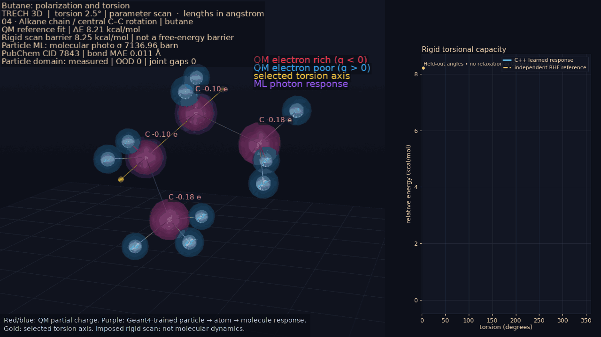

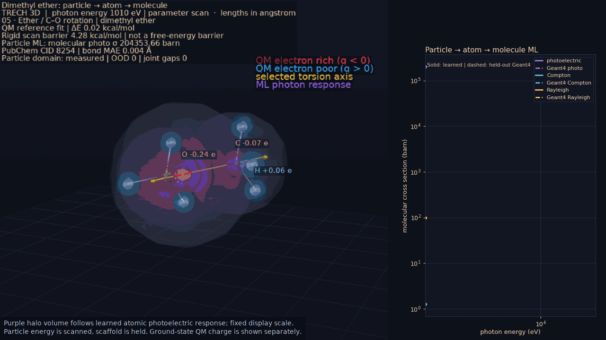

Three independent **30,000-photon Geant4 runs** check the learned molecular attenuation:
absolute transmission gaps are 0.0033–0.0039. This first learned lift covers CHNO photon
response under Geant4's independent-atom approximation; correlated electronic/bond/torsion
inference remains open. [Data, validation and all six new GIFs](docs/particle_molecule.md),
including [acetamide torsion](tools/viz/demos/molecular_acetamide.gif) and
[its particle-response scan](tools/viz/demos/molecular_particle_acetamide.gif).

**First molecular polarization and torsion series:** ethane (nonpolar control), ethanol
(polar alcohol) and formamide (restricted amide). Red/blue bubbles show learned atom-integrated
partial charges; the gold line marks the selected torsion axis. These are **imposed rigid scans**,
with energy/charge response learned from independent RHF/STO-3G calculations and evaluated by
the C++ runtime. Geant4 provides real transport and elemental consistency checks; it does not
solve these electronic surfaces. The bubbles are charge glyphs, not orbitals or electron density.

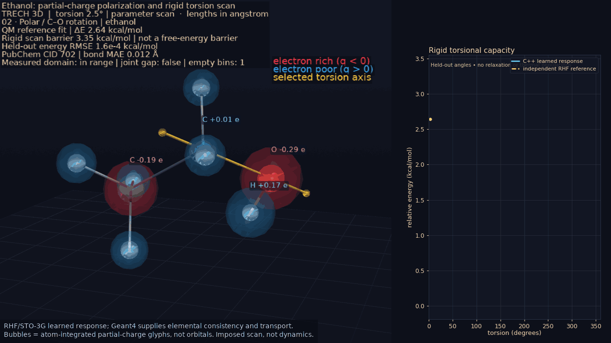

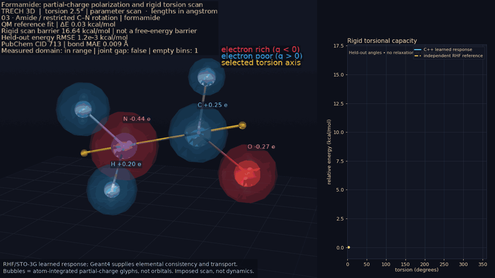

The rigid reference barriers are **2.99 / 3.35 / 16.64 kcal/mol** for ethane / ethanol / formamide.
Across 24 withheld angles per molecule, energy interpolation RMSE stays below 0.002 kcal/mol.
Independent minima differ from [PubChem 3D conformers](https://pubchem.ncbi.nlm.nih.gov/docs/3d-structure-viewer)
by 0.009–0.012 Å in mean bond length. Mulliken–PubChem MMFF94 charge differences are also
reported (0.087–0.222 e); they use different charge definitions. These bounded comparison
prototypes do not establish general molecular or experimental accuracy.
[Scenarios, sources, validation and regeneration](docs/molecular_series.md) ·
[Ethane control animation](tools/viz/demos/molecular_ethane.gif).


*The thesis in miniature: a spherical cell clears lipophilic **benzene** while retaining polar **D-glucose**. PubChem XLogP and Geant4 membrane/cytosol plus event facts feed committed micro operators: `ctx.evolve` advances every molecule in 3D (a distilled 3D transport operator, worst held-out R² 0.999) and `ctx.react` decides conserved membrane crossings. No authored transport/crossing law runs on the default path; the retired formulas are validation-only teachers. The simulated count still matches the classical first-order curve at R²≈0.99, but that curve grades the learned microscopic result rather than driving it.*


*The thesis again, in an MRI: a 5 cm³ **water cube** in a static field. Geant4 builds the phantom + a copper receiver coil and — through the material-composition surface (`ctx.materials`) — supplies the **¹H (proton) number density** (6.686×10²² /cm³, exactly the literature value, never hard-coded); the deterministic hook layer runs the **Bloch spin dynamics**. **We tell it only the proton gyromagnetic ratio γ (a particle constant) and the machine field B₀** — the resonance is not assumed. The 3D replay shows the bulk magnetization the RK4 Bloch integration actually produced for each swept RF frequency (barely tipped off resonance, laid 90° into the transverse plane on it) while the measured |Mxy| spectrum grows beside the cube, then the free-induction decay. The precise **Larmor line is DISCOVERED** from the FID carrier, recovering **γ/2π = 42.5768 MHz/T** vs CODATA 42.5775 (0.001%). Geant4 does not simulate nuclear spin; the spin dynamics are hook-layer physics-for-comparison, and the textbook values grade the gap only.*


*Stage 2 makes the output photons **REAL**: for each NIST tissue the number of excitation primaries is set proportional to that tissue's **Geant4-computed proton density** (an "ignorant" material fact), Geant4 produces **every consequent photon**, and a NaI shell scores the **real deposited energy**. The replay overlays the recorded tracks of a water run (150 excitations, cyan) and a cortical-bone run (90, magenta) with each run's Geant4-scored detector energy in the HUD. The multi-run driver (`scripts/run_magnetic_resonance_tissues.py`) grades the full panel: **cortical bone lands at 0.60× water**, detected signal tracks proton density with **r = 0.9995**.*


*Stage 3 turns the contrast into an **actual image**. Geant4 builds a row of NIST-tissue voxels (including an **air gap** and **cortical bone**) and supplies each voxel's ¹H density (the voxel shading). A **field gradient** makes the Larmor frequency position-dependent (`ω(x)=γ(B₀+G$_x$·x)`): the replay draws each voxel's rotating-frame magnetization — exactly the terms the readout synthesis sums — winding at γG$_x$x and dephasing, with the summed receiver signal beside the row, then the **DFT-reconstructed profile**: bright · bright · **BLACK (air)** · bright · **dark (bone)** · bright · bright, each voxel recovered to **0.001 mm**.*


*Stage 4 makes the picture a **brain — in 3D**. A procedural, [BrainWeb](https://brainweb.bic.mni.mcgill.ca/brainweb/anatomic_normal_20.html)-inspired **volumetric** head phantom (scalp, fat, skull, CSF, cortical grey ribbon with sulcal in-folds, white-matter core, lateral ventricles, deep grey nuclei) gives the anatomy; **every voxel's brightness is the Geant4-computed mobile-¹H density** of its tissue; a **3D k-space acquisition + inverse 3D FFT** reconstructs the volume, and the replay sweeps an axial slice through it in front of a coronal plane. Per-tissue intensity tracks the Geant4 proton density at **r = 0.9995** with volumetric reconstruction fidelity **r = 0.991** (the 2D slice pipeline is still graded alongside). The anatomy is a digital phantom and the k-space/FFT is signal processing; the contrast is Geant4's. Driver: `scripts/run_magnetic_resonance_brain.py`.*

## Why TRECH

- **Reproducible**: every run writes provenance (config JSON + hashes + seeds + versions).
- **Determinism modes**: strict simulation runs remain reproducible; predictive ML layers can be enabled with explicit provenance capture.
- **Programmable**: JS can compute and assemble configs (helpers, unit conversions, loops) while C++ remains in control.
- **Extensible**: initial Geant4-DNA physics wiring is available (guarded by `TRECH_ENABLE_DNA_CHEM`); chemistry and ML stubs remain.
- **Agnostic config**: long-term, keep the C++ config surface physics/chemistry agnostic while JS scenarios and lab sessions express combinations; define physics/chemistry classes, properties, and extensions in authoring layers.
- **System abstraction**: point-agnostic, ensemble-level metrics (densities) connect particle-scale runs to macro-scale predictions.
- **Online learning**: LibTorch/TorchScript is the chosen ML runtime for learning from simulation outputs (slower inference, but richer training loops).

## Multi-scale inference cascade

The engine thesis made concrete: **take a precise Geant4 particle/nano base and lift its
behaviour, via statistical/ML inference, scale by scale up the dimension ladder
(atomic → nano → micro → meso → macro) until it reaches the scale of the observer/experiment** —
so a macroscopic question (*"what does this glass of water do while I stir it: the fluid motion,
the waves?"*) can be inferred from the microscopic truth without hand-specifying every step.

All inference paths are deterministic and **disabled in strict mode** (enabled in `predictive`):

- **`ctx.predict(name, features?)`** — a single learned model, seeded with ambient Geant4
  event/material/optics facts; optional numeric features override individual keys. Missing required
  inputs return `null`. The demo reads live Geant4 composition/density and includes a water/ethanol
  material control instead of a fixed water feature vector.
- **`ctx.cascade(seed?, modelNames?)`** — chains declared models by their `scale` band
  (`models: [{name, path, scale}]`) in one pass: each stage's named outputs become the
  next-higher stage's inputs automatically, so lower-scale predictions feed higher-scale ones
  **without the scenario wiring the chain**. The optional name list selects one model family
  when the config also declares independent operators. Called with **no argument it auto-seeds the
  bottom of the ladder from the real Geant4 base** — the per-event tallies (`edep_mev`, `track_length_mm`,
  `step_count`, `track_count`, `optical_photon_*`) and, when `materialProbe` is on, the
  `material.<name>.*` probes (density, electron density, mean-I, X0, per-element number density) —
  so the scenario copies nothing from `ctx.event`/`ctx.materials` by hand; an explicit `seed`
  overrides/augments per key. Read the observer-scale prediction; it returns the flat, augmented
  context plus a `__cascade` trace (stages run, per-stage missing inputs, and the sorted
  `seedKeys` that seeded the pass).
- **`ctx.evolve(spec)`** — evolves arrays of named element state through learned operator stages.
  Operator models declare `operator_role`, `element_kind`, and `required_context_keys`; with no
  explicit model list the engine selects the single compatible role/kind group from the ambient
  Geant4/material context plus caller overrides. Ambiguous or absent matches return `ran:false`
  with a compatibility trace and do not mutate state. An explicit `models` list is still the
  override. Each N-element × K-stage pass reports N×K inferences.
- **`ctx.react(spec)`** — performs learned discrete transitions over integer state. The scenario
  declares species inventories, stoichiometric channels, and conserved linear quantities such as
  atoms, charge, or packet count; models emit bounded channel hazards. The engine owns deterministic
  seeded selection, rejects unavailable reactants without negative counts, and applies accepted
  deltas atomically. Reports distinguish model inferences, RNG draws, attempted transitions,
  accepted transitions, and availability rejections. Strict mode returns `null` without drawing or
  mutation.
  Its `element_kind` also accepts a **per-element array**, so one call can advance several
  materials at once: each kind selects its own operator from its own context, `selection.groups[]`
  reports what each material got, and a material with no compatible operator is left bit-identical
  instead of inheriting another material's law. `ctx.react` takes the same array (an unclaimed cell
  consumes no RNG draw), and `ctx.interact` selects per canonical **pair kind** — the unordered
  material combination of the two members (`melt|sand`), because a grain-grain, a grain-melt and a
  melt-melt contact are three different interactions.
- **`ctx.interact(spec)`** — the pair/neighbour operator: what one element does *to another*. The
  scenario declares positions, a neighbour cutoff and/or a persistent bond list, per-pair state,
  and which element fields receive contributions **equal-and-opposite** (`antisymmetric` — a force,
  a heat exchange) or **shared** (`symmetric` — a density/coordination sum). The engine owns the
  deterministic cell list, the canonical `(a,b)` enumeration, the exact equal-and-opposite
  application and the declared bounds; the learned stages own the interaction law. Reports P×K
  inferences over P pairs and K stages, with per-pair trust coverage. *Mechanism shipped
  2026-08-15; glass-furnace conduction uses illustrative per-material-pair maps, while the
  MD/foam-bond/PBF migrations remain open roadmap rows.*

Missing required model inputs block the affected stage and appear in `missingInputs`; only
actual evaluations count as inferences. Element/pair intermediates belong to their own material,
and blocked discrete stages consume no RNG draw. Explicit zero inputs remain valid facts.

It is **domain-agnostic** — the same `ScaleCascade` serves every scenario family (fluids/H₂O,
chemistry cycles, biology/membranes, CNT electronics, magnetic resonance, mechanics, nuclear);
only the trained per-family stage models differ. Optics is merely the first family with a
validated surrogate — not the point. Engine: `include/trech/ml/ScaleCascade.{hpp,cpp}`,
`ModelConfig.scale` (conditionally serialized so existing config hashes hold), `ctx.cascade` +
the ambient `buildAmbientGeant4Seed` in `src/js/JsRuntime.cpp`. Demo:
[`cascade_multiscale_demo.js`](examples/experiments/cascade_multiscale_demo.js) lifts a real
Geant4 per-event energy deposit nano → meso to an observer-scale number — **argument-free**, its
seed coming straight from the ambient Geant4 base.


*The section's own question, answered:* [`glass_of_water_shaken.js`](examples/experiments/glass_of_water_shaken.js)
**pours ~1 litre of water into a glass, then shakes it — and never types a single macroscopic
water property.** A short
rigid-SPC/E nano MD measures water's number density (0.0334 /ų) and hydrogen-bond coordination
(≈4.86, g(r) peak 2.77 Å); `ctx.cascade` lifts those facts **nano → micro → macro** (3 bands in
one pass) into the macroscopic fluid parameters — a rest density of **999.2 kg/m³** (a *grounded*
coarse-graining of the nano number density, landing on measured water's 998 as a **check, not an
input** — 0.10 % off), a surface tension (from the H-bond coordination) that **merges drops on
contact**, and a viscosity. A **Position-Based-Fluid** solver (uniform spatial grid, ~4,300
particles at ~**6 mm**) then plays out three phases the video shows: water is **poured in** from a
faucet and fills the wide tumbler (11 cm across, ~1 L), **settles**, and is **shaken** by a
smooth-but-random motion. The scenario emits every particle and the glass at its shaken position
as `material_frame`s with a declared Gaussian surface, which classic `trech-viz` fuses into one
water body (2 mm grid) so splashes break off and merge back. Waves and splashes emerge, the water
stays contained (mass conserved) and the run is stable — guarded by `glass_of_water_shaken_waves`.
Rendered by [`tools/viz/demos/render_readme_3d.py`](tools/viz/demos/render_readme_3d.py).

*Honest scope:* the Geant4 base is real; the inferred higher scales are *learned/validated
predictions* (labelled as such, gap-to-truth measured). The demo stage models — both
`cascade_multiscale_demo`'s and the glass-of-water cascade's (`data/glass_cascade/`) — are
illustrative maps that show the mechanism (the *density* coarse-graining is grounded; the
cohesion/viscosity maps are labelled illustrative); the nano *inputs* are genuinely measured and
no macro water property is typed. Training real, held-out-validated per-band chains across the
scenario families is the standing objective in [`ROADMAP.md`](ROADMAP.md).

## "Sputnik" milestone (north star)


*108 periodic-box rigid-SPC/E water molecules (classical MD in the deterministic hook layer, SHAKE/RATTLE constraints, Geant4 as the per-tick clock) replayed in 3D from the emitted molecular state as the start lattice melts into liquid, while the HUD shows the O-O radial distribution function the run is accumulating: the first peak lands at 2.74 Å vs the measured 2.80 Å hydrogen-bond distance, the inter-shell minimum (g≈0.78) and coordination (≈4.7) match the measured liquid, and the ~4.5 Å tetrahedral second shell is resolved. The same run measures the **self-diffusion coefficient** two independent ways — Einstein (MSD) and Green-Kubo (velocity autocorrelation) — which agree at D ≈ 2.6–2.8×10⁻⁹ m²/s, on the SPC/E literature value. A companion temperature sweep (`h2o_diffusion_temperature.js`, `diffusion_temperature.gif` in the gallery) shows each molecule's real displacement trail lengthening as D(T) tracks the measured trend across 281–313 K.*

- Simulate H2O fluid behavior with Geant4 using as much subatomic detail as practical.
- Secondary reference ("Vostok" milestone): simulate carbon nanotube variants (structure, chirality, diameter) and electron behavior differences, including Fermi gap modeling, per `docs/CNT/BackToTheCarbon.md`. **Electronic-structure step advanced:** `examples/experiments/cnt_band_structure.js` reproduces the metallic/semiconducting classification ((n−m) mod 3 rule), the semiconducting primary band-gap ∝ 1/diameter law on STM-measured anchors, and the curvature-induced secondary gap for nominally metallic non-armchair tubes (`E_curv ∝ |cos(3θ)|/d²`, armchairs remain zero-gap) via hook-layer tight-binding (`cnt_band_structure.gif` renders the whole panel, each tube rolled atom by atom from its own (n,m)). **Logic-gate step landed:** `examples/experiments/cnt_logic_gates.js` turns that band structure into working CNTFET devices and digital logic — the full static-CMOS gate family and half/full/2-bit-adder circuits whose simulated truth tables are confirmed against the canonical boolean/arithmetic functions, with the on/off ratio set by Fermi-Dirac statistics (`~exp(E_g/2kT)`), the recovered subthreshold swing on the ~60 mV/dec Fermi limit, and a metallic tube shown to short the logic. It emits two 3D streams — the (16,0)/(5,5)/(9,0) channels glowing with the model's drain current across a gate sweep (`cnt_structure.gif`) and every gate's CMOS netlist per truth row with each CNTFET's conductance and every node voltage (`cnt_circuit.gif`) — see the [scenario animation gallery](#scenario-animation-gallery).
- Learn to separate predictable events from exceptional ones so only outliers are re-simulated.
- Scale to large molecule counts with multi-scale acceleration (e.g., Lattice Boltzmann, variance reduction, reduced-order models).
- Prioritize photon transport accuracy (scattering, absorption, refraction, color response) within molecular volumes.
- "Apollo" milestone: totally generic physical simulator able to simulate and predict complex systems (chemistry on high volumes) and physical interactions 

## Architecture (short version)

1. **Authoring input** is either a JS experiment (`run`) or a live JSON command stream (`lab`).
2. **C++ core** parses config, applies deterministic patches/overrides, and tracks lab/session metadata.
3. **Geant4 layer** runs the canonical lifecycle and emits scoring + provenance.
4. **System aggregation** computes point-agnostic ensemble metrics for ML and multiscale stages.

See `docs/structure.md` for the detailed skeleton and `docs/trech-roadmap.md` for the full plan.
Mermaid diagrams of the workflow, Geant4 wiring, prediction loop, and ML scale-up path live in `CHARTS.md`.

## Quick start

```
git submodule update --init --recursive
cmake --preset dev
cmake --build --preset dev
./build/dev/trech run examples/experiments/hello_world.js
./build/dev/trech lab --config examples/lab/realtime_lab_bootstrap.json
```

Build artifacts live under `build/` and are ignored by git.

## CLI

```
trech run <experiment.js> [--macro <file>] [--ui] [--output <dir>] [--seed <n>] [--events <n>]
trech lab [--config <file>] [--commands <file>] [--output <dir>] [--seed <n>] [--events <n>]
```

Examples:

```
./build/dev/trech run examples/experiments/hello_world.js --output out
./build/dev/trech run examples/experiments/water_box.js --seed 42 --events 100
./build/dev/trech run examples/experiments/h2o_fluid.js
./build/dev/trech run examples/experiments/hello_world.js --macro examples/macros/minimal.mac
./build/dev/trech lab --config examples/lab/realtime_lab_bootstrap.json
./build/dev/trech lab --config examples/lab/realtime_lab_bootstrap.json --commands examples/lab/realtime_lab_commands.jsonl
```

`lab` mode command schema (JSON object per line, stdin or `--commands` file):
- `{"action":"patch","patch":{...}}` merge a config patch into the live session state.
- `{"action":"simulate"}` run Geant4 with the online timing planner's learned round count.
- `{"action":"simulate","events":N,"seed":S}` run Geant4 with an explicit one-command count override.
- `{"action":"snapshot"}` print canonical config plus `lab.roundPlanner` timing/precision state.
- `{"action":"help"}` print supported actions.
- `{"action":"quit"}` close the lab session.

The first batch initializes Geant4; compatible later batches reuse that kernel and call `BeamOn`
directly. Event count, seed, and planner settings may change live. A patch to geometry, beam,
physics, scoring, or output state is rejected after initialization with a restart-required error,
because safe in-process reinitialization remains an explicit `ROADMAP.md` item. Always use
`achieved_hz`, not the planned count alone, when describing real-time performance.

## Config examples

- `examples/experiments/hello_world.js`: minimal baseline.
- `examples/experiments/water_box.js`: container volume holding explicit water material (non-chemical boundary).
- `examples/experiments/config_optics.js`: medium box with optics enabled (includes `optics.spectrum` sample) and explicit water material.
- `examples/experiments/h2o_fluid.js`: H2O fluid stub with container + brine mixture + nested solute seed.
- `examples/experiments/h2o_single_molecule.js`: single-molecule proxy stub with container + nested sphere proxy.
- `examples/experiments/h2o_optics_beam.js`: optical photon beam through water (spectrum-enabled, explicit water material).
- `examples/experiments/config_stratify.js`: event stratification thresholds/labels.
- `examples/experiments/config_stratify_ml.js`: stratification with TorchScript model path stub.
- `examples/experiments/surrogate_generic_demo.js`: generic learned inference — declares a `models: [{name, path, scale}]` entry and calls it via `ctx.predict(name, features)` (a single point-predictor; here the committed optics ridge predicts water's refractive index).
- `examples/experiments/cascade_multiscale_demo.js`: **multi-scale inference cascade** — declares two `scale`-tagged models and lets `ctx.cascade(seed)` chain them from a real Geant4 per-event energy deposit (nano) up to an observer-scale response (meso) in one pass, with no hand-wiring. Illustrative stage models under `data/cascade_demo/` demonstrate the mechanism (see [Multi-scale inference cascade](#multi-scale-inference-cascade)).
- `examples/experiments/glass_of_water_shaken.js`: **the cascade's canonical worked example — a glass of water poured and shaken.** A short rigid-SPC/E nano MD measures water's number density + hydrogen-bond coordination; `ctx.cascade` lifts them **nano→micro→macro** into the macroscopic fluid parameters (rest density 999 kg/m³ — a grounded coarse-graining that lands 0.1% off measured water without typing it; a cohesion that merges drops; a viscosity); a **Position-Based-Fluid** solver (uniform spatial grid, ~4,300 particles at ~6 mm) then **pours ~1 L** of water into a wide glass (11 cm across), lets it **settle**, and **shakes** it, producing waves + splashes that stay contained. **No macroscopic water property is hand-typed.** 3-band cascade + illustrative stage models under `data/glass_cascade/`; emits `material_frame`s (particles + the glass at its shaken position + a Gaussian surface contract) fused by classic `trech-viz` into a **2 mm-grid water surface**; guarded by `glass_of_water_shaken_waves`.
- `examples/experiments/beaker_water_n_pentane.js`: **water + n-pentane poured into an open beaker at 30 °C and observed for 60 minutes.** Geant4 NIST materials supply composition/density and the cross sections behind TRECH's colour/optics; PubChem supplies CID + SMILES **structure only**. A two-stage `ctx.cascade` consumes that ambient base plus beaker/air context and infers colour, phase separation/layer order, temperature-aware held-out volatility and evaporation. At 303.15 K, 100 mL water + 50 mL n-pentane are inferred colourless with pentane above water; predicted vapour pressure is 87.17 kPa vs validation-only NIST 81.98 kPa (6.3%), and 13.99% / 4.38 g evaporates in 60 min. Sixty-one `material_frame`s now show an empty beaker → water pour → pentane pour → transient intermingling/phase separation → a moving, fading vapour plume; the physical 60-minute interval is retained beside an explicit 545× playback clock. Optional tints/vapour emphasis are tagged representation-only. Guarded by `beaker_water_n_pentane_inference` (11 checks). The macro response surface and hook-layer kinematics remain illustrative with σ=0.08; a wider liquid-pair/airflow panel is tracked in `ROADMAP.md`.
- `examples/experiments/lava_lamp.js`: **a duration-independent, stateful 3D lava-lamp thermofluid scenario.** Geant4 probes water and a configured paraffin/density-modifier reference blend; the two-stage `ctx.cascade` infers melting, thermal expansion, heat transfer/diffusion, viscosity/drag, cohesion, interfacial velocity coupling, carrier circulation/advection, vorticity, and lateral-plume strength. A bounded-step solver advances persistent parcel IDs through temperature, liquid fraction, density, buoyancy, a cylindrical 3D convection basis, velocity coupling, boundaries, and neighbour topology—without a target cycle, authored trajectory, preferred axis, phase schedule, birth, or regeneration. Initial thermal fluctuations deterministically choose the convection orientation and handedness. The README run's centroid spans 38.73 mm × 36.52 mm laterally, traverses 123.41 mm, and visits 10/12 azimuth sectors. Its earlier fine parcel interface is preserved independently at 19 coalescences, 18 fissions, and 43/101 merged states; a wider observer-scale Gaussian interface adds distance-faded in-gap splats only for parcel pairs already inside its connection radius, producing continuous neck growth/rupture with 8 merges, 10 splits, and 90/101 merged states. The [Studio GIF](studio/tests/reference/lava_lamp.gif) and [classic 3D GIF](tools/viz/demos/lava_lamp_trech_viz.gif) show the complete 600 s response in ten seconds; both viewers share this contract and never move centres or change component topology. Precision remains split across fixed-volume parcel count, `max_physics_step_s` integration, `simulation_ticks` sampling, and representation-only `render_surface_grid_mm`. Emitted centres and clocks are unchanged; 100 post-tick states map directly to 100 GIF frames with no interpolation or optical flow. Guarded by `lava_lamp_inferred_thermofluid` (**23 checks**), including retained parcel lineage, fluid-interface merge/split lineage, volumetric non-axis-locked transport, temporal coherence, duration/condition, and precision refinement. Geant4 does not itself solve phase change or CFD; the compact response and parcel discretisation remain illustrative, with wider held-out training tracked in `ROADMAP.md`.
- `examples/experiments/config_chemistry_stub.js`: chemistry/DNA wiring (DNA physics when enabled; chemistry stage still stubbed by default).
- `examples/experiments/config_multiscale_stub.js`: multi-scale stub wiring config.
- `examples/experiments/config_nitrogen_carbon_cycle.js`: nitrogen gas <-> carbon-14 cycle scenario (`N-14 + n -> C-14 + p`, `C-14 -> N-14 + e- + anti_nu_e`) with Geant-backed consistency/Q-value reporting. It selects Geant4's data-driven neutron-HP physics (`physics: {list: "QGSP_BIC_HP", radioactiveDecayThresholdYears: 1e6}`), so both legs are Geant4-sampled: thermal ¹⁴N(n,p)¹⁴C in the gas (36 of 20,000 events) and the ¹⁴C β⁻ decay back to ¹⁴N (the raised very-long-decay cut lets a 5,730-year nuclide decay inside the event).
- `examples/experiments/analytic_beer_lambert.js`: complex test scenario with a **classical-formula cross-check** — a narrow 100 keV gamma beam through a 50 mm water slab, where the engine compares the textbook Beer-Lambert prediction `T = exp(-mu*x)` (with `mu` summed from Geant4's own atomic cross sections via `G4EmCalculator`) against the run's measured Monte-Carlo uncollided-primary fraction. Both numbers + the gap land in `trech_scores.jsonl` under `analytic_checks` (classical 0.4265 vs Geant4 0.4217, ~1.1% — Poisson-limited).
- `examples/experiments/analytic_csda_range.js`: charged-particle **CSDA-range cross-check** — a 20 MeV proton fully stops in water; the engine derives the CSDA range from Geant4's own stopping power (`G4EmCalculator::GetCSDARange`) and compares it to the measured mean primary track length (a new per-primary path-length tally). Derived 4.28 mm vs measured 4.27 mm (~0.4%); emitted under `analytic_checks` (`type: "csda_range"`), guarded by `analytic_csda_range_cross_check`.
- `examples/experiments/analytic_photo_fraction.js`: photon **process-branching cross-check** — a 30 keV gamma beam (near water's photoelectric/Compton crossover) where the engine predicts the photoelectric share of the total interaction cross section `sigma_phot/sigma_total` from the same `G4EmCalculator` cross sections and compares it to the measured fraction of primaries whose first discrete interaction is photoelectric (classified through QBBC's `G4GammaGeneralProcess` wrapper by EM subtype). Derived 0.391 vs measured 0.393 (~0.6%); emitted under `analytic_checks` (`type: "photo_fraction"`), guarded by `analytic_photo_fraction_cross_check`. Unlike the attenuation/range checks, this tests the process *choice* and is slab-thickness independent.
- `examples/experiments/config_cnt_stub.js`: CNT stub modeled in a fluid container with explicit materials and nested volumes.
- `examples/experiments/config_cnt_world_stub.js`: CNT stub volume placed in a void container in the world (no medium box).
- `examples/experiments/config_cnt_optics_stub.js`: CNT geometry + optics mixed testing stub (medium box + optics enabled).
- `examples/experiments/cnt_band_structure.js`: CNT electronic-structure comparison panel; emits metallicity, primary semiconducting gaps, curvature secondary gaps for quasi-metallic tubes, and validation flags to `trech_hook_emits.jsonl`.
- `examples/experiments/cnt_logic_gates.js`: **CNT logic gates + circuits** — builds CNTFETs from the tight-binding band gap, the full static-CMOS gate family (NOT/BUFFER/AND/OR/NAND/NOR/XOR/XNOR as resistive-divider pull-up/pull-down FET networks), and three circuits (half adder, full adder, 2-bit ripple-carry adder), then **confirms the truth table the electrons produce at every output**. The transistor on/off ratio is Fermi-Dirac-set (`~exp(E_g/2kT)`), the subthreshold swing recovered from the simulated `I_d(V_gs)` lands on the ~60 mV/dec room-temperature Fermi limit, and a **metallic** tube dropped into the same topology collapses the outputs to ~Vdd/2 and breaks the logic (the metallic-short manufacturing problem of `docs/CNT/BackToTheCarbon.md`). Geant4 transports the e- beam through the representative (16,0) channel each event. Emits `cnt_device` + `cnt_gates_summary` with `visual_topologies` and `visual_source`; its two `material_frame` streams replay in 3D via classic `trech-viz` → `cnt_structure.gif` (channel sweep) and `cnt_circuit.gif` (CMOS netlists); guarded by the `cnt_logic_gates` case.
- `examples/experiments/config_flow_language.js`: flow-style scenario using `TRECH_FLOW` chaining (`set`, `defaults`, `merge`, `push`, `derive`, `ensureArray`, `normalizeDetectorAliases`, `finalize`, `require`) and function-based `TRECH_CONFIG`.
- `examples/experiments/config_hook_dispatch.js`: hook runtime smoke example (`ctx`, deterministic `emit`, `onInit` override patch, and hook guardrails: `hooks.maxStepCallbacks`, `hooks.maxEmitsPerCallback`, `hooks.maxEmitPayloadBytes`).
- `examples/experiments/testscenario_efflux.js`: **headline biological comparison** — a spherical cell clears lipophilic benzene through a lipid bilayer while retaining polar D-glucose. The default path no longer contains an authored transport or membrane-crossing law: `ctx.evolve` advances each molecule in 3D through the committed micro transport model (x/y/z + a 3D Ornstein–Uhlenbeck velocity; streaming about z plus a radial drift) and `ctx.react` owns the learned crossing hazard, seeded draw and packet conservation. PubChem XLogP and Geant4 membrane/cytosol interaction plus event facts are model inputs. The retired OU/advection/drift and Overton-scaled crossing formulas run only with `physics_source=reference`. The operator run retains all 30 glucose packets, clears 78/80 benzene packets and fits first-order clearance at R²=0.990 (half-life 1,226 ticks vs the reference teacher's 1,270) with zero out-of-domain inferences; the effective permeability is back-derived through the spherical Fick relation k = 3P/R. Guarded by `efflux_first_order_kinetics` and the paired `efflux_operators_match_reference`.
- `examples/experiments/glass_from_sand.js`: **a material that does not exist when the run starts.** Geant4 builds and probes silica sand, soda ash, limestone and the declared soda-lime product; a nano→macro cascade turns those facts into this batch's calcination/melt/fusion onsets and its conduction coefficient (no onset is typed into the scenario); then per-material `ctx.evolve`, per-material `ctx.react` and per-**pair**-material `ctx.interact` advance each cell with the operator its CURRENT material class selects, as cells migrate `batch_solid → melt → glass`. The chemistry is real stoichiometry — `Na2CO3 → Na2O + CO2`, `CaCO3 → CaO + CO2`, `6 SiO2 + Na2O + CaO → Na2O·CaO·6SiO2` — with Si/Na/Ca/C/O conservation validated by the engine before any draw. The charge is a 6³ lattice of cells with 6-neighbour conduction pairs; the nominal run creates 648 glass units from zero, closes every element balance at exactly 0, never reacts below an inferred onset, and forms its first glass at the bottom of the charge because heat only enters at the floor. Its five per-material operators are **distilled trained artefacts** (`physics_source=operator`, the default): harvested from the states five independent furnace operating points actually visited, held out by whole run on two never-fitted ones, and carrying a measured meso hull, occupancy, band and held-out metrics. The hand-authored family they came from is reachable as `physics_source=reference` and remains the teacher — so the near-unit held-out R² is migration fidelity, **not** physical accuracy (`measured:false`), and the onsets/conductances stay illustrative. Guarded by `glass_from_sand_material_creation` (21/21) and the paired `glass_operator_matches_reference` (8/8 gaps, 22/22 trust).
- `examples/experiments/testscenario_h2o_electrolysis_combustion.js`: H2O reaction-cycle test — the default `ctx.react` path evaluates a committed meso hazard model over 90 two-water reaction cells, while the engine owns seeded choices, availability, atomic mutation and exact declared H/O conservation. PubChem supplies formulas/CIDs; raw Geant4 event and `G4EmCalculator` interaction facts condition the learned hazards. It produces 180 H2 + 90 O2 across two cathodes and recovers all 180 waters with zero out-of-domain inference. Its 3D replay draws the operator inventory as packet molecules whose kinematics are labelled representation — diffusion in the liquid, H2/O2 bubbles nucleating on the cathode/anode rods and rising by buoyancy, burning nearest the spark, product water falling back — never packets steered to a target. The former `electrolysisProbability`/`combustionProbability` laws survive only as `reaction_source=reference` audit teachers. Guarded by both `h2o_electrolysis_combustion_cycle` and the 4/4-gap, 22/22-trust `h2o_cycle_operator_matches_reference` pair.
- `examples/experiments/briggs_rauscher_oscillator.js`: **the Briggs–Rauscher oscillating reaction in an open beaker** — the classic chemical clock that visibly cycles **colourless → amber → deep blue-black → colourless** for minutes, then settles. TRECH is told only what is *in the beaker*: the reagent recipe (KIO₃ / H₂O₂ / malonic acid / H₂SO₄ / MnSO₄ + starch, as molarities) and the Geant4-constructed solution materials. Geant4 reports the dissolved **iodine (1.5e20 /cm³) and manganese (6.9e19 /cm³)** and the colourless solution's derived colour; a two-stage `ctx.cascade` (nano reagent descriptors → macro observer-band response) infers the **coefficients of a reduced Field–Körös–Noyes / Oregonator relaxation oscillator** (f, ε, q, iodide regeneration/consumption, iodine production/removal, triiodide–starch coupling, reservoir depletion, seconds-per-τ). The cascade emits **no** period, cycle count, colour, or phase schedule: a deterministic hook-layer integrator advances the oscillator plus the emergent [I₂]/[I⁻] species, and **the oscillation itself emerges** — 8 completed colourless→amber(free I₂)→deep-blue(triiodide·starch) cycles with amber always preceding blue, a ~10.5 s period, then a clean settle when the oxidant/substrate reservoir depletes (all graded against known Briggs–Rauscher behaviour only at run end). Emits `br_frame` (beaker colour, [I₂]/[I⁻], cycle index), a `material_frame` per state (the Geant4 beaker holding one well-mixed liquid body in the emergent colour — a well-mixed reactor has no spatial motion to show) + `briggs_rauscher_summary`; rendered by classic `trech-viz` → `briggs_rauscher.gif`; guarded by `briggs_rauscher_oscillation` (**10 checks**). Honest scope: Geant4 does not solve aqueous radical/non-radical iodine chemistry — the reduced oscillator is a labelled "physics for comparison" hook-layer model whose coefficients are inferred from the Geant4 base; the compact macro response surface is illustrative (σ=0.12 emitted), and the amber/blue-black swatches are labelled representation while the colour *timing/sequence* is the emergent, graded result. A wider trained oscillating-chemistry panel is tracked in `ROADMAP.md`.
- `examples/experiments/polyurethane_foam.js`: **the polyurethane foam experiment ("the solid sponge")** — two viscous liquids are poured into a cup (Solution A: polyol + a little water; Solution B: a diisocyanate) and within seconds the mixture creams, expands toward ~30x its volume, and cures into a **rigid porous sponge** that **leans under its own weight, cracks, and drops pieces onto the table**. TRECH is told only what is *in the cup*: the two-part recipe and the Geant4-constructed solution materials. Geant4 reports the **isocyanate nitrogen** in Solution B, the A/B density contrast, and the mixed liquid's derived colour; a two-stage `ctx.cascade` infers the coefficients of **both** the dual-reaction chemistry — gel (`R−N=C=O + R'−OH → urethane`) and blow (`R−N=C=O + H₂O → amine + CO₂↑`) — **and the mechanics of the foam it builds** (bond stiffness, failure strain, stress relaxation, material drag, contact, and the cell-scale imperfection dispersion). Every parcel then runs **its own chemistry**, with heat diffusing along the bond network and leaking from the free surface, so a hot core and a cooler skin appear on their own. The material is a **growing viscoelastic bonded-parcel network under standard gravity** (`trech_foam_solver.js`): rest lengths grow with each parcel's gas generation, creep away stress while fluid, lock as it cures, and break past the failure strain — so the cream, the rise, the exotherm, the cream→gel→solid ordering, the lean, the cracks, which pieces detach and where they land are all consequences, never scheduled. A `gravity_scale=0` control run must produce no fallen debris and less lean and cracking, proving gravity *caused* the sag rather than a script. PubChem contributes structure identity only (CID+SMILES+formula, element-cross-checked). Rendered by classic `trech-viz` → `polyurethane_foam.gif`; guarded by `polyurethane_foam_expansion`. Honest scope: Geant4 solves neither urethane kinetics nor continuum mechanics — both are labelled "physics for comparison" hook-layer models whose coefficients come from the Geant4-seeded cascade, gravity is used as a physical constant, the macro response surface is illustrative, and fracture *siting* is discretisation-sensitive (the aggregate response is what is guarded). Remaining work — training those coefficients instead of hand-authoring them, and a mesh-objective fracture criterion — is tracked in `ROADMAP.md`.
- Engine-side polyurethane reaction operator: the promoted default
  (`chemistry_source=operator`) moves the eight-field per-parcel chemical update out of scenario
  JavaScript and through `StateEvolution`/`ctx.evolve`.
  The committed meso MLP (`data/polyurethane_cascade/meso_reaction_operator.json`, 2,216
  parameters) was trained on 115,437 rows spanning 285–310 K and 0.02–0.08 s steps and validated on
  38,565 independent-run rows (worst-output R²=0.9929). It carries
  `teacher=polyurethane_foam.js` and `measured:false`: this is the reduced model learned, not new
  measured foam physics. `polyurethane_operator_matches_reference` passes all eight paired
  observer gaps (0.56% expansion; ≤1.07 s milestone drift; 1.19 K core-skin drift), with all
  2,812,320 parcel-step inferences in-domain; the chemical→mechanical coupling and solver laws
  remain authored and tracked in `ROADMAP.md`. Its model is selected contextually from
  `operator_role=reaction_state`, `element_kind=foam_parcel`, and its 16 required shared facts;
  the same declarative paired-run validator now gates future scenario migrations.
- Experimental polyurethane constitutive operator (`--param 'mechanics_source="operator"'`):
  `ctx.evolve` predicts local creep, drag and strength from parcel state and cascade context.
  The retained comparison law remains the default because the candidate misses full-run height
  and lean tolerances despite held-out R² ≥0.998. Its synthetic teacher data are labelled
  `measured:false`; neither the fit nor Geant4 material probes establish physical foam mechanics.
  Run `bash scripts/validate_foam_mechanics.sh` for the separate promotion gates. The generic
  trainer now supports `--log-outputs` for positive targets, with C++ decoding and held-out
  errors in physical units; bond/contact laws and independent physical validation remain open.
- `examples/experiments/elephants_toothpaste.js`: **elephant's toothpaste ("the soapy lather") in a graduated cylinder** — concentrated H₂O₂ + dish soap meets a KI solution and the iodide-catalysed decomposition `2 H₂O₂ →(I⁻) 2 H₂O + O₂↑` erupts as a massive steaming lather column that **never solidifies**. TRECH is told only what is *in the cylinder*: the recipe (30% peroxide, 2% soap, 2 M KI, pour fractions) and the Geant4-constructed solution materials. Geant4 reports the **dissolved iodine (1.30e21 /cm³) and potassium (1.29e21 /cm³)**, the oxygen-rich peroxide density (1.11 g/cm³), and the clear mixture's derived colour; a two-stage `ctx.cascade` infers the **coefficients of a reduced catalytic-decomposition model** (catalysed + uncatalysed rate constants, Arrhenius activation, exotherm, O₂ foam capacity, surfactant trapping, lather drainage, iodine-intermediate shunt). The cascade emits **no** completion time, eruption height, temperature, or colour: the hook-layer integrator makes it all emerge — an **80,000× catalytic acceleration**, 90% completion in 9.7 s, the foam over the rim in under a second, a **18.4× lather column 433 mm above the rim**, a steaming sub-boiling **368.9 K** peak (an explicit, labelled evaporative clamp near the carrier boiling band accounts for only 8.2 K of that — the unclamped exotherm would reach 375.7 K, and both numbers are emitted so the clamp's share is measured, not hidden), a transient amber iodine tinge that fades as the peroxide depletes, and a soft lather that keeps moving and **drains to 74% of peak without ever rigidifying** — the emergent consistency contrast to the polyurethane sponge (graded against known demonstration behaviour only at run end). PubChem contributes structure identity only (H₂O₂/KI/water CID+SMILES+formula, element-set cross-checked). Emits 136 `material_frame`s + `elephants_toothpaste_summary`; rendered by classic `trech-viz` → `elephants_toothpaste.gif`; guarded by `elephants_toothpaste_eruption` (**16 checks**). Honest scope: Geant4 does not solve aqueous redox kinetics or foam drainage — the reduced model is a labelled "physics for comparison" hook-layer model whose coefficients are inferred from the Geant4 base; the compact macro response surface is illustrative (σ=0.15 emitted), and the white/amber swatches are labelled representation while their *timing* is the emergent, graded result. A wider trained catalytic-kinetics panel is tracked in `ROADMAP.md`.
- `tools/pubchem` (`python -m trech_pubchem fetch <names>`): PubChem property + 2D-structure cache helper. Use `--cache-dir` or `TRECH_PUBCHEM_CACHE_DIR` for build-local real-time fetches (the validation suite uses `build/dev/pubchem_cache`); new fetched records are ignored by git by default.
- `examples/experiments/testscenario_magnetic_resonance.js`: **magnetic resonance (Stage 1)** — NMR/MRI of a 5 cm³ water cube. Geant4 builds the phantom + a copper receiver-coil volume and, through the new material-composition surface (`materialProbe`/`ctx.materials`), supplies the ¹H (proton) number density that sets the equilibrium magnetization; a `G4EmCalculator` beer_lambert anchor + per-event transport are the clock. The deterministic hook layer runs the Bloch spin dynamics: a swept-RF spectroscopy pass and a free-induction-decay pass whose lab-frame carrier is measured to **discover** the Larmor line — feeding only the proton gyromagnetic ratio γ (a particle constant) and the machine field B0, so γ/2π = 42.5768 MHz/T (vs CODATA 42.5775, 0.001%), the Geant4 water proton density 6.686e22/cm³ (= literature, 0.006%), and T2* all emerge and are graded against the textbook values. `mr_summary.tissue_preview` already shows the Geant4-derived proton-density contrast (cortical bone 0.58× water) for the upcoming tissue stage. Emits `mr_spectrum`/`mr_fid`/`mr_summary`; guarded by `magnetic_resonance_water`. Honest scope: Geant4 does not simulate nuclear spin — the spin dynamics are hook-layer physics-for-comparison.
- `examples/experiments/testscenario_magnetic_resonance_tissues.js` + `scripts/run_magnetic_resonance_tissues.py`: **magnetic resonance (Stage 2)** — virtual-tissue contrast with REAL Geant4 photon emission (multi-run, no C++). The driver reads each NIST tissue's Geant4-computed ¹H number density from `material_probes` (an ignorant material fact), runs the scenario per tissue with the excitation-primary count set **proportional to that proton density**, and Geant4 then produces **every consequent photon** which a NaI detector shell scores as real deposited energy (`receiver_coil` `volume_edep_mev`). The per-tissue detected signal is a genuine Monte-Carlo tally that reproduces MRI proton-density contrast (cortical bone 0.60× water, corr 0.9995), byte-reproducible. Aggregate emitted as `mr_tissue_contrast`; guarded by `magnetic_resonance_tissue_contrast`. Honest scope: the excitation-per-proton is a labelled proxy (Geant4 can't make spins radiate RF); what is REAL is the Geant4-set emission count and the Geant4-transport detection tally.
- `examples/experiments/testscenario_osmotic.js`: validation scenario for a biological cell osmotically dehydrating in a hypertonic bath (`docs/testscenario_osmotic-todo.md`); a coarse-grained **3D** MD bath of H2O + glucose + wrong-polarized ions around a **selectively permeable triangulated membrane** (642-vertex icosphere with 24 water-channel caps) runs inside the hook layer (one Geant4 event = one MD tick). The membrane moves overdamped under the **measured** collision-pressure difference across it while its lipid area is held and bending is resisted — no target volume or lobe pattern is prescribed — so as water leaves, the impermeant solutes outside out-press those inside, the cell shrinks toward van 't Hoff balance, and the excess membrane **folds into an emergent crenated (echinocyte-like) shape**. Particles collide with, cross and are swept by the actual deformed membrane; wrong-polarized molecules are **expelled** (glucose by size, small ions by polarity). `final_summary` validates 9 behaviours — dimensional + polarity exclusion, early pore crossings, macroscopic water flux, osmotic shift, bounded energy, the external-over-internal pressure bias while the cell shrinks, membrane crenation (volume loss at held area) and stability. `material_frame` carries the particles and the membrane mesh for the 3D replay.
- `examples/experiments/testscenario_pascal.js`: validation scenario for Pascal's principle and material deformation (`docs/testscenario_pascal-todo.md`); three vessel models (ideal-rigid, Hookean/plastic, finer micro/macro structural mesh — each sensor wall a grid of Hookean patches coupled by membrane tension with a rigid rim, around a 3D particle bath) are advanced through `thermalize → baseline → compress → hold → release` phases with per-bucket deterministic initialization, emitting live pressure windows, wall profiles, elastic/plastic displacement, and `pascal_summary` flags (`pascal_principle_holds`, `plastic_damping_observed`, `macro_mesh_consistent`).
- `examples/experiments/trech_helpers.js`: JS helper module (units, constants, material presets, geometry helpers).
- `examples/experiments/config_multi_beam_units.js`: unit conversion + multi-beam composition example (uses `beams` array normalization).
- `examples/experiments/include_error_demo.js`: `TRECH_INCLUDE` stack demo (intentional failure via `include_error_helper.js`).
- `examples/lab/realtime_lab_bootstrap.json`: JSON bootstrap config for `trech lab` (no JS authoring required).
- `examples/lab/realtime_lab_commands.jsonl`: sample real-time lab command stream (`patch`/`simulate`/`snapshot`).

Helper modules are single-file today; load them with `TRECH_INCLUDE("trech_helpers.js")` to keep line numbers stable.

Optics can be constant or spectral. Use `optics.spectrum` with `energyEv` or `wavelengthNm`
entries to override refractive index/absorption/scatter per wavelength while keeping the
config JSON canonical.
H2O stubs author `system` blocks in JS to label ensembles and keep aggregation point-agnostic.

CNT runs are still a parallel track for schema/physics coherence, but they now use the
generic `geometry.volumes` surface. Volumes declare shapes (box/tube/sphere), materials,
placements, and optional `scoreEdep` flags. The CNT stubs steer the beam across a tube
shell volume to exercise `volume_edep_mev` while keeping comparisons focused on electron
transport; photon counts are a secondary comparison in mixed tests.

## Essential test scenarios

This is the canonical set of physics/chemistry scenarios the validation suite
exercises, grouped by **how much each one learns from Geant4 vs. relies on a
pre-written law**. The project thesis (see the top of this file) is to obtain
behaviour from Geant4 particle transport and use classical formulas only for
**comparison/validation** — so each scenario below is labelled with Geant4's
role. Re-run them all and regenerate `docs/validation_report.md` with
`scripts/run_validation_suite.sh`; each row's **validation case** is the
pass/fail guard. Honest scope is stated per tier — Geant4 transports particles
but cannot itself form bound molecules, compute band structure, or evolve a
chemical network, so those tiers use a hook-layer model with Geant4 as an
anchor/clock, never a fitted rule standing in for the physics.

Every scenario below has a **3D replay of its own run** under `tools/viz/demos/`
— recorded Geant4 tracks or the hook solver's emitted state, rendered by classic `trech-viz`
(no scripted 2D animation remains). See [`tools/viz/demos/README.md`](tools/viz/demos/README.md);
regenerate everything with `tools/viz/demos/render_readme_3d.py`.

**Tier 1 — behaviour *derived from* Geant4 (no pre-written physical law drives the result; the classical formula is only the cross-check):**

| Scenario | Validates | Geant4 role | Validation case |
|---|---|---|---|
| [`viz_refraction_demo.js`](examples/experiments/viz_refraction_demo.js) | refractive index `n(λ)` of air/water/glass, ordering, `n ≥ 1`, KK window | `G4EmCalculator` photo/Compton/Rayleigh cross sections → Beer-Lambert extinction → **Kramers-Kronig** dispersion → `n`. No `n` is ever hardcoded. | `optics_n_water/glass/air`, `optics_index_ordering`, `optics_index_above_one`, `optics_kk_integration_window` |
| [`analytic_beer_lambert.js`](examples/experiments/analytic_beer_lambert.js) | photon attenuation `T = exp(-μx)` | μ summed from Geant4's **own** atomic cross sections; classical `T` vs the run's measured Monte-Carlo uncollided-primary fraction (≈1% gap) | `analytic_beer_lambert_cross_check` |
| [`analytic_csda_range.js`](examples/experiments/analytic_csda_range.js) | charged-particle range `R_CSDA = ∫dE/(dE/dx)` (20 MeV proton in water) | CSDA range from Geant4's **own** stopping power (`GetCSDARange`) vs the run's measured mean primary track length (a per-primary tally); ≈0.4% gap | `analytic_csda_range_cross_check` |
| [`analytic_photo_fraction.js`](examples/experiments/analytic_photo_fraction.js) | photon process branching `f = σ_phot/σ_total` (30 keV gamma in water) | photoelectric fraction from Geant4's **own** per-process cross sections vs the run's measured fraction of primaries whose first interaction is photoelectric (`G4GammaGeneralProcess` sub-process by EM subtype); ≈0.6% gap | `analytic_photo_fraction_cross_check` |
| [`config_nitrogen_carbon_cycle.js`](examples/experiments/config_nitrogen_carbon_cycle.js) | nuclear cycle `N-14 + n → C-14 + p`, `C-14 → N-14 + e⁻ + ν̄` | Geant4 isotope masses → Q-values + charge/baryon conservation; neutron-HP physics samples both legs (the (n,p) reaction and the ¹⁴C β⁻ decay) | `nuclear_cycle_conservation`, `nuclear_cycle_q_value_closure` |

**Tier 2 — Geant4-*anchored* mesoscale (a hook-layer model whose rate/selectivity is scaled by live Geant4 data; validated against a closed-form law):**

| Scenario | Validates | Geant4 role | Validation case |
|---|---|---|---|
| [`testscenario_efflux.js`](examples/experiments/testscenario_efflux.js) | passive membrane efflux → first-order clearance `N(t)=N₀e^{-kt}` (validation only) | micro `ctx.evolve` transport + `ctx.react` crossing models consume PubChem/Geant4 context; retired JS laws are reference-only | `efflux_first_order_kinetics`, `efflux_operators_match_reference` |
| [`glass_from_sand.js`](examples/experiments/glass_from_sand.js) | sand + soda ash + limestone under furnace heat → soda-lime glass (a material created mid-run) | Geant4 material probes → cascade onsets; distilled trained per-material `ctx.evolve`/`ctx.react` operators (reference teacher retained) and per-pair-material `ctx.interact`; engine-enforced Si/Na/Ca/C/O conservation | `glass_from_sand_material_creation`, `glass_operator_matches_reference` |
| [`testscenario_h2o_electrolysis_combustion.js`](examples/experiments/testscenario_h2o_electrolysis_combustion.js) | electrolysis + inverse combustion: 2 H₂O → 2 H₂ + O₂ → 2 H₂O | meso `ctx.react` model predicts hazards; engine enforces atom conservation and seeded transitions; JS formulas are reference-only | `h2o_electrolysis_combustion_cycle`, `h2o_cycle_operator_matches_reference` |
| [`briggs_rauscher_oscillator.js`](examples/experiments/briggs_rauscher_oscillator.js) | **Briggs–Rauscher oscillator**: colourless→amber→deep-blue cycling emerges from the beaker recipe alone — 8 cycles, amber-before-blue, ~10.5 s period, then settles on reagent depletion | Geant4-built solution materials report the dissolved I + Mn and the colourless colour; a two-stage cascade infers the Oregonator coefficients — the oscillation/period/colours are emergent, not typed | `briggs_rauscher_oscillation` |
| [`polyurethane_foam.js`](examples/experiments/polyurethane_foam.js) | **polyurethane foam ("the solid sponge")**: cream→rise→gel→solid from the two-part recipe alone, plus the **gravity consequences** — the bun leans under its own weight, cracks, sheds pieces, and the pieces land on the table; a zero-g control prevents any piece reaching the table and sharply reduces detachment, lean and cracking | Geant4-built solution materials report the isocyanate N + A/B density contrast + liquid colour; a two-stage cascade infers coefficients, the promoted-default trained `ctx.evolve` operator replaces the per-parcel JS reaction law, and a bonded-parcel network under standard gravity is integrated | `polyurethane_foam_expansion`, `polyurethane_operator_matches_reference` |
| [`elephants_toothpaste.js`](examples/experiments/elephants_toothpaste.js) | **elephant's toothpaste ("the soapy lather")**: an 8e4× iodide-catalysed runaway, 90% done in 9.7 s, an 18.4× steaming lather column 433 mm over the rim (369 K), transient amber iodine tinge, then slow drainage — **never solidifies** | Geant4-built solution materials report the dissolved I + K, the O-rich peroxide density, and the clear colour; a two-stage cascade infers the catalytic-decomposition coefficients — acceleration/eruption/steam/drainage are emergent, not typed | `elephants_toothpaste_eruption` |
| [`beaker_water_n_pentane.js`](examples/experiments/beaker_water_n_pentane.js) | sequential pour/intermix/separate, colourless immiscible pentane upper layer, and temperature-aware 30 °C / 60-minute evaporation (13.99% / 4.38 g, σ=0.08) with a moving vapour plume | Geant4 NIST material/optics facts auto-seed a two-stage cascade; PubChem contributes CID+SMILES only; physical/chemical references grade the result only | `beaker_water_n_pentane_inference` |
| [`lava_lamp.js`](examples/experiments/lava_lamp.js) | Persistent wax parcels integrate heat, phase, density, buoyancy, drag, cohesion, and neighbour topology; duration is only the horizon | Geant4 water/reference-blend material+optics facts seed a two-stage cascade whose inferred coefficients are consumed at every bounded physics step | `lava_lamp_inferred_thermofluid` |
| [`testscenario_magnetic_resonance.js`](examples/experiments/testscenario_magnetic_resonance.js) | **NMR/MRI of a 5 cm³ water cube**: hook-layer Bloch dynamics **discover** the Larmor line (γ/2π = 42.577 MHz/T, 0.001% gap) from the FID carrier; signal scaled by proton density | Geant4 builds the phantom + receiver coil and, via the new material-probe surface (`ctx.materials`), supplies the ¹H (proton) number density (6.686e22/cm³ = literature); `G4EmCalculator` beer_lambert anchor + per-event clock | `magnetic_resonance_water` |
| [`testscenario_magnetic_resonance_tissues.js`](examples/experiments/testscenario_magnetic_resonance_tissues.js) + [driver](scripts/run_magnetic_resonance_tissues.py) | **MRI tissue contrast, REAL photons**: per NIST tissue the excitation count ∝ Geant4's proton density, Geant4 produces **every consequent photon**, a NaI shell detects the real energy → cortical bone **0.60× water** (MRI-dark), corr 0.9995 | Geant4 computes ¹H density (`material_probes`) that sets the emission count, then really transports + detects all consequent radiation (`receiver_coil` `volume_edep_mev`) | `magnetic_resonance_tissue_contrast` |
| [`testscenario_magnetic_resonance_imaging.js`](examples/experiments/testscenario_magnetic_resonance_imaging.js) | **1D MRI image line**: a field gradient encodes position (`ω(x)=γ(B₀+G$_x$·x)`); DFT of the readout reconstructs the proton-density profile — positions recovered to **0.001 mm**, air gap **black**, cortical bone **dark** | Geant4 builds the real NIST-tissue phantom row + transports the probe, and supplies each voxel's ¹H density (`ctx.materials`) that weights the image | `magnetic_resonance_image_line` |
| [`testscenario_magnetic_resonance_brain.js`](examples/experiments/testscenario_magnetic_resonance_brain.js) + [driver](scripts/run_magnetic_resonance_brain.py) | **Brain MRI, 2D slice + 3D volume**: a BrainWeb-inspired head phantom imaged with per-voxel brightness = Geant4 ¹H density; k-space + 2D/3D FFT → bright CSF/ventricles, grey>white, dark skull, black bg (r = 0.998 slice / 0.9995 volume) | Geant4 builds the brain-tissue materials + supplies each tissue's mobile-¹H density (`material_probes`) that sets the image contrast | `magnetic_resonance_brain_image` |

**Tier 3 — molecular-dynamics ladder (classical MD in the hook layer, Geant4 as the deterministic per-tick clock; validated against measured liquid/mechanical data):**

| Scenario | Validates | Geant4 role | Validation case |
|---|---|---|---|
| [`h2o_molecule_stability.js`](examples/experiments/h2o_molecule_stability.js) | a single H₂O stays bound (bond ≈0.957 Å, angle ≈104.5°, energy drift <2%) | per-tick clock | `h2o_molecule_bonds_stable` |
| [`h2o_cluster_fluid.js`](examples/experiments/h2o_cluster_fluid.js) | 8-molecule hydrogen-bonded droplet (bounded Rg, ~10 contacts, ~313 K) | per-tick clock | `h2o_cluster_fluid_stable` |
| [`h2o_bulk_water.js`](examples/experiments/h2o_bulk_water.js) | periodic bulk water O-O `g(r)` first peak ≈2.8 Å, self-diffusion (Einstein + Green-Kubo) | per-tick clock | `h2o_bulk_water_structure` |
| [`glass_of_water_shaken.js`](examples/experiments/glass_of_water_shaken.js) | **glass of water poured + shaken** — ~1 L poured into a wide glass then sloshed (waves + splashes, spatial-grid PBF ~4,300 particles at 6 mm, 2 mm metaball render) with **every macro fluid parameter inferred from the nanoscale base by `ctx.cascade`** (nano→micro→macro): rest density 999 kg/m³ (0.1% off measured), cohesion→drop-merging, viscosity; nothing macroscopic typed | per-tick clock (nano MD + macro PBF are hook-layer) | `glass_of_water_shaken_waves` |
| [`h2o_diffusion_temperature.js`](examples/experiments/h2o_diffusion_temperature.js) | self-diffusion `D(T)` rises with T, tracks measured water | per-tick clock | `h2o_diffusion_temperature_trend` |
| [`testscenario_pascal.js`](examples/experiments/testscenario_pascal.js) | Pascal's principle (rigid transmits pressure; deformable damps it) | per-tick clock | `pascal_principle_holds` |
| [`testscenario_osmotic.js`](examples/experiments/testscenario_osmotic.js) | osmosis: water leaves a hypertonic cell, crenation, size/polarity exclusion | per-tick clock | `osmotic_shift_observed` |

**Tier 4 — CNT electronics (Vostok; hook-layer tight-binding + Fermi-Dirac statistics, Geant4 transports electrons through the channel geometry):**

| Scenario | Validates | Geant4 role | Validation case |
|---|---|---|---|
| [`cnt_band_structure.js`](examples/experiments/cnt_band_structure.js) | metallic/semiconducting `(n−m) mod 3` rule, `E_g ∝ 1/d` law, curvature secondary gaps | transports e⁻ through a representative (10,0) tube | `cnt_band_structure` |
| [`cnt_logic_gates.js`](examples/experiments/cnt_logic_gates.js) | **CNT circuit**: full CNTFET gate family + half/full/2-bit-adder **truth tables confirmed**; ~60 mV/dec Fermi swing; metallic tube shorts the logic | transports e⁻ through the (16,0) channel each event | `cnt_logic_gates` |

**Tier 5 — learning, anti-degeneration & engine invariants (keep runs honest and non-degenerate):**

| Scenario | Validates | Validation case |
|---|---|---|
| [`optics_surrogate_demo.js`](examples/experiments/optics_surrogate_demo.js) | the ridge-learned high-Z `n` (NaI ≈1.77, where the f-sum extractor fails at ≈1.33) reaches transport RINDEX | `optics_surrogate_transport_applied` |
| [`glass_of_water_varied.js`](examples/experiments/glass_of_water_varied.js) | a varied beam samples a real distribution (not 1 identical primary) | `sampling_diversity_non_degenerate` |
| [`h2o_fluid.js`](examples/experiments/h2o_fluid.js) | brine/element-component material build closes without the historical SIGSEGV | `h2o_fluid_brine_run_closes` |
| `viz_refraction_demo.js` (reused) | determinism replay, primaries accounting, system-density arithmetic, event-feature stats, viz schema, material composition | `determinism_replay`, `primaries_accounting_closure`, `system_volume_density_arithmetic`, `event_feature_*`, `viz_*`, `material_composition_sums_to_one` |

> **Next on-thesis additions:** the charged-particle CSDA-range check above (Tier 1) landed as the companion to Beer-Lambert. The next data-driven analytic checks (`AnalyticCheckResult` stays extensible via `measuredField`) are the **Compton edge / Klein-Nishina** spectrum and **photofraction vs energy**. Tracked in `ROADMAP.md`.

## Scenario animation gallery

Every essential test-suite scenario has a **3D replay of a real run**, rendered at 1280×720 with a
side panel of 2D charts. Geant4 scenarios replay their recorded tracks on the Geant4 clock
(captured with `trech run --viz`/`--viz-all`): trails fade with age, a photon is bright until its
first recorded interaction, interaction vertices are marked by the recorded Geant4 process, optical
rays are bundled by wavelength and recorded surface history, ions are labelled nuclei and
nuclide-changing reactions are labelled from their recorded products. Their charts are statistics
of the recorded tracks next to the engine's own formula prediction. Hook-layer scenarios replay the
`material_frame` state their solvers emit — atoms, bonds, parcels, membranes, moving apparatus,
vectors, cell grids — and chart the observables they emit per frame. Camera orbit, lighting,
captions, display tints and labelled exaggerations are the only rendering choices. Regenerate
with [`tools/viz/demos/render_readme_3d.py`](tools/viz/demos/render_readme_3d.py) (details in
[`tools/viz/demos/README.md`](tools/viz/demos/README.md)).

**Tier 1 — behaviour derived from Geant4 (recorded Geant4 tracks; the formula is the dashed comparison)**

<table>
<tr><td align="center"><br/><sub><b>beer_lambert</b> — 100 keV photons through 50 mm of water: bright until their first interaction, orange once Compton-scattered; the chart is a Kaplan–Meier survival curve of the recorded photons against exp(−μx) with μ from Geant4 cross sections, and the channel split against σᵢ/σ</sub></td></tr>
<tr><td align="center"><br/><sub><b>photo_fraction</b> — 30 keV photons in water: photoelectric absorptions flash red, Compton white, Rayleigh blue; recorded first-interaction channels vs σ_phot/σ_total (0.391 vs 0.393)</sub></td></tr>
<tr><td align="center"><br/><sub><b>csda_bragg</b> — 20 MeV protons coloured by recorded kinetic energy; the Bragg curve and range straggling are built from the recorded steps and meet the engine's CSDA range (4.28 mm)</sub></td></tr>
<tr><td align="center"><br/><sub><b>nuclear_cycle</b> — thermal neutrons in N₂ gas with Geant4 neutron-HP physics: real ¹⁴N(n,p)¹⁴C reactions, labelled ¹⁴C nuclei, and their β⁻ decay back to ¹⁴N thousands of years later on the Geant4 clock; N₂ glyphs show the gas composition (not to scale)</sub></td></tr>
<tr><td align="center"><br/><sub><b>glass_of_water_beam</b> — white light through a glass of water: photons bundled by wavelength and recorded surface history, reflections marked; each photon's bend inverted through Snell's law lands on the engine's Geant4-derived n(λ)</sub></td></tr>
</table>

**Tier 2 — Geant4-anchored mesoscale (solver state, 3D)**

<table>
<tr><td align="center"><br/><sub><b>efflux_clearance</b> — benzene leaves a spherical cell through the lipid membrane while glucose stays; the log-scale count is a straight line — first-order kinetics — from the learned `ctx.evolve` transport and `ctx.react` crossing operators</sub></td></tr>
<tr><td align="center"><br/><sub><b>electrolysis</b> — `ctx.react` inventory as molecules: H₂ bubbles off the cathodes, O₂ off the anode, into the headspace; the spark recombines them and the product water sinks back into the bath; charts show the 2 : 2 : 1 inventory</sub></td></tr>
<tr><td align="center"><br/><sub><b>briggs_rauscher</b> — the stirred beaker cycling colourless → amber → deep blue-black with the emergent concentrations charted live, then settling as the reservoir depletes (stir-bar spin is representation)</sub></td></tr>
<tr><td align="center"><br/><sub><b>glass_from_sand</b> — sand, soda ash and limestone grains heated from the furnace floor melt (orange) and fuse into soda-lime glass, each cell's class from the learned per-material operators; phase counts, temperature and carbonate release charted</sub></td></tr>
<tr><td align="center"><br/><sub><b>beaker_water_n_pentane</b> — the cascade predicts the colourless liquids stay separate, pentane floats, and 14% evaporates in an hour at 30 °C (display tints; pour/mix paths illustrative)</sub></td></tr>
</table>

<table>
<tr>
<td align="center"><br/><sub><b>polyurethane_foam</b> — the solid sponge: a growing viscoelastic bonded network under gravity rises, leans, cracks and drops pieces onto the table (zero-g control in the suite)</sub></td>
<td align="center"><br/><sub><b>elephants_toothpaste</b> — the soapy lather: an iodide-catalysed O₂ runaway erupts a steaming 18.4× column that drains without ever solidifying</sub></td>
</tr>
<tr><td align="center"><br/><sub><b>lava_lamp_trech_viz</b> — ten physical minutes of persistent inferred wax parcels fused into merging/splitting blobs</sub></td></tr>
</table>

**Tier 3 — molecular dynamics and mesoscale baths (Geant4 as the per-tick clock)**

<table>
<tr><td align="center"><br/><sub><b>h2o_molecule</b> — the Verlet-integrated nuclei of one flexible water molecule; bond lengths and angle charted against the force field's rest geometry</sub></td></tr>
<tr><td align="center"><br/><sub><b>h2o_cluster</b> — 8 molecules in a thermostatted droplet with the solver's O–O contacts; temperature, radius of gyration and contact count charted</sub></td></tr>
<tr><td align="center"><br/><sub><b>h2o_bulk_water</b> — 108 rigid SPC/E molecules equilibrating in a periodic cell, with the O–O g(r) accumulating from these frames toward the measured ~2.8 Å first peak</sub></td></tr>
<tr><td align="center"><br/><sub><b>diffusion_temperature</b> — the box held at 278, 298 and 318 K: 480 fs displacement trails, each block's MSD, and D(T) against measured water (Holz 2000)</sub></td></tr>
<tr><td align="center"><br/><sub><b>glass_of_water_shaken</b> — ~1 L poured and shaken: PBF particles with cascade-inferred parameters fused into one water body; the prescribed shake and the water's response charted</sub></td></tr>
<tr><td align="center"><br/><sub><b>pascal_press</b> — pistons push 3D baths: the pressure ratio stays ≈1 in every vessel (Pascal), and the deformable walls, coloured by their own displacement (drawn ×3), bulge and keep a permanent set</sub></td></tr>
<tr><td align="center"><br/><sub><b>osmotic_dehydration</b> — a 3D cell in a hypertonic bath loses water through its channels and crenates; volume, water inside and the pressure imbalance charted</sub></td></tr>
</table>

**Magnetic resonance (Geant4 ¹H densities + hook-layer spin physics)**

<table>
<tr><td align="center"><br/><sub><b>magnetic_resonance</b> — the magnet's field B₀, the net ¹H magnetization tipping about B_eff through each RF pulse (the Bloch solver's own path), and the spins fanning out during the FID; spectrum and FID charted</sub></td></tr>
<tr><td align="center"><br/><sub><b>magnetic_resonance_tissues</b> — water and cortical bone side by side: signal packets per tissue follow Geant4's proton density, real Geant4 photons reach the NaI shell; detected signal vs ¹H density charted</sub></td></tr>
<tr><td align="center"><br/><sub><b>magnetic_resonance_imaging</b> — a gradient makes each voxel precess at its own rate (slow motion), the coil hears the sum, and the DFT recovers the Geant4 proton-density profile</sub></td></tr>
<tr><td align="center"><br/><sub><b>magnetic_resonance_brain</b> — an axial slice sweeping through the 3D k-space reconstruction of the volumetric head phantom</sub></td></tr>
</table>

**Tier 4 — CNT electronics (Vostok): geometry from (n,m), currents from the device model**

<table>
<tr><td align="center"><br/><sub><b>cnt_structure</b> — (16,0) semiconducting vs (5,5) and (9,0) metallic channels across a gate sweep: electrons (count ∝ model I_d, representation) stream source → drain; transfer curves and band gaps charted</sub></td></tr>
<tr><td align="center"><br/><sub><b>cnt_circuit</b> — every static-CMOS gate as a 3D netlist of (16,0) CNTFETs, one truth row at a time: FET conductance glow and evaluated node voltages</sub></td></tr>
<tr><td align="center"><br/><sub><b>cnt_band_structure</b> — the 26-chirality panel (armchair · quasi-metallic · semiconducting rows, by diameter) coloured by the tight-binding band gap</sub></td></tr>
</table>

**Tier 5 — learning & anti-degeneration**

<table>
<tr><td align="center"><br/><sub><b>optics_surrogate</b> — the same 35° beam through NaI in two real runs, side by side: the learned surrogate (n≈1.77) bends light more than the f-sum extractor (n≈1.33); recorded bends match Snell with each run's engine n</sub></td></tr>
<tr><td align="center"><br/><sub><b>sampling_diversity</b> — every photon draws its own start point, direction and wavelength; histograms of what Geant4 actually emitted</sub></td></tr>
<tr><td align="center"><br/><sub><b>brine_deposit</b> — 2 MeV photons through element-built brine around a NaCl crystal (composition glyphs, not to scale); energy left by recorded electrons vs the Geant4-scored deposit</sub></td></tr>
</table>

## Outputs

- `trech_provenance.jsonl`: run provenance records (config JSON/hash, seed, Geant4/runtime metadata, determinism mode, stratify model path/hash, stratify source counters, hook registration/dispatch counters with step/emit guardrail metadata, `hook_patch_count`/`hook_emit_count`/`hook_emit_dropped_count`, nuclear cycle summary counts, and system event moment summaries).
- `trech_scores.jsonl`: scoring summaries (total energy deposit, per-volume energy deposits when `scoreEdep` is enabled, optical photon counts/track length when optics are enabled, determinism mode, stratify model hash metadata, hook dispatch counters/guardrail fields including emit guardrails, `hook_patch_count`/`hook_emit_count`/`hook_emit_dropped_count`, system-level density metrics plus Geant4-merged `event_feature_stats`, chemistry/DNA flags, stratify counts, and nuclear cycle consistency/Q-value payloads).
- `trech_hook_emits.jsonl`: deterministic hook `ctx.emit(tag, payload)` records (hook name, event/step context, tag, parsed payload).
- `trech_event_scores.jsonl`: per-event scoring summaries when `stratify.enable` is true.
- `trech_event_features.jsonl`: per-event features when `stratify.dumpFeatures` is true.
- TorchScript models consume the feature vector in `FeaturePipeline::kSchemaId` order (`trech_event_features_v1`: `total_edep_mev`, `total_track_length_mm`, `total_step_count`, `total_track_count`, `optical_photon_steps`, `optical_photon_tracks`, `optical_photon_track_length_mm`).
- `trech_resim_queue.jsonl`: exceptional event queue when `stratify.dumpResimQueue` is true.

By default these are written to the current working directory; use `--output` to redirect.
Schema details: `docs/output_schema.md`.
System aggregation uses `system.volumeMm3` when provided; otherwise it derives volume from the medium box (if present) or the world cube.
Hook registrations are recorded in the config JSON; determinism and stratify model provenance fields are emitted directly by the runtime.

## Scenario authoring direction

- JS is a full authoring runtime: use helpers to convert units, assemble multi-entity configurations, and gate choices on runtime arguments.
- Experiments set `globalThis.TRECH_CONFIG` to an object, JSON string, or function returning one; `globalThis.TRECH_HOOKS` is optional and recorded for provenance.
- `TRECH_FLOW(initial)` is available globally for flow-like authoring with deterministic fluent transforms and checks: `set`, `defaults`, `merge`, `push`, `ensureArray`, `derive`, `selectBeam`, `normalizeDetectorAliases`, `finalize`, `require`/`assert`, `when`, `tap`, and `build`.
- `TRECH_VALUE.number/integer/boolean/string/choice(name, definition)` declares a typed scenario
  option and returns its `default` during an ordinary run. Definitions can include `label`,
  `description`, `group`, `unit`, numeric `min`/`max`/`step`, or `choices`. Studio evaluates them
  through `trech inspect` and renders native controls in its right sidebar; a run supplies validated
  selections with repeatable `--param name=<json>` arguments.
- **Precision is a profile mapped onto the scenario's own axes** — TRECH publishes no global
  "quality" number, because a Geant4 event, an MD step, a PBF particle, a chemistry tick and a
  replay frame are not the same knob. `helpers.precision.resolve({profile, axes})` moves every
  declared axis one rung (`preview`/`balanced`/`high`/`convergence`), where `balanced` is the
  scenario's reference values, and returns `config.precision`. Each axis declares a
  physics-agnostic `role` (`spatial`/`temporal`/`output`/`statistical`/`representation`), the
  control it drives, its unit and direction; a `representation` axis is forced display-only by the
  engine, so a render knob can never read as improved physics. An explicit control overrides its
  axis and makes the reported profile `custom` — a rung only half-followed is not that rung. The
  run reports `precision_profile` + `precision_axes` in `trech_scores.jsonl` (and the profile in
  provenance), and Studio shows them in the run summary and every capture sidecar.
  `lava_lamp.js` is the worked example (spatial parcels / temporal step / output ticks /
  representation-only surface grid).
- Determinism is explicit via `determinism.mode` (`"strict"` default, `"predictive"` to enable ML inference paths when configured).
- Use `geometry.volumes` to describe named shapes and placements; enable `scoreEdep` to capture per-volume energy deposits.
- Build recursive scenes by assigning `placement.parent` to other volume names; container volumes (vacuum material) can bound fluids without modeling container chemistry.
- Use `materials` to define simple mixtures (density + component fractions) when NIST materials are insufficient; optional `smiles` is a placeholder for future registry metadata.
- `beams` is supported for array definitions (normalized to the active/first entry); `beam` remains as a single-entry alias.
- Use `nuclear.cycles` for isotope-cycle consistency analysis. Reactions are declared with `reactants`/`products` participants (`{z,a}` ions or `particle` names) and TRECH computes Geant-backed Q-values plus charge/baryon conservation checks.
- `detector` remains the canonical runtime key, but top-level `environment` and `medium` are accepted as authoring aliases and normalized by the loader.
- `G4_*` materials refer to the Geant4/NIST database; wrap them with JS presets when clarity matters.
- Collections should use plural names and accept either a single object or an array; loaders normalize single objects into arrays (materials/components/tags/optics.spectrum/hooks.registered accept single values).
- Multi-beam, multi-source, and layered systems are intended targets; the engine should grow toward generic particle/source definitions without schema fragmentation.
- Use `TRECH_INCLUDE` to load helper modules while preserving per-file line numbers.
- JS runtime errors include stack traces with filenames (including `TRECH_INCLUDE` sources).
- Hook callback dispatch points are wired at init/run/event/step boundaries and exported as deterministic run-level counters (`hook_on_*`) with `hooks.maxStepCallbacks` guardrails.
- Hook callbacks receive deterministic context (`ctx.config`, `ctx.runtime`, optional `ctx.event`, optional `ctx.step`, persistent `ctx.state`, deterministic `ctx.rng.uniform/int`, `ctx.emit(tag, payload)`, and — when `materialProbe` is enabled — `ctx.materials`), with per-callback emit guardrails (`hooks.maxEmitsPerCallback`, `hooks.maxEmitPayloadBytes`) and dropped-emit accounting. `onEventEnd` exposes Geant4 event metrics on `ctx.event` (`edepMeV`, track/step counts and lengths), and `ctx.materials["<name>"]` exposes Geant4-derived material composition (density, `numberDensityPerCm3.H`, electron density, mean excitation I), so hook-layer inference can consume live transport data and material physics.
- `TRECH_PUBCHEM(name)` loads a PubChem JSON cache record from `TRECH_PUBCHEM_CACHE_DIR` first, then the legacy `data/pubchem` cache, so scenarios can use real fetched substance metadata without committing new cache files.
- `onInit` supports deterministic config patching through return value `{ override: { ... } }`; patch application is intentionally whitelisted (`beam`, `run`, `optics`, `system`, `stratify`) and tracked in outputs.
- Hook API proposal: `docs/scenario_hooks.md` (names, allowed operations, provenance requirements).

## Studio chemistry mode

**Chemistry mode (initial workbench):** Studio's **Chemistry → Open chemistry workspace**
edits explicit molecular structures, isotopes and declared bonds, runs the engine, and shows
the emitted Å-scale structure in 3D. Geant4 supplies isotope masses/composition and photon
response; natural-neutral CHNO can use the shared learned atomic → nano response. Optional
reaction inventories use `ctx.react` with a supplied hazard model and derived atom/isotope/charge
conservation. General stability, transferable polarization dynamics and atomistic reaction paths remain unavailable;
no fixed valence or reaction-rate rules were added. [Usage and scope](docs/chemistry_mode.md).

Chemistry now accepts **multi-molecule JSON scenes** with placements, rotations, explicit links
and recorded density frames. Studio's view selector explores joint electron-density gradients,
supplied probability samples, or Geant4 proton/neutron nuclear initial-state ensembles in fm.
Open `chemistry_probability_reference.js` for water + D2: joint RHF/6-31g density is an independent
quantum comparison along an authored approach scan, not Geant4 electron or reaction dynamics.
[Probability views, JSON format and limits](docs/chemistry_probability.md).

**Electronic reference calculation:** Studio and the terminal share an optional PySCF
RHF/6-31g engine tool for edited JSON geometries. TRECH validates the results and emits total
energy, dipole, discrete orbital energies/occupations and individual orbital probability grids.
The **States & particles** tab shows counts and lets you select occupied/virtual states.
Positions have continuous probability; discrete energies do not imply circular paths or fixed
allowed radii. Nuclear views identify **one nucleus**, with species counts and sampled radial
statistics. [Calculate and inspect quantum states](docs/chemistry_probability.md#shared-electronic-reference-calculation-and-quantum-states).

**Nonuniform electron distributions:** **Chemistry → Atomic core/valence reference (Ne)**
opens a computed ten-electron reference. The cloud mixes local occupied-energy contributions;
**Electron levels** plots their actual density through the nucleus and their spherical radial
probability. Core concentration, outer peaks and nodes come from the solver, with no linear
radial fade or fixed shell radii. **Field explorer** adds movable sections, enclosed-probability
controls, signed orbital phase and joint-minus-isolated-molecule density comparisons.
[Distribution details and limits](docs/chemistry_probability.md#nonuniform-occupied-level-distributions-through-an-atom).

**Studio Chemistry in use** — native screenshots from the Ne and water + D2 references.
Click an image to inspect the full workspace.

<table>
<tr>
<td width="50%" valign="top">
<a href="docs/images/studio-chemistry/structure-editor.jpg">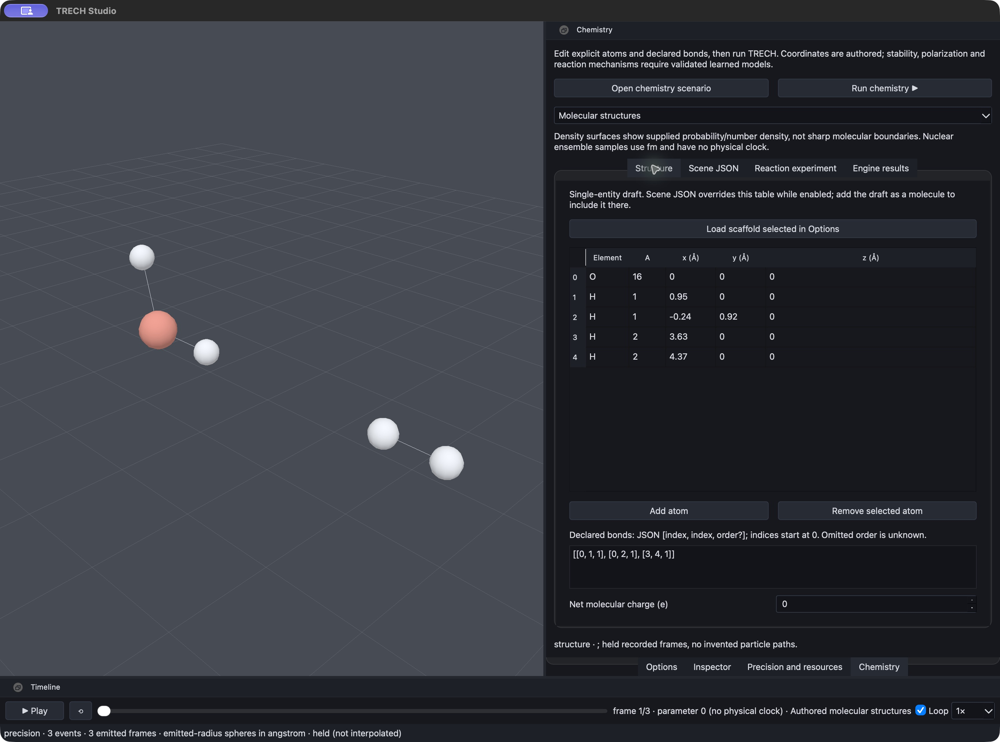</a><br>
<b>Atoms, isotopes and molecular structures.</b> The editor holds authored positions and
declared bonds; the timeline replays a recorded parameter-scan frame.
</td>
<td width="50%" valign="top">
<a href="docs/images/studio-chemistry/joint-density-gradient.jpg">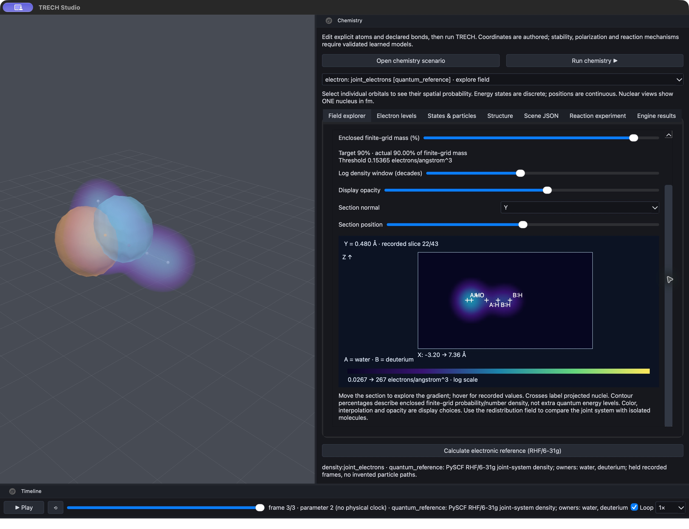</a><br>
<b>Joint density, gradients and orbital context.</b> A log-density volume and numeric section
show the recorded distribution; orange/blue lobes overlay one orbital's signed phase.
Joint means one electronic calculation of both molecules; it does not establish a shared bond.
</td>
</tr>
<tr>
<td width="50%" valign="top">
<a href="docs/images/studio-chemistry/orbital-phase-gradient.jpg">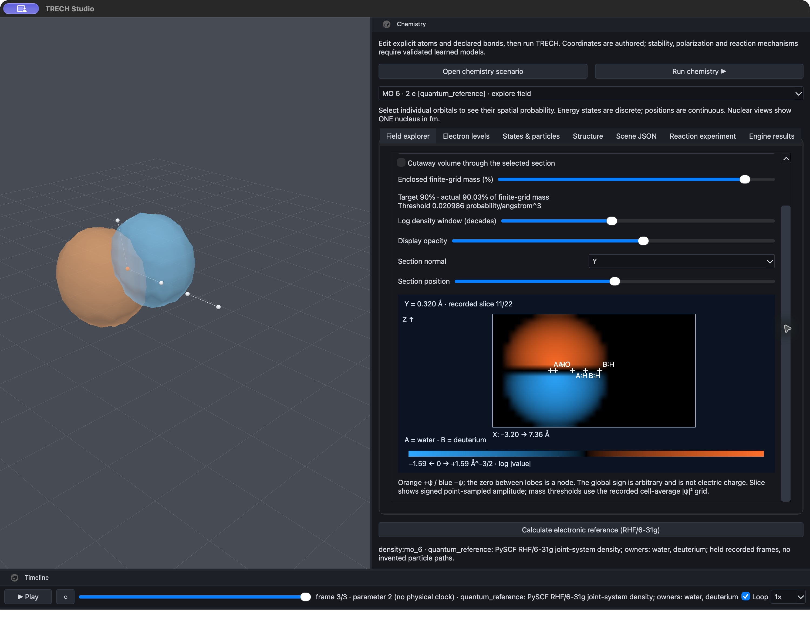</a><br>
<b>Orbital phase, nodes and continuous probability.</b> Select a recorded orbital and move its
section to explore signed amplitude. Orange/blue denote arbitrary wavefunction sign; the gap is
a node. The independent RHF reference supplies the states, energies and occupations.
</td>
<td width="50%" valign="top">
<a href="docs/images/studio-chemistry/nuclear-ensemble.jpg">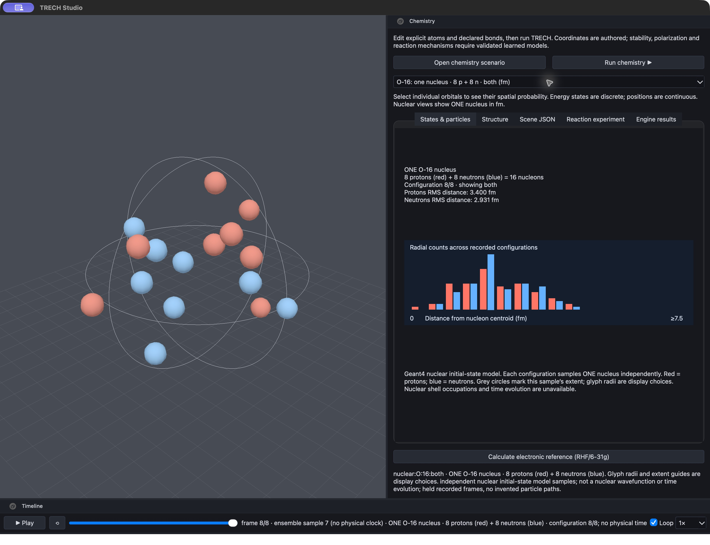</a><br>
<b>One O-16 nucleus: 8 protons + 8 neutrons.</b> The selected Geant4 initial configuration
appears beside its particle inventory, RMS distances and sampled radial-count distribution. Grey extent guides and glyph sizes are display choices; configuration index is separate from physical time.
</td>
</tr>
<tr>
<td width="50%" valign="top">
<a href="docs/images/studio-chemistry/electron-level-diameter.jpg">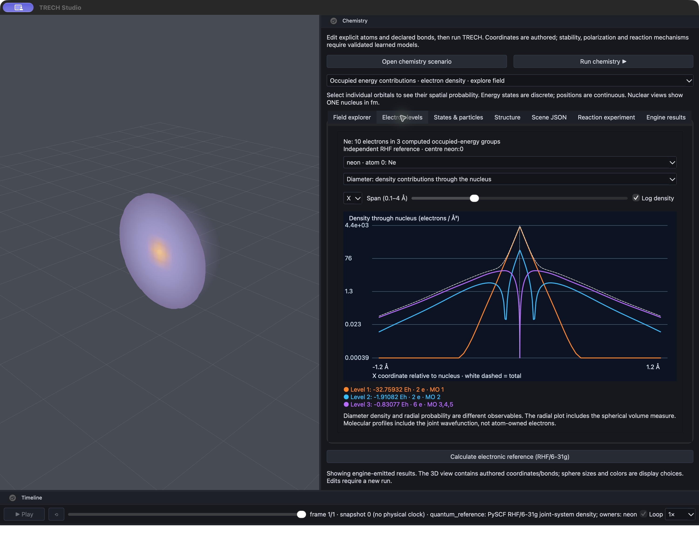</a><br>
<b>Density through the diameter.</b> Ne's computed occupied-energy groups contain 2, 2 and 6
electrons. Their nonuniform contributions and nodes are shown on a log scale; white dashed is
the total. Colors blend in the cloud where states overlap.
</td>
<td width="50%" valign="top">
<a href="docs/images/studio-chemistry/electron-level-radial.jpg">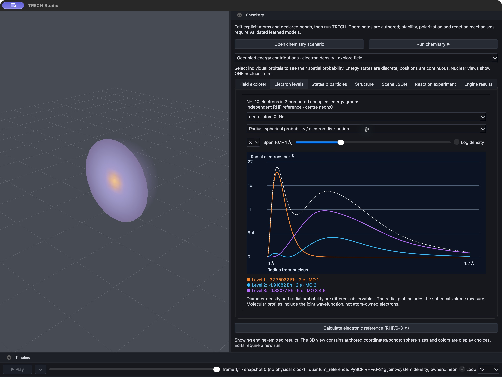</a><br>
<b>Radial probability resolves core and outer distributions.</b> The spherical volume measure
4πr² changes the profile: a narrow core peak and broader outer peaks emerge from the reference.
No fixed shell radii are drawn; orbital eigenvalues are not measured excitation energies.
</td>
</tr>
<tr>
<td colspan="2" valign="top" align="center">
<a href="docs/images/studio-chemistry/density-redistribution.jpg">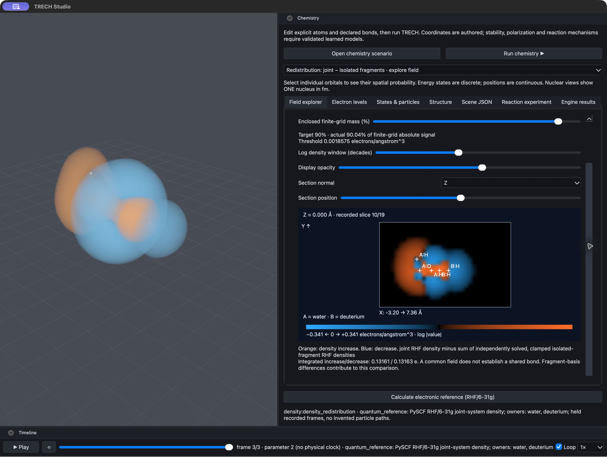</a><br>
<b>What changes when the molecules are calculated together?</b> Orange/blue show increased/decreased
density against independently solved isolated fragments. This RHF comparison includes fragment-basis
differences and is not proof of bonding, entanglement or a predicted reaction.
</td>
</tr>
</table>

[Screenshot provenance and capture instructions](docs/images/studio-chemistry/README.md).


## Dependencies

Current submodule revisions: Geant4 `f3d5293d38` (`v11.5.0.beta`), nlohmann/json
`8617d9c94` (develop), QuickJS `19d6bd8`, and Evolvo `7ca9c66`.
The updated dependencies still require a rebuild and compatibility/physics validation;
existing installed libraries and validation reports describe the earlier builds.

- **Geant4**: tracked as a required submodule under `thirds/geant4`.
  You still need a Geant4 build/install to build TRECH; set `Geant4_DIR` or `CMAKE_PREFIX_PATH` (for example, to the submodule build/install).
  Build with `-DTRECH_ENABLE_DNA_CHEM=ON` to enable Geant4-DNA physics when `chemistry.enable` is true.
  If a local clone exists under `thirds/geant4`, prefer it before fetching elsewhere.
  `Geant4Config.cmake` is generated by the Geant4 build/install; the template lives at `thirds/geant4/cmake/Templates/Geant4Config.cmake.in`.
  Recommended: build in `build/geant4-build` and install to `build/geant4-install` to keep the submodule clean.
- **QuickJS**: required for JS experiments. Either vendor it under `thirds/quickjs/quickjs`
  or configure with `-DTRECH_FETCH_DEPS=ON` (enabled by presets).
- **LibTorch**: optional for `TRECH_ENABLE_TORCH`. Provide `Torch_DIR` or `CMAKE_PREFIX_PATH` for the LibTorch install.
  The local, gitignored `thirds/torch` installation is LibTorch **2.14.1 for macOS ARM64**
  (official CPU package). CMake finds it with
  `-DTorch_DIR="$PWD/thirds/torch/share/cmake/Torch"`; a standalone C++20 tensor/TorchScript
  smoke check passes. TRECH's Torch-enabled build remains blocked by its C++17 setting and
  an incomplete-type destructor in `TorchScriptStub`; normal presets keep Torch disabled.
- **nlohmann/json**: used for config parsing. Vendor under `thirds/json` or fetch.

## Repository layout

```
include/trech/        public headers
src/                 C++ implementation
apps/trech-cli/       CLI entrypoint
examples/experiments  JS experiments
tests/                unit tests
docs/                 roadmap and structure
tools/viz/            Python 3D viewer (PyVista) + demo renderers
studio/               TRECH Studio — desktop UI (3D scenario editor + viewer + code editor)
thirds/               submodules and vendored dependencies
```

### TRECH Studio (desktop UI)

`studio/` is a PySide6 + wgpu (WebGPU → Vulkan/Metal) desktop app: a real-time 3D scenario
editor, simulation viewer, and scenario code editor. It is a **client of the engine** — it runs
`trech run` / `trech lab` and draws the documented outputs, never inventing physics.

Studio previews now use Geant4 medium/process labels rather than guessing scatter from a bent
line: air segments remain evident in the precision/media readout and render finer/translucent,
while only a recorded scatter process receives scatter emphasis. Weak sampled beams are tighter
and more transparent. Preview inspector/status and every capture JSON sidecar report simulation
precision (events, sampling/caps, medium/process coverage, MC standard errors) separately from
representation precision (ribbon/sprite choices, native step/frame holding, raster and
supersampling). It also consumes material-resolved RGBA frames and preserves hollow tube geometry.
JavaScript scenarios can expose their intended editing surface with typed `TRECH_VALUE` calls;
Studio discovers them through the engine (not source-text parsing), shows grouped number/integer/
boolean/choice/text controls in the right-side Options panel, and passes selections back to the
same scenario evaluator when Run is pressed. `viz_refraction_demo.js`, `h2o_fluid.js`, and
`config_cnt_stub.js` demonstrate sizes/levels, temperatures, source settings, and sampling levels.

```
cd studio && pip install -e . && python -m trech_studio          # launch
python -m trech_studio --open build/dev/out_viz_refraction       # view an existing run
```

See `studio/README.md`, `studio/AGENTS.md`, and `studio/ROADMAP.md`.

## Testing

```
ctest --preset dev
```

Fallback if presets are unavailable:

```
ctest --test-dir build/dev
```

## Validation script

```
scripts/run_validation.sh
```

Env overrides: `BUILD_PRESET` (default `dev`), `EVENTS` (default `100`), `SCORES_FILE` (default `trech_scores.jsonl`), `PROVENANCE_FILE` (default `trech_provenance.jsonl`), `SUMMARY_FILE` (default `docs/validation_summary.md`).
Requires Ninja, a C++ compiler, Python 3, and Geant4 for the H2O run.
Successful runs write `docs/validation_summary.md` via `scripts/update_validation_summary.py`.

## Smoke test script

```
scripts/run_smoke.sh
```

Env override: `BUILD_PRESET` (default `dev`). Requires Ninja and a C++ compiler. Runs `ctest` after building.

## Validation status

- Lava lamp + shared Studio/classic 3D playback (corrected 2026-07-16):
  `lava_lamp_inferred_thermofluid` passes **23/23** checks over a real Geant4 material base,
  two cascade bands, 240 persistent parcel IDs, bounded heat/phase/density/buoyancy integration,
  emerging reversals and top travel, zero velocity-cap activations, and neighbour-derived
  topology, retained fine parcel lineage plus continuous fluid-interface necking, non-axis-locked 3D transport, and fixed-inventory spatial/temporal refinement convergence. The current validation corpus reports **45 cases, 41 pass / 0 fail-error / 0 skip /
  4 info**. Duration is not model identity: an independent 60 s horizon matches the default run
  at t=60 within 1e-9 mm. Conditions are dynamic: at 60 s the 333.15 K run has mean liquid
  fraction 0.263 and crosses carrier density, while the same-material 310 K control remains at
  0.0025 and never becomes buoyant. Both committed GIFs replay the same separately simulated
  600 s / 100-tick output as fused 3D density surfaces, mapping its 100 post-tick states directly into ten display seconds
  without slowed sparse frames,
  interpolation, or optical flow. The compact inferred response is illustrative rather than a
  calibrated commercial lava-lamp model.
- Water+n-pentane beaker + Studio motion correction (2026-07-15):
  `beaker_water_n_pentane_inference` passes **11/11** focused checks — PubChem payload structure-only,
  Geant4 base/colour present, two inferred layers with n-pentane above water, 30 °C held-out volatility
  within 6.3%, 60 minutes reached and evaporation mass closed (13.99%, 4.38 g, σ=0.08), plus the
  emitted pour→intermix/separate→evaporate order, a moving vapour plume, and the declared 545× clock. The
  validation runner over the current output corpus reports **40 cases, 36 pass / 0 fail-error /
  0 skip / 4 info**. A real Studio/wgpu still capture also passed; its sidecar reports 60 MC
  events + 61 held material frames and the exact 960×640 / 2× supersampled raster path. Studio's
  curated gallery now includes `beaker_water_pentane.gif`, rendered from the same frames through
  a wrapper whose blue/gold phase tints are explicitly representation-only.
- Optical provenance + adaptive lab rounds (2026-07-15): a fresh 200-event refraction run gave
  100% medium/process coverage in Studio's 686 rendered segments (water 214 / glass 247 / air
  225; boundaries/world exits only, no false scatter). C++ tests pass **11/11** and Studio tests
  pass **40/40**. `trech lab` now times each completed batch, learns seconds/round online and
  emits the next `targetHz`-fit plan unless a config/command override supplies the count. Its
  initialized kernel is reused for compatible batches: the exercised 25 / adaptive-1 / explicit-5
  sequence completed in one process with truthful per-batch scores and config hashes; general
  live geometry/physics reinitialization remains tracked work.
- README animations made legible (2026-09-29): 1280×720 GIFs with a side panel of 2D charts. Geant4 track replays gained fading trails, interaction-history colouring, process-marked vertices, labelled nuclide reactions, bundled optical rays with recorded reflection/refraction (`G4OpBoundaryProcess` status now recorded per point), side-by-side run comparison, composition glyphs and captions; their charts (Kaplan–Meier attenuation, Bragg curve, channel split, measured dispersion, reaction timeline, tissue contrast) are statistics of the recorded tracks vs the engine's formula. `material_frame` gained `samples`/`charts`/`curves`/`labels`/`grid`/mesh `vertex_rgba`, and every hook-layer README scenario charts its own observables. The nitrogen-carbon cycle now runs on neutron-HP physics (a scenario-selectable `physics.list`) so the (n,p) leg and the ¹⁴C decay are Geant4-sampled.
- Every README animation is a 3D replay of a real run (2026-09-29): scripted 2D matplotlib/bespoke renderers (`render_physics_anims.py`, `render_efflux.py`, `render_osmotic.py`, `render_bulk_water.py`, the CNT/MRI/glass renderers) and their MP4/PNG outputs were retired. `trech run --viz`/`--viz-all` captures Geant4 tracks without editing a scenario; `trech-viz --gif` replays them on the Geant4 clock or replays scenario `material_frame` state (atoms/bonds/vectors/apparatus meshes/HUD). Osmosis, efflux (re-distilled 3D operator), Pascal, electrolysis kinematics and the glass furnace were lifted from planar to 3D solvers. One driver regenerates all media: `tools/viz/demos/render_readme_3d.py`.
- Cascade ambient Geant4 seeding landed (2026-07-11): **multi-scale workstream 1** — `ctx.cascade()` with no argument now auto-seeds the bottom of the ladder from the real Geant4 base (`buildAmbientGeant4Seed`, `src/js/JsRuntime.cpp`): per-event tallies (`edep_mev`, `track_length_mm`, `step_count`, `track_count`, `optical_photon_*`) plus `material.<name>.*` probes when `materialProbe` is on; an explicit `ctx.cascade(seed)` still overrides per key, and the sorted seed keys surface on `__cascade.seedKeys`. So the scenario copies nothing from `ctx.event`/`ctx.materials` by hand. `cascade_multiscale_demo.js` switched to the argument-free call — verified byte-identical through a **real Geant4 run** (`ionization_density` 0.6 → `bulk_response` 2.4, `seed_keys` = the 7 ambient event tallies, `stages_run:2`). Deterministic, strict mode still null. `ctest --preset dev` **11/11** (`trech_js_runtime` gains an argument-free `ctx.cascade()` ambient-seed case).
- Multi-scale inference cascade landed (2026-07-05): the core-doctrine engine — `ScaleCascade` (`src/ml/ScaleCascade.cpp`) chains scenario-declared, `scale`-tagged `GenericSurrogate` models from the Geant4 base up the dimension ladder in one deterministic pass, exposed to hooks as `ctx.cascade(seed)`. New physics-agnostic `ModelConfig.scale` (conditionally serialized → existing config hashes byte-identical). Strict-mode-gated; each ran stage counts as a `hook_predict_count` inference. `ctest --preset dev` **11/11** (new `trech_scale_cascade`; two-stage `ctx.cascade` in `trech_js_runtime`; `scale` roundtrip in `trech_config_roundtrip`); demo `cascade_multiscale_demo.js` verified through a real Geant4 run (edep 1.0 MeV → nano 0.6 → meso 2.4, `stages_run:2`). Doctrine cemented in AGENTS.md + ROADMAP.md + CHARTS.md + this README; the cascade is domain-agnostic (fluids/chemistry/biology/CNT/MRI/…), optics is only the first family with a validated surrogate. Honest scope: the demo stage models (`data/cascade_demo/`) are illustrative hand-authored maps; real held-out-validated per-band chains are the standing-objective work.
- Magnetic-resonance Stage 4 — 2D brain MRI image landed (2026-07-05, no C++): `testscenario_magnetic_resonance_brain.js` declares mobile-¹H proxy materials whose Geant4 proton densities set the tissue contrast; `scripts/run_magnetic_resonance_brain.py` paints them onto a procedural [BrainWeb](https://brainweb.bic.mni.mcgill.ca/brainweb/anatomic_normal_20.html)-inspired axial head phantom and does a k-space acquisition + 2D FFT reconstruction. The reconstructed brain MRI shows bright CSF/ventricles, grey > white matter, bright fat, dark skull, black background; per-tissue intensity↔Geant4 proton density **r = 0.998**, reconstruction fidelity **r = 0.966**, byte-reproducible. Guarded by `magnetic_resonance_brain_image` (7/7, category `resonance`); report regenerated to **38 cases, 34 pass / 0 fail / 4 info / 0 skip**. Rendered `magnetic_resonance_brain.png` (README hero). Honest scope: the anatomy is a digital phantom and the k-space/FFT is signal processing; the per-tissue brightness is Geant4-derived (mobile-¹H model).
- Magnetic-resonance Stage 3 — 1D MRI image line via frequency encoding landed (2026-07-05, no C++): `testscenario_magnetic_resonance_imaging.js` builds a real NIST-tissue phantom row (incl. an air gap + cortical bone), reads each voxel's Geant4 ¹H density (`ctx.materials`), applies a readout gradient (`ω(x)=γ(B₀+G_x·x)`) and **DFT-reconstructs the 1D proton-density image line**: positions recovered from peak frequency to **0.001 mm**, amplitude↔proton corr **1.0**, air gap **0.01** (black) / cortical bone **0.59** (dark). Guarded by `magnetic_resonance_image_line` (6/6, category `resonance`); report regenerated to **37 cases, 33 pass / 0 fail / 4 info / 0 skip**. Rendered `magnetic_resonance_imaging.png`. Completes the magnetic-resonance track (discover Larmor → real-photon tissue contrast → image); honest scope: the gradient encoding + reconstruction are hook-layer signal processing on Geant4-supplied proton densities + a real Geant4 phantom/transport.
- Magnetic-resonance Stage 2 — virtual-tissue contrast with REAL Geant4 photon emission landed (2026-07-04, no C++): shared scenario `testscenario_magnetic_resonance_tissues.js` + multi-run driver `scripts/run_magnetic_resonance_tissues.py`. Per NIST tissue the excitation-primary count = `round(base · Geant4 ¹H density(T)/density(water))` (an ignorant `material_probes` fact); Geant4 produces **every consequent photon** and a NaI shell scores the REAL deposited energy. Over 6 tissues: water 1.00 / adipose 0.97 / muscle 0.95 / brain 1.00 / lung 0.98 / **cortical bone 0.60×** (MRI-dark), corr(detected signal, proton density) **0.9995**, byte-reproducible. Guarded by `magnetic_resonance_tissue_contrast` (5/5, category `resonance`); report regenerated to **36 cases, 32 pass / 0 fail / 4 info / 0 skip**. Rendered `magnetic_resonance_tissues.png`. Honest scope: the excitation-per-proton is a labelled proxy; REAL = the Geant4-set emission count + the Geant4-transport detection tally.
- Magnetic-resonance Stage 1 + Geant4 material-composition surface landed (2026-07-04): new engine surface (`MaterialProbe.{hpp,cpp}`, `materialProbe`/`ctx.materials`) exposes Geant4's per-material composition — density, per-element atoms/cm³ (¹H = proton density), electron density, mean excitation I, radiation length — to hooks and to `trech_scores.jsonl` (`material_probes`), opt-in so existing scenarios stay byte-identical. `testscenario_magnetic_resonance.js` builds a 5 cm³ water phantom + copper coil and runs hook-layer Bloch dynamics that **discover** the Larmor line from the FID carrier (feeding only proton γ + machine B0): γ/2π **42.5768 MHz/T** vs CODATA 42.5775 (0.001%), Geant4 water proton density **6.686e22/cm³** = literature (0.006%), T2* recovered 0.1%, receiver-coil Geant4 tally 0.947 MeV, byte-reproducible under `threads:1`. Guarded by `magnetic_resonance_water` (category `resonance`, 7/7 incl. a `material_probes`↔`ctx.materials` cross-check). `ctest --preset dev` 10/10; validation report regenerated to **35 cases, 31 pass / 0 fail / 4 info / 0 skip**.
- Full suite/media refresh completed on 2026-06-30: `scripts/run_validation_suite.sh` reran the default slow suite with bulk water and D(T) enabled and reported **32 cases, 28 pass / 0 fail-error / 0 skip / 4 info**. The glass-of-water validator and optics-surrogate held-out validator were regenerated (`surrogate LOO MAE 0.0839 < extractor MAE 0.1406`), and the scenario GIF/MP4/PNG gallery under `tools/viz/demos/` was refreshed from the new `build/dev/out_*` outputs.
- Scenario execution audit (2026-06-30): fresh probes confirmed `trech run` initializes Geant4 and executes `BeamOn`, while several H2O/CNT/biology cases honestly remain hook-layer MD/device/reaction proxies driven by Geant4 event metrics or `G4EmCalculator` anchors. Fixed a real audit gap: run-end `event_feature_stats` now use Geant4 accumulables so MT worker features merge into `trech_scores.jsonl` (12-event stratify probe count/means match event rows), and `scripts/run_validation_suite.sh` no longer swallows selected scenario/export failures with `|| true`.
- `ctest --preset dev` passed (latest run); optics spectrum smoke run completed with `examples/experiments/config_optics.js` (`--events 50`, output `build/dev/out_optics_spectrum`).
- H2O single-molecule proxy stub run completed with `examples/experiments/h2o_single_molecule.js` (`--events 50`, output `build/dev/out_h2o_single`).
- H2O optics beam stub run completed with `examples/experiments/h2o_optics_beam.js` (`--events 50`, output `build/dev/out_h2o_optics`).
- CNT smoke runs completed with `examples/experiments/config_cnt_stub.js` and `examples/experiments/config_cnt_world_stub.js` (`--events 5`, outputs `build/dev/out_cnt`, `build/dev/out_cnt_world`); stubs now use container volumes with explicit materials (diameter 3.0 nm, wallCount 5) and a 0.8 MeV electron beam, rerun to refresh outputs.
- CNT optics smoke run completed with `examples/experiments/config_cnt_optics_stub.js` (`--events 5`, output `build/dev/out_cnt_optics`); stub now uses a 1.2 MeV electron beam with thicker walls (diameter 3.0 nm, wallCount 5) and `volume_edep_mev` scoring, rerun to refresh outputs.
- CNT electronic-structure comparison rerun completed with `examples/experiments/cnt_band_structure.js` (`--events 5`, output `build/dev/out_cnt_band_structure`): 12 nominal-metal / 14 semiconducting tubes, semiconducting `E_g*d = 0.8236 eV*nm`, quasi-metallic curvature `E_curv*d^2 = 0.050 eV*nm^2`, max secondary gap 0.1007 eV; `cnt_band_structure` validation passes and `tools/viz/demos/cnt_band_structure.png` was regenerated.
- CNT logic-gates run completed with `examples/experiments/cnt_logic_gates.js` (`--events 8`, output `build/dev/out_cnt_logic_gates`): working **(16,0)** CNTFET on/off `3.33e5`, all 8 gate truth tables + half/full/2-bit-adder tables confirmed, recovered subthreshold swing `60.27 mV/dec` (ideal 59.53), metallic armchair (5,5) on/off 1.0 collapses outputs to ~Vdd/2 and breaks the logic, Geant4 e- drive 8 events / 32 steps / 8.0 mm; `cnt_logic_gates` validation passes (10 flags). The run now emits 8 `visual_topologies` plus `visual_source` (`PubChem` not applicable to CNT chirality/device structure); `cnt_logic_gates.png`, `cnt_structure.gif`, and the data-driven `cnt_circuit.gif` were regenerated. Current validation reporter over `build/dev`: 32 cases, 28 pass / 0 fail-error / 4 info / 0 skip.
- CSDA-range analytic cross-check landed (2026-06-30): `examples/experiments/analytic_csda_range.js` fires a 20 MeV proton into water; the engine derives the CSDA range from Geant4's own stopping power (`G4EmCalculator::GetCSDARange`, with `SetBuildCSDARange(true)` enabled only when a `csda_range` check is configured) and compares it to a **new per-primary track-length tally** (`primary_mean_track_length_mm`, summed over `parentID==0` steps in `SteppingAction`). Derived **4.282 mm** vs measured **4.266 mm** (**0.38%**), all 5000 protons contained (0 transmitted), stopping power 2.59 MeV/mm (≈ NIST PSTAR). Deterministic (`threads:1`, byte-identical reruns). Guarded by `analytic_csda_range_cross_check` (category `analytic`); `ctest --preset dev` 9/9; report now **32 cases, 28 pass / 0 fail / 4 info / 0 skip**.
- Osmotic scenario refinement completed on 2026-06-28: the Brownian bath now uses a Langevin thermostat instead of unbounded random heating, and validation later tightened to the biological-cell 9/9 check set (`net_water_flux_out=71`, first crossing at tick 3, bounded KE, late pressure bias, polarity exclusion, crenation, membrane stability). `ctest --preset dev` passed 9/9; current validation reporter over `build/dev` is green at 32 cases, 28 pass / 0 fail-error / 4 info / 0 skip.
- Osmotic biological-cell replay video landed: `tools/viz/demos/render_osmotic.py` consumes the scenario's `osmotic_particles` hook emits and writes `tools/viz/demos/osmotic_dehydration.mp4` (+ `.gif`), replaying an evident top-down cell — crenating lipid membrane, cytoplasm/nucleus/organelles, channel pores expelling water into the hypertonic glucose bath, and flash markers where the membrane expels wrong-polarized molecules — directly from TRECH output. The spring/mesh membrane is now simulated in the scenario (turgor-driven crenation emitted as physical state), not just visualized; the wrong-polarized `ion` species is rejected by polarity selectivity. Validation tightened to 9/9 checks.
- Membrane-efflux comparison scenario landed (`examples/experiments/testscenario_efflux.js`): a cell clears a lipophilic waste molecule (benzene) by passive lipid permeation (Overton's rule), reproducing the classical first-order clearance law `N(t)=N₀·e^(−kt)` (log-linear fit R²≈0.99, 72/80 cleared, 30/30 essentials retained). **PubChem XLogP** (benzene +2.1 vs D-glucose −2.6, loaded via `TRECH_PUBCHEM` from `TRECH_PUBCHEM_CACHE_DIR`) decides which molecule permeates; Geant4 `G4EmCalculator` membrane/cytosol EM ratio (μ_lipid≈0.0291/mm vs μ_water≈0.0377/mm at 30 keV → 1.30, emitted live as `analytic_checks`; illustrative) and per-event Geant4 transport metrics (`ctx.event`, 12,789 steps / 4.99 MeV in the refreshed run) scale the rate. The molecules move by drift-diffusion (coherent cytoplasmic streaming + outward efflux drift — directed flow, not jitter) and are drawn as ring glyphs with real PubChem 2D structure cards. Rendered by `tools/viz/demos/render_efflux.py` → `efflux_clearance.mp4`/`.gif`. Guarded by `efflux_first_order_kinetics` (6/6 checks incl. lipophilicity selectivity + Geant4 event drive); `ctest --preset dev` 9/9.
- CNT animation clarity refresh (2026-07-01): the two CNT GIFs were reworked for readability. **`cnt_structure.gif`** now rolls each tube from its *own* chiral vector `C = n·a1 + m·a2` (faithful `build_tube_chiral`), so armchair vs zigzag **wrapping asymmetry** is visible rather than only diameter; it renders all three emitted archetypes (metallic armchair `(5,5)` / quasi-metallic zigzag `(9,0)` / semiconducting zigzag `(16,0)`) and adds a clearly-labelled electron **source contact (the base)** + drain electrode plates so it is obvious where the particles come from and which way current flows, with per-tube status cards (chirality kind, θ, d, gap, behaviour). **`cnt_circuit.gif`** was de-frenetified: gate/truth-row selection moved from a continuous `int(t·len)` mapping (which strobed) to a held step-plan (`--hold` frames per row, default 6) with a **static camera**, a bottom progress bar, and a lit output node (`Y=` green 1 / red 0) + `✓ MATCH`/`✗ MISMATCH` readout, and it re-encodes against a shared palette with `disposal=1` to fall from ~7 MB to ~1.4 MB. Regenerated `cnt_structure.gif` (915 atoms) and `cnt_circuit.gif` (28 truth rows, 168 frames).
- Scenario animation clarity refresh (2026-06-30): electrolysis snapshots now carry sampled H2/O2/product-H2O packets so the burn shows correlated molecule consumption/recombination; Pascal snapshots carry pressure gauges, wall profiles, and plastic displacement; the CNT structure GIF now reads the `(5,5)`/`(16,0)` devices from `cnt_gates_summary`, and the CNT circuit GIF now renders the emitted per-gate CMOS topologies instead of a fixed inverter-chain template; brine shows hydrated Na+/Cl- pairs with deposits limited to the visible brine/beam path. Regenerated `electrolysis.gif`, `pascal_press.gif`, `brine_deposit.gif`, `cnt_structure.gif`, and `cnt_circuit.gif`.
- H2O electrolysis + inverse-combustion reaction-cycle scenario landed (`examples/experiments/testscenario_h2o_electrolysis_combustion.js`): real-time fetched PubChem formulas for water/hydrogen/oxygen drive a deterministic hook-layer reaction ledger, while Geant4 event-level e- energy deposition/track statistics (`ctx.event`) and live `G4EmCalculator` H2O/H2/O2 interaction anchors directly scale the stochastic split/recombination rates. Validation `h2o_electrolysis_combustion_cycle` passes: 180 H2O → 180 H2 + 90 O2, both cathodes active (92/88 H2, imbalance 0.022), combustion recovers 180 H2O, atoms conserved, analytic labels emitted, and Geant4 event drive positive (24.0 MeV deposited). Validation report now has 32 cases, 28 pass / 0 fail / 4 info.
- CMake target link dependencies trimmed to avoid duplicate `libtrech_core.a` warnings on macOS.
- QuickJS header warnings are suppressed for the `trech_js` target via scoped compile flags (Clang/GNU).
- `examples/experiments/h2o_fluid.js` SIGSEGV fixed: it referenced `G4_SODIUM_CHLORIDE` (not a Geant4 NIST material), and `buildCustomMaterials` left a malformed mixture that crashed Geant4. Fixed via element components (`MaterialComponentConfig.element`, so salt = Na+Cl) and fail-safe material building; h2o_fluid now runs clean and the full scenario sweep is green (except the by-design `include_error_demo`).
- `examples/experiments/config_chemistry_stub.js` run completed with `--events 5` and `--output build/dev/out_chem`; `trech_scores.jsonl` includes chemistry/DNA fields.
- Nitrogen-carbon cycle scenario run completed with `examples/experiments/config_nitrogen_carbon_cycle.js` (`--events 5`, output `build/dev/out_nitrogen_cycle`); scores now include `nuclear_cycles` with forward/backward Q-values (~0.626 MeV and ~0.156 MeV) and macro transition consistency (`gas_to_solid`).
- Geant4 build/install is available at `build/geant4-install` (from submodule `thirds/geant4`); point `Geant4_DIR` or `CMAKE_PREFIX_PATH` there when rebuilding.
- Multi-beam helper run completed with `examples/experiments/config_multi_beam_units.js` (`--output build/dev/out_multi_beam`); `trech_scores.jsonl` recorded `total_edep_mev` 25.0, `system_volume_mm3` 1000000.0, `system_edep_mev_per_mm3` 2.5e-05 (`QBBC`, optics disabled).
- Flow-language scenario run completed with `examples/experiments/config_flow_language.js` (`--events 1`, output `build/dev/out_flow_language`); provenance normalized `environment` to `detector` and preserved flow-composed optics/materials/beam fields.
- `ctest --preset dev -R trech_js_runtime` passed; includes test coverage for `TRECH_INCLUDE` error filenames/line numbers plus flow-style `TRECH_CONFIG` + `TRECH_FLOW`.
- `trech lab` bootstrap smoke run completed with `examples/lab/realtime_lab_bootstrap.json` + `examples/lab/realtime_lab_commands.jsonl` (`--output build/dev/out_lab_boot`); command stream applied live patches, ran simulation, and emitted snapshot JSON without JS scenario authoring.
- Determinism/provenance smoke run completed with `examples/experiments/config_stratify_ml.js` (`--events 1`, output `build/dev/out_determinism`); outputs now include `determinism_mode`, `predictive_mode`, `stratify_model_hash`, and provenance stratify source counters.
- Hook runtime extension smoke run completed with `examples/experiments/config_hook_dispatch.js` (`--output build/dev/out_hook_runtime_ext`); scores/provenance now include `hook_patch_count` and `hook_emit_count`, and `trech_hook_emits.jsonl` captures deterministic emit payloads.
- Hook emit guardrails now enforce per-callback caps and payload-size caps (`hooks.maxEmitsPerCallback`, `hooks.maxEmitPayloadBytes`); scores/provenance include `hooks_guardrail_max_emits_per_callback`, `hooks_guardrail_max_emit_payload_bytes`, and `hook_emit_dropped_count` (`ctest --preset dev` passed).
- Validation summary (auto-updated after a successful run): `docs/validation_summary.md`.

## Benchmark references

Long-form validation benchmarks live under `docs/benchmarks/` as plain
text snapshots. They are the canonical baselines that future commits
diff against: when a run moves any number, the `.txt` shows the delta
inline in the PR so engine regressions or improvements are caught in
code review. The companion `.md` is human-readable and the `.json`
sidecar is the machine-readable form consumed by tooling.

Conventions for adding a benchmark:

- The scenario lives under `examples/experiments/<name>.js`.
- The validator lives under `scripts/validate_<name>.py` and emits
  three artifacts in one pass: `docs/<name>.md` (markdown report),
  `docs/<name>.json` (sidecar), `docs/benchmarks/<name>.txt`
  (committed reference). The `.txt` must be deterministic given the
  same run inputs so the diff stays clean.
- The validator is wired into `scripts/run_validation_suite.sh` with
  a `SKIP_<NAME>` env knob so CI can opt out individually.

| Benchmark | Scenario | Validator | Reference | Status |
|---|---|---|---|---|
| Glass-of-Water optical inverse | [validation_glass_of_water.js](examples/experiments/validation_glass_of_water.js) | [validate_glass_of_water.py](scripts/validate_glass_of_water.py) | [`docs/benchmarks/validation_glass_of_water.txt`](docs/benchmarks/validation_glass_of_water.txt) | informational; after the f-sum valence oscillator the engine derives n_water ≈ 1.331 / n_glass ≈ 1.472 (≈99% / ≈103% of handbook, up from ≈1.001) — inverse-Snell recovers n within ≤1.1% rel err at every interface (4000 events / seed 20260525) |

Future benchmarks should be appended as new rows. Tighten the status
column to `pass` / `fail` once a benchmark has a numeric tolerance the
PR check enforces (today the row is informational and the diff is the
signal).

## Roadmap

- Short-term next steps: `ROADMAP.md` (editable source of truth)
- Initial roadmap concept: `docs/trech-roadmap.md` (reference-only)
- H2O experiment spec (initial): `examples/experiments/h2o_fluid_spec.md`
- CNT parallel track for schema/physics coherence: `ROADMAP.md`

## License

See `LICENSE`.
