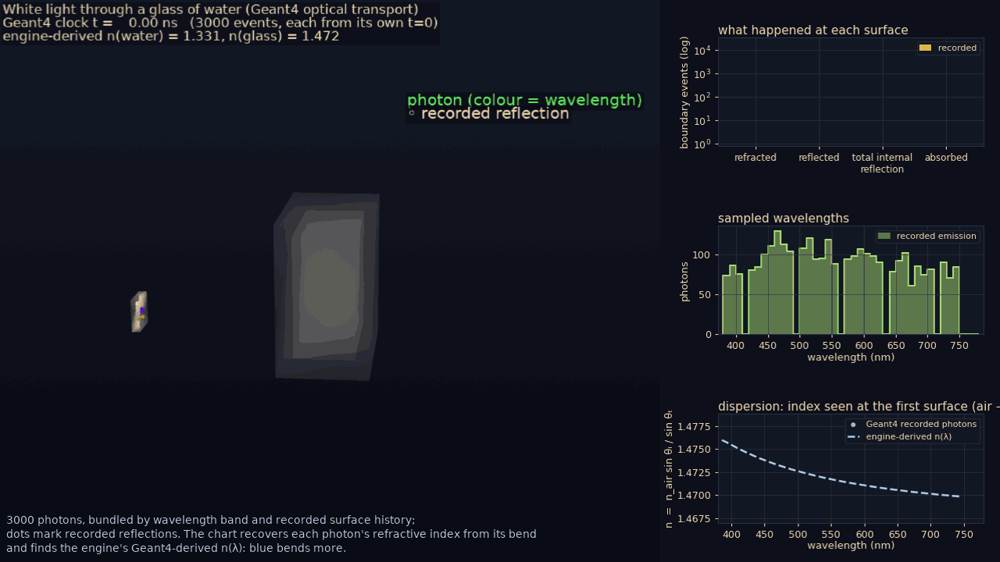
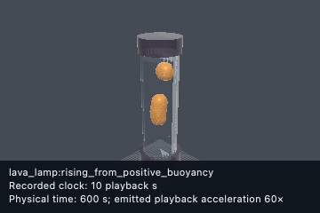
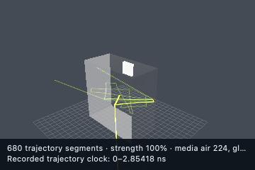
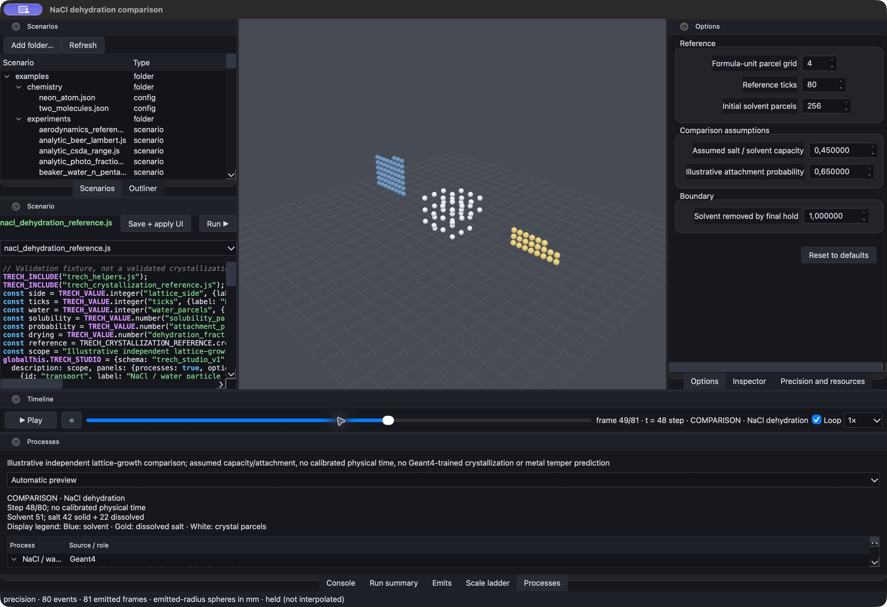
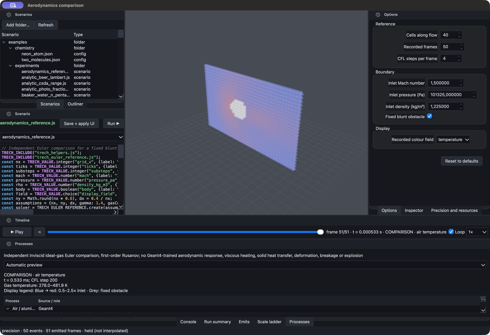
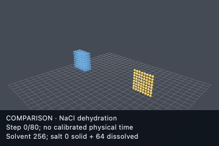
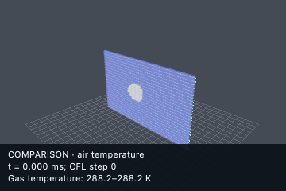

# TRECH

**Scenario bundles:** all 63 shipped scenarios live in `examples/scenarios/<name>/` with
`<name>.js` (physics), `.view.js` (presentation), `.validation.js` (expectations), and `.ui.js`
(typed controls/Studio descriptions). Shared TRECH JS lives in `js/`; failure fixtures live in
`tests/fixtures/js/`. The C++ loader loads companions for roots and nested includes; CLI/library
and Studio share parameter validation. Source inventory includes companions. Contract:
[`docs/scenario_bundles.md`](docs/scenario_bundles.md). Historical media identities are retained.


TRECH is a **C++/Geant4 simulation and learning toolkit**. Experiments written in
**JavaScript (QuickJS)** compute and compose configuration, then hand it as JSON to a
**deterministic-by-default C++ runtime** that runs Geant4 and records provenance.

Its core thesis is the **multi-scale inference cascade**: learn from precise Geant4
particle/nano data, then lift behaviour **scale by scale — atomic → nano → micro → meso →
macro — to the observer's experiment**. The goal is a general-purpose, context-driven
inference layer across fluids, chemistry, biology, CNT electronics and magnetic resonance.
Validated training and gap-to-truth measurements must establish where predictions are
trustworthy and where more simulation or training is needed.

**Current scope:** an active H2O/optics baseline, with tracks for chemistry/DNA wiring,
reaction cycles, biology, CNT electronics, magnetic resonance/MRI, learned operators and a
[desktop Studio](#trech-studio-desktop-ui). These tracks have different levels of physical
validation; the [scenario tables](#essential-test-scenarios) state Geant4's role in each.

Initial [NaCl dehydration and compressible-airflow references](docs/process_references.md) now
exercise connected crystal growth/bookkeeping and pressure/temperature flow output. They are
independent comparison fixtures; quantitative crystallization, metal tempering and high-speed
structural predictions remain unvalidated. [Studio JS authoring](docs/studio_authoring.md)
edits included process modules and reloads declarative UI descriptions on Save. An optional
[V8 source/embedding foundation](docs/v8.md) is included under `thirds/v8`; QuickJS remains the
simulation runtime and no V8 performance claim is established.



*900 of 3,000 white-light photons from `glass_of_water_spectral.js`, replaying recorded
Geant4 tracks at engine-derived n(water)=1.331 / n(glass)=1.472. Animations show recorded
tracks or emitted hook-layer state; the [gallery](#scenario-animation-gallery) explains
sources, comparison models and rendering choices.*

**Start here:** [Quick start](#quick-start) · [Dependencies](#dependencies) · [CLI](#cli) ·
[Scenario authoring](#scenario-authoring-direction) · [Inference cascade](#multi-scale-inference-cascade)

**Explore:** [Examples](#config-examples) · [Studio](#trech-studio-desktop-ui) ·
[Outputs](#outputs) · [Validation](#testing-and-validation) · [Animation gallery](#scenario-animation-gallery) ·
[Molecular examples](#molecular-learning-and-quantum-comparisons) ·
[Repository layout](#repository-layout) · [Roadmap](#roadmap)

## Principles

To refresh experiment media for both viewers, run
[`scripts/update_experiment_media.sh`](scripts/update_experiment_media.sh) from the repo root.
It includes slow experiments, replaces successful renders, updates the curated Studio references,
and writes a per-experiment audit plus the [Studio preview index](studio/previews/README.md).
The current refresh covers 41 engine captures and 63 Studio scenarios: 47 animated previews,
15 static scenes and one recipe blocked on missing process models.
`--list` shows coverage; `--resume build/media_refresh/<session>` resumes matching source data.
Missing process models and unsupported motion are reported explicitly, without staged animations.
Native desktop screenshots remain historical captures and are never synthesized by this script.

- **Geant4 is the particle-scale base of truth.** Higher-scale behaviour should come from
  learned, validated inference. Classical physical and chemical laws serve as comparison or
  validation references; existing MD/Bloch/fluid solvers are explicitly labelled hook-layer
  physics for comparison.
- **Determinism is explicit.** `strict` is the default and disables all model inference;
  `predictive` enables configured inference with provenance. An inferred result is never a
  strict Geant4 tally.
  Local default-thread strict transport replay currently has a known gap; serial
  `run.threads: 1` replay passes. Diagnosis is tracked in [ROADMAP.md](ROADMAP.md).
- **Provenance comes first.** Every run records config JSON, hashes, seeds, versions, hook
  dispatch and patch/emit/predict counters, including guardrails and dropped emits.
- **Author physics in JS; keep C++ generic.** Helpers, unit conversions, dynamic assembly,
  geometry and material classes belong in scenarios. Ensemble-level metrics connect particle
  runs to higher scales. Studio is a viewer/client of this same engine.

## Architecture (short version)

1. **Authoring input** is either a JS experiment (`run`) or a live JSON command stream (`lab`).
2. **C++ core** parses config, applies deterministic patches/overrides, and tracks lab/session metadata.
3. **Geant4 layer** runs the canonical lifecycle and emits scoring + provenance.
4. **System aggregation** computes point-agnostic ensemble metrics for ML and multiscale stages.

See [structure](docs/structure.md) for the detailed skeleton, [CHARTS.md](CHARTS.md) for
Mermaid dataflow diagrams, and [ROADMAP.md](ROADMAP.md) for current plans.

## Quick start

Requires Ninja, a C++ compiler and a configured Geant4 build/install; see
[Dependencies](#dependencies) for setup and the current compatibility caveat.

```sh
git submodule update --init --recursive
cmake --preset dev
cmake --build --preset dev
./build/dev/trech run examples/scenarios/hello_world/hello_world.js --output build/dev/out_hello
./build/dev/trech lab --config examples/lab/realtime_lab_bootstrap.json
```

Build artifacts live under `build/` and are ignored by git.

## Dependencies

Current submodule revisions: Geant4 `f3d5293d38` (`v11.5.0.beta`), nlohmann/json
`8617d9c94` (develop), QuickJS `19d6bd8`, and Evolvo `7ca9c66`.
The updated dependencies still require a rebuild and compatibility/physics validation;
existing installed libraries and validation reports describe the earlier builds.

- **Geant4**: tracked as a required submodule under `thirds/geant4`.
  You still need a Geant4 build/install to build TRECH; set `Geant4_DIR` or `CMAKE_PREFIX_PATH` (for example, to the submodule build/install).
  Build with `-DTRECH_ENABLE_DNA_CHEM=ON` to enable Geant4-DNA physics when `chemistry.enable` is true.
  If a local clone exists under `thirds/geant4`, prefer it before fetching elsewhere.
  `Geant4Config.cmake` is generated by the Geant4 build/install; the template lives at `thirds/geant4/cmake/Templates/Geant4Config.cmake.in`.
  Recommended: build in `build/geant4-build` and install to `build/geant4-install` to keep the submodule clean.
- **QuickJS**: required for JS experiments. Either vendor it under `thirds/quickjs/quickjs`
  or configure with `-DTRECH_FETCH_DEPS=ON` (enabled by presets).
- **LibTorch**: optional for `TRECH_ENABLE_TORCH`. Provide `Torch_DIR` or `CMAKE_PREFIX_PATH` for the LibTorch install.
  The local, gitignored `thirds/torch` installation is LibTorch **2.14.1 for macOS ARM64**
  (official CPU package). CMake finds it with
  `-DTorch_DIR="$PWD/thirds/torch/share/cmake/Torch"`; a standalone C++20 tensor/TorchScript
  smoke check passes. TRECH's Torch-enabled build remains blocked by its C++17 setting and
  an incomplete-type destructor in `TorchScriptStub`; normal presets keep Torch disabled.
- **nlohmann/json**: used for config parsing. Vendor under `thirds/json` or fetch.

## CLI

```
trech run <experiment.js> [--macro <file>] [--ui] [--output <dir>] [--seed <n>] [--events <n>]
trech lab [--config <file>] [--commands <file>] [--output <dir>] [--seed <n>] [--events <n>]
```

Examples:

```
./build/dev/trech run examples/scenarios/hello_world/hello_world.js --output out
./build/dev/trech run examples/scenarios/water_box/water_box.js --seed 42 --events 100
./build/dev/trech run examples/scenarios/h2o_fluid/h2o_fluid.js
./build/dev/trech run examples/scenarios/hello_world/hello_world.js --macro examples/macros/minimal.mac
./build/dev/trech lab --config examples/lab/realtime_lab_bootstrap.json
./build/dev/trech lab --config examples/lab/realtime_lab_bootstrap.json --commands examples/lab/realtime_lab_commands.jsonl
```

### Live lab sessions

`lab` accepts JSON objects, one per line, on stdin or in a `--commands` file:

- `{"action":"patch","patch":{...}}` merge a config patch into the live session state.
- `{"action":"simulate"}` run Geant4 with the online timing planner's learned round count.
- `{"action":"simulate","events":N,"seed":S}` run Geant4 with an explicit one-command count override.
- `{"action":"snapshot"}` print canonical config plus `lab.roundPlanner` timing/precision state.
- `{"action":"help"}` print supported actions.
- `{"action":"quit"}` close the lab session.

The first batch initializes Geant4; compatible later batches reuse that kernel and call `BeamOn`
directly. Event count, seed, and planner settings may change live. A patch to geometry, beam,
physics, scoring, or output state is rejected after initialization with a restart-required error,
because safe in-process reinitialization remains an explicit `ROADMAP.md` item. Always use
`achieved_hz`, not the planned count alone, when describing real-time performance.

### Precision and resource controls

Continuous `--refinement` factors complement scenario precision profiles. Predictive batch
runs can use `--time-budget` to stop at complete event boundaries, recording completed and
requested counts separately. Cascades resolve dependencies within each scale band and accept
optional stage/target budgets. Studio's **Precision and resources** dock exposes these
controls, representation-only adaptive 3D detail and preview memory allowances.
[Commands, contracts and limits](docs/adaptive_precision.md).

## Scenario authoring direction

### Runtime and scenario options

- JS is a full authoring runtime: use helpers to convert units, assemble multi-entity configurations, and gate choices on runtime arguments.
- Experiments set `globalThis.TRECH_CONFIG` to an object, JSON string, or function returning one; `globalThis.TRECH_HOOKS` is optional and recorded for provenance.
- `TRECH_FLOW(initial)` is available globally for flow-like authoring with deterministic fluent transforms and checks: `set`, `defaults`, `merge`, `push`, `ensureArray`, `derive`, `selectBeam`, `normalizeDetectorAliases`, `finalize`, `require`/`assert`, `when`, `tap`, and `build`.
- `TRECH_VALUE.number/integer/boolean/string/choice(name, definition)` declares a typed scenario
  option and returns its `default` during an ordinary run. Definitions can include `label`,
  `description`, `group`, `unit`, numeric `min`/`max`/`step`, or `choices`. Studio evaluates them
  through `trech inspect` and renders native controls in its right sidebar; a run supplies validated
  selections with repeatable `--param name=<json>` arguments.

### Precision and determinism

- **Precision is a profile mapped onto the scenario's own axes** — TRECH publishes no global
  "quality" number, because a Geant4 event, an MD step, a PBF particle, a chemistry tick and a
  replay frame are not the same knob. `helpers.precision.resolve({profile, axes})` moves every
  declared axis one rung (`preview`/`balanced`/`high`/`convergence`), where `balanced` is the
  scenario's reference values, and returns `config.precision`. Each axis declares a
  physics-agnostic `role` (`spatial`/`temporal`/`output`/`statistical`/`representation`), the
  control it drives, its unit and direction; a `representation` axis is forced display-only by the
  engine, so a render knob can never read as improved physics. An explicit control overrides its
  axis and makes the reported profile `custom` — a rung only half-followed is not that rung. The
  run reports `precision_profile` + `precision_axes` in `trech_scores.jsonl` (and the profile in
  provenance), and Studio shows them in the run summary and every capture sidecar.
  `lava_lamp.js` is the worked example (spatial parcels / temporal step / output ticks /
  representation-only surface grid).
- Determinism is explicit via `determinism.mode` (`"strict"` default, `"predictive"` to enable ML inference paths when configured).

### Geometry, materials and sources

- Use `geometry.volumes` to describe named shapes and placements; enable `scoreEdep` to capture per-volume energy deposits.
- Build recursive scenes by assigning `placement.parent` to other volume names; container volumes (vacuum material) can bound fluids without modeling container chemistry.
- Use `materials` to define simple mixtures (density + component fractions) when NIST materials are insufficient; optional `smiles` is a placeholder for future registry metadata.
- `beams` is supported for array definitions (normalized to the active/first entry); `beam` remains as a single-entry alias.
- Use `nuclear.cycles` for isotope-cycle consistency analysis. Reactions are declared with `reactants`/`products` participants (`{z,a}` ions or `particle` names) and TRECH computes Geant-backed Q-values plus charge/baryon conservation checks.
- `detector` remains the canonical runtime key, but top-level `environment` and `medium` are accepted as authoring aliases and normalized by the loader.
- `G4_*` materials refer to the Geant4/NIST database; wrap them with JS presets when clarity matters.
- Collections should use plural names and accept either a single object or an array; loaders normalize single objects into arrays (materials/components/tags/optics.spectrum/hooks.registered accept single values).
- Multi-beam, multi-source, and layered systems are intended targets; the engine should grow toward generic particle/source definitions without schema fragmentation.

### Helpers and hooks

- Use `TRECH_INCLUDE` to load helper modules while preserving per-file line numbers.
- `TRECH_INCLUDE("trech_helpers.js")` also loads shared `helpers.math`, `helpers.random`, and
  `helpers.materialFacts`. Reuse these for numeric utilities, deterministic sampling, recorded
  optics and comparison-only PubChem identity checks. `helpers.observer.linearClock(apparatus)`
  provides a uniform frame clock with both physical and playback times retained. Scenario
  coefficients, physical models and piecewise time mappings remain explicit in their owners.
- JS runtime errors include stack traces with filenames (including `TRECH_INCLUDE` sources).
- Hook callback dispatch points are wired at init/run/event/step boundaries and exported as deterministic run-level counters (`hook_on_*`) with `hooks.maxStepCallbacks` guardrails.
- Hook callbacks receive deterministic context (`ctx.config`, `ctx.runtime`, optional `ctx.event`, optional `ctx.step`, persistent `ctx.state`, deterministic `ctx.rng.uniform/int`, `ctx.emit(tag, payload)`, and — when `materialProbe` is enabled — `ctx.materials`), with per-callback emit guardrails (`hooks.maxEmitsPerCallback`, `hooks.maxEmitPayloadBytes`) and dropped-emit accounting. `onEventEnd` exposes Geant4 event metrics on `ctx.event` (`edepMeV`, track/step counts and lengths), and `ctx.materials["<name>"]` exposes Geant4-derived material composition (density, `numberDensityPerCm3.H`, electron density, mean excitation I), so hook-layer inference can consume live transport data and material physics.
- `TRECH_PUBCHEM(name)` loads a PubChem JSON cache record from `TRECH_PUBCHEM_CACHE_DIR` first, then the legacy `data/pubchem` cache, so scenarios can use real fetched substance metadata without committing new cache files.
- `onInit` supports deterministic config patching through return value `{ override: { ... } }`; patch application is intentionally whitelisted (`beam`, `run`, `optics`, `system`, `stratify`) and tracked in outputs.
- [Hook API reference](docs/scenario_hooks.md): names, allowed operations and provenance requirements.

## Multi-scale inference cascade

Scale-tagged models (`models: [{name, path, scale}]`) turn Geant4 facts into progressively
higher-scale responses. The engine orders and connects their named inputs and outputs, so a
scenario can ask an observer-scale question without wiring each intermediate prediction.

All inference paths are deterministic and **disabled in strict mode** (enabled in `predictive`):

- **`ctx.predict(name, features?)`** — a single learned model, seeded with ambient Geant4
  event/material/optics facts; optional numeric features override individual keys. Missing required
  inputs return `null`. The demo reads live Geant4 composition/density and includes a water/ethanol
  material control instead of a fixed water feature vector.
- **`ctx.cascade(seed?, modelNames?)`** — chains declared models by their `scale` band
  (`models: [{name, path, scale}]`) in one pass: each stage's named outputs become the
  next-higher stage's inputs automatically, so lower-scale predictions feed higher-scale ones
  **without the scenario wiring the chain**. The optional name list selects one model family
  when the config also declares independent operators. Called with **no argument it auto-seeds the
  bottom of the ladder from the real Geant4 base** — the per-event tallies (`edep_mev`, `track_length_mm`,
  `step_count`, `track_count`, `optical_photon_*`) and, when `materialProbe` is on, the
  `material.<name>.*` probes (density, electron density, mean-I, X0, per-element number density) —
  so the scenario copies nothing from `ctx.event`/`ctx.materials` by hand; an explicit `seed`
  overrides/augments per key. Read the observer-scale prediction; it returns the flat, augmented
  context plus a `__cascade` trace (stages run, per-stage missing inputs, and the sorted
  `seedKeys` that seeded the pass).
- **`ctx.evolve(spec)`** — evolves arrays of named element state through learned operator stages.
  Operator models declare `operator_role`, `element_kind`, and `required_context_keys`; with no
  explicit model list the engine selects the single compatible role/kind group from the ambient
  Geant4/material context plus caller overrides. Ambiguous or absent matches return `ran:false`
  with a compatibility trace and do not mutate state. An explicit `models` list is still the
  override. Each N-element × K-stage pass reports N×K inferences.
- **`ctx.react(spec)`** — performs learned discrete transitions over integer state. The scenario
  declares species inventories, stoichiometric channels, and conserved linear quantities such as
  atoms, charge, or packet count; models emit bounded channel hazards. The engine owns deterministic
  seeded selection, rejects unavailable reactants without negative counts, and applies accepted
  deltas atomically. Reports distinguish model inferences, RNG draws, attempted transitions,
  accepted transitions, and availability rejections. Strict mode returns `null` without drawing or
  mutation.
  Both `ctx.evolve` and `ctx.react` accept a **per-element `element_kind` array**, so one call
  can advance several materials at once: each kind selects its own operator from its own context, `selection.groups[]`
  reports what each material got, and a material with no compatible operator is left bit-identical
  instead of inheriting another material's law. An unclaimed cell consumes no RNG draw.
  `ctx.interact` selects per canonical **pair kind** — the unordered
  material combination of the two members (`melt|sand`), because a grain-grain, a grain-melt and a
  melt-melt contact are three different interactions.
- **`ctx.interact(spec)`** — the pair/neighbour operator: what one element does *to another*. The
  scenario declares positions, a neighbour cutoff and/or a persistent bond list, per-pair state,
  and which element fields receive contributions **equal-and-opposite** (`antisymmetric` — a force,
  a heat exchange) or **shared** (`symmetric` — a density/coordination sum). The engine owns the
  deterministic cell list, the canonical `(a,b)` enumeration, the exact equal-and-opposite
  application and the declared bounds; the learned stages own the interaction law. Reports P×K
  inferences over P pairs and K stages, with per-pair trust coverage. *Current scope:
  glass-furnace conduction uses illustrative per-material-pair maps, while the
  MD/foam-bond/PBF migrations remain open roadmap rows.*

Missing required model inputs block the affected stage and appear in `missingInputs`; only
actual evaluations count as inferences. Element/pair intermediates belong to their own material,
and blocked discrete stages consume no RNG draw. Explicit zero inputs remain valid facts.
Inference calls share a lazily built ambient Geant4 seed within each hook dispatch; caller
overrides stay local to each call. Batched operators reuse prediction scratch for joint-domain
coverage, standardizing each input once while preserving the training-center scan order.

The same physics-agnostic `ScaleCascade` serves every family; the trained models differ.
Implementation: [ScaleCascade.cpp](src/ml/ScaleCascade.cpp), conditionally serialized
`ModelConfig.scale`, and `ctx.cascade` / `buildAmbientGeant4Seed` in
[JsRuntime.cpp](src/js/JsRuntime.cpp). Demo:
[`cascade_multiscale_demo.js`](examples/scenarios/cascade_multiscale_demo/cascade_multiscale_demo.js) lifts a real
Geant4 per-event energy deposit nano → meso to an observer-scale number — **argument-free**, its
seed coming straight from the ambient Geant4 base.

The [glass-of-water example](examples/scenarios/glass_of_water_shaken/glass_of_water_shaken.js) demonstrates the
full nano → micro → macro path: measured nano MD facts become fluid parameters for pouring
and shaking a glass. Its density coarse-graining is grounded; its cohesion/viscosity maps and
`data/cascade_demo/` maps are illustrative. Real, held-out-validated per-band chains across
scenario families remain a standing objective in [ROADMAP.md](ROADMAP.md).

Optional offline tooling uses Torch/TorchScript and the pinned `thirds/evolvo` structure-search
adapter. Candidates still need independent testing; see [adaptive precision and Evolvo](docs/adaptive_precision.md)
and [Torch tooling](tools/torch/README.md). The current LibTorch integration limits are listed
under [Dependencies](#dependencies).

## Config examples

Start with `hello_world.js`, then choose a family below. The [validation tables](#essential-test-scenarios)
map the physics scenarios to their pass/fail guards; the [gallery](#scenario-animation-gallery)
shows their recorded outputs. Expand a group for scenario details and limitations.

<details>
<summary>Basics and authoring</summary>

- [`hello_world.js`](examples/scenarios/hello_world/hello_world.js): minimal baseline.
- [`water_box.js`](examples/scenarios/water_box/water_box.js): container volume holding explicit water material (non-chemical boundary).
- [`config_optics.js`](examples/scenarios/config_optics/config_optics.js): medium box with optics enabled
  (includes `optics.spectrum` sample) and explicit water material.
- [`h2o_fluid.js`](examples/scenarios/h2o_fluid/h2o_fluid.js): H2O fluid stub with container + brine mixture + nested solute seed.
- [`h2o_single_molecule.js`](examples/scenarios/h2o_single_molecule/h2o_single_molecule.js): single-molecule proxy
  stub with container + nested sphere proxy.
- [`h2o_optics_beam.js`](examples/scenarios/h2o_optics_beam/h2o_optics_beam.js): optical photon beam through water
  (spectrum-enabled, explicit water material).
- [`config_stratify.js`](examples/scenarios/config_stratify/config_stratify.js): event stratification thresholds/labels.
- [`config_stratify_ml.js`](examples/scenarios/config_stratify_ml/config_stratify_ml.js): stratification with TorchScript model path stub.
- [`config_multiscale_stub.js`](examples/scenarios/config_multiscale_stub/config_multiscale_stub.js): multi-scale stub wiring config.
- [`config_flow_language.js`](examples/scenarios/config_flow_language/config_flow_language.js): flow-style scenario
  using `TRECH_FLOW` chaining (`set`, `defaults`, `merge`, `push`, `derive`, `ensureArray`,
  `normalizeDetectorAliases`, `finalize`, `require`) and function-based `TRECH_CONFIG`.
- [`config_hook_dispatch.js`](examples/scenarios/config_hook_dispatch/config_hook_dispatch.js): hook runtime smoke
  example (`ctx`, deterministic `emit`, `onInit` override patch, and hook guardrails:
  `hooks.maxStepCallbacks`, `hooks.maxEmitsPerCallback`, `hooks.maxEmitPayloadBytes`).
- [`trech_helpers.js`](js/trech_helpers.js): JS helper module (units, constants,
  material presets, geometry helpers).
- [`config_multi_beam_units.js`](examples/scenarios/config_multi_beam_units/config_multi_beam_units.js): unit conversion +
  multi-beam composition example (uses `beams` array normalization).
- [`include_error_demo.js`](tests/fixtures/js/include_error_demo.js): `TRECH_INCLUDE` stack demo
  (intentional failure via `include_error_helper.js`).

</details>

<details>
<summary>Inference and fluids</summary>

- [`surrogate_generic_demo.js`](examples/scenarios/surrogate_generic_demo/surrogate_generic_demo.js): generic learned
  inference — declares a `models: [{name, path, scale}]` entry and calls it via `ctx.predict(name,
  features)` (a single point-predictor; here the committed optics ridge predicts refractive index
  from live material composition/density).
- [`cascade_multiscale_demo.js`](examples/scenarios/cascade_multiscale_demo/cascade_multiscale_demo.js): **multi-scale
  inference cascade** — declares two `scale`-tagged models and lets argument-free `ctx.cascade()`
  chain them from a real Geant4 per-event energy deposit (nano) up to an observer-scale response
  (meso) in one pass, with no hand-wiring. Illustrative stage models under `data/cascade_demo/`
  demonstrate the mechanism (see [Multi-scale inference cascade](#multi-scale-inference-cascade)).
- [`glass_of_water_shaken.js`](examples/scenarios/glass_of_water_shaken/glass_of_water_shaken.js): **the cascade's
  canonical worked example — a glass of water poured and shaken.** A short rigid-SPC/E nano MD
  measures water's number density + hydrogen-bond coordination; `ctx.cascade` lifts them
  **nano→micro→macro** into the macroscopic fluid parameters (rest density 999 kg/m³ — a grounded
  coarse-graining that lands 0.1% off measured water without typing it; a cohesion that merges
  drops; a viscosity); a **Position-Based-Fluid** solver (uniform spatial grid, ~4,300 particles at
  ~6 mm) then **pours ~1 L** of water into a wide glass (11 cm across), lets it **settle**, and
  **shakes** it, producing waves + splashes that stay contained. **No macroscopic water property is
  hand-typed.** 3-band cascade + illustrative stage models under `data/glass_cascade/`; emits
  `material_frame`s (particles + the glass at its shaken position + a Gaussian surface contract)
  fused by classic `trech-viz` into a **2 mm-grid water surface**; guarded by
  `glass_of_water_shaken_waves`.
- [`beaker_water_n_pentane.js`](examples/scenarios/beaker_water_n_pentane/beaker_water_n_pentane.js): **water + n-pentane
  poured into an open beaker at 30 °C and observed for 60 minutes.** Geant4 NIST materials supply
  composition/density and the cross sections behind TRECH's colour/optics; PubChem supplies CID +
  SMILES **structure only**. A two-stage `ctx.cascade` consumes that ambient base plus beaker/air
  context and infers colour, phase separation/layer order, temperature-aware held-out volatility and
  evaporation. At 303.15 K, 100 mL water + 50 mL n-pentane are inferred colourless with pentane
  above water; predicted vapour pressure is 87.17 kPa vs validation-only NIST 81.98 kPa (6.3%), and
  13.99% / 4.38 g evaporates in 60 min. Sixty-one `material_frame`s now show an empty beaker → water
  pour → pentane pour → transient intermingling/phase separation → a moving, fading vapour plume;
  the physical 60-minute interval is retained beside an explicit 545× playback clock. Optional
  tints/vapour emphasis are tagged representation-only. Guarded by
  `beaker_water_n_pentane_inference` (11 checks). The macro response surface and hook-layer
  kinematics remain illustrative with σ=0.08; a wider liquid-pair/airflow panel is tracked in
  `ROADMAP.md`.
- [`lava_lamp.js`](examples/scenarios/lava_lamp/lava_lamp.js): **a duration-independent, stateful 3D
  lava-lamp thermofluid scenario.** Geant4 probes water and a configured paraffin/density-modifier
  reference blend; the two-stage `ctx.cascade` infers melting, thermal expansion, heat
  transfer/diffusion, viscosity/drag, cohesion, interfacial velocity coupling, carrier
  circulation/advection, vorticity, and lateral-plume strength. A bounded-step solver advances
  persistent parcel IDs through temperature, liquid fraction, density, buoyancy, a cylindrical 3D
  convection basis, velocity coupling, boundaries, and neighbour topology—without a target cycle,
  authored trajectory, preferred axis, phase schedule, birth, or regeneration. Initial thermal
  fluctuations deterministically choose the convection orientation and handedness. The README run's
  centroid spans 38.73 mm × 36.52 mm laterally, traverses 123.41 mm, and visits 10/12 azimuth
  sectors. Its earlier fine parcel interface is preserved independently at 19 coalescences, 18
  fissions, and 43/101 merged states; a wider observer-scale Gaussian interface adds distance-faded
  in-gap splats only for parcel pairs already inside its connection radius, producing continuous
  neck growth/rupture with 8 merges, 10 splits, and 90/101 merged states. The [Studio
  GIF](studio/tests/reference/lava_lamp.gif) and [classic 3D
  GIF](tools/viz/demos/lava_lamp_trech_viz.gif) show the complete 600 s response in ten seconds;
  both viewers share this contract and never move centres or change component topology. Precision
  remains split across fixed-volume parcel count, `max_physics_step_s` integration,
  `simulation_ticks` sampling, and representation-only `render_surface_grid_mm`. Emitted centres and
  clocks are unchanged; 100 post-tick states map directly to 100 GIF frames with no interpolation or
  optical flow. Guarded by `lava_lamp_inferred_thermofluid` (**23 checks**), including retained
  parcel lineage, fluid-interface merge/split lineage, volumetric non-axis-locked transport,
  temporal coherence, duration/condition, and precision refinement. Geant4 does not itself solve
  phase change or CFD; the compact response and parcel discretisation remain illustrative, with
  wider held-out training tracked in `ROADMAP.md`.
- [`testscenario_pascal.js`](examples/scenarios/testscenario_pascal/testscenario_pascal.js): validation scenario for
  Pascal's principle and material deformation (`docs/testscenario_pascal-todo.md`); three vessel
  models (ideal-rigid, Hookean/plastic, finer micro/macro structural mesh — each sensor wall a grid
  of Hookean patches coupled by membrane tension with a rigid rim, around a 3D particle bath) are
  advanced through `thermalize → baseline → compress → hold → release` phases with per-bucket
  deterministic initialization, emitting live pressure windows, wall profiles, elastic/plastic
  displacement, and `pascal_summary` flags (`pascal_principle_holds`, `plastic_damping_observed`,
  `macro_mesh_consistent`).

</details>

<details>
<summary>Chemistry and material transformations</summary>

- [`config_chemistry_stub.js`](examples/scenarios/config_chemistry_stub/config_chemistry_stub.js): chemistry/DNA wiring
  (DNA physics when enabled; chemistry stage still stubbed by default).
- [`config_nitrogen_carbon_cycle.js`](examples/scenarios/config_nitrogen_carbon_cycle/config_nitrogen_carbon_cycle.js):
  nitrogen gas <-> carbon-14 cycle scenario (`N-14 + n -> C-14 + p`, `C-14 -> N-14 + e- +
  anti_nu_e`) with Geant-backed consistency/Q-value reporting. It selects Geant4's data-driven
  neutron-HP physics (`physics: {list: "QGSP_BIC_HP", radioactiveDecayThresholdYears: 1e6}`), so
  both legs are Geant4-sampled: thermal ¹⁴N(n,p)¹⁴C in the gas (36 of 20,000 events) and the ¹⁴C β⁻
  decay back to ¹⁴N (the raised very-long-decay cut lets a 5,730-year nuclide decay inside the
  event).
- [`glass_from_sand.js`](examples/scenarios/glass_from_sand/glass_from_sand.js): **a material that does not exist
  when the run starts.** Geant4 builds and probes silica sand, soda ash, limestone and the declared
  soda-lime product; a nano→macro cascade turns those facts into this batch's
  calcination/melt/fusion onsets and its conduction coefficient (no onset is typed into the
  scenario); then per-material `ctx.evolve`, per-material `ctx.react` and per-**pair**-material
  `ctx.interact` advance each cell with the operator its CURRENT material class selects, as cells
  migrate `batch_solid → melt → glass`. The chemistry is real stoichiometry — `Na2CO3 → Na2O + CO2`,
  `CaCO3 → CaO + CO2`, `6 SiO2 + Na2O + CaO → Na2O·CaO·6SiO2` — with Si/Na/Ca/C/O conservation
  validated by the engine before any draw. The charge is a 6³ lattice of cells with 6-neighbour
  conduction pairs; the nominal run creates 648 glass units from zero, closes every element balance
  at exactly 0, never reacts below an inferred onset, and forms its first glass at the bottom of the
  charge because heat only enters at the floor. Its five per-material operators are **distilled
  trained artefacts** (`physics_source=operator`, the default): harvested from the states five
  independent furnace operating points actually visited, held out by whole run on two never-fitted
  ones, and carrying a measured meso hull, occupancy, band and held-out metrics. The hand-authored
  family they came from is reachable as `physics_source=reference` and remains the teacher — so the
  near-unit held-out R² is migration fidelity, **not** physical accuracy (`measured:false`), and the
  onsets/conductances stay illustrative. Guarded by `glass_from_sand_material_creation` (21/21) and
  the paired `glass_operator_matches_reference` (8/8 gaps, 22/22 trust).
-
  [`testscenario_h2o_electrolysis_combustion.js`](examples/scenarios/testscenario_h2o_electrolysis_combustion/testscenario_h2o_electrolysis_combustion.js):
  H2O reaction-cycle test — the default `ctx.react` path evaluates a committed meso hazard model
  over 90 two-water reaction cells, while the engine owns seeded choices, availability, atomic
  mutation and exact declared H/O conservation. PubChem supplies formulas/CIDs; raw Geant4 event and
  `G4EmCalculator` interaction facts condition the learned hazards. It produces 180 H2 + 90 O2
  across two cathodes and recovers all 180 waters with zero out-of-domain inference. Its 3D replay
  draws the operator inventory as packet molecules whose kinematics are labelled representation —
  diffusion in the liquid, H2/O2 bubbles nucleating on the cathode/anode rods and rising by
  buoyancy, burning nearest the spark, product water falling back — never packets steered to a
  target. The former `electrolysisProbability`/`combustionProbability` laws survive only as
  `reaction_source=reference` audit teachers. Guarded by both `h2o_electrolysis_combustion_cycle`
  and the 4/4-gap, 22/22-trust `h2o_cycle_operator_matches_reference` pair.
- [`briggs_rauscher_oscillator.js`](examples/scenarios/briggs_rauscher_oscillator/briggs_rauscher_oscillator.js): **the
  Briggs–Rauscher oscillating reaction in an open beaker** — the classic chemical clock that visibly
  cycles **colourless → amber → deep blue-black → colourless** for minutes, then settles. TRECH is
  told only what is *in the beaker*: the reagent recipe (KIO₃ / H₂O₂ / malonic acid / H₂SO₄ / MnSO₄
  + starch, as molarities) and the Geant4-constructed solution materials. Geant4 reports the
  dissolved **iodine (1.5e20 /cm³) and manganese (6.9e19 /cm³)** and the colourless solution's
  derived colour; a two-stage `ctx.cascade` (nano reagent descriptors → macro observer-band
  response) infers the **coefficients of a reduced Field–Körös–Noyes / Oregonator relaxation
  oscillator** (f, ε, q, iodide regeneration/consumption, iodine production/removal,
  triiodide–starch coupling, reservoir depletion, seconds-per-τ). The cascade emits **no** period,
  cycle count, colour, or phase schedule: a deterministic hook-layer integrator advances the
  oscillator plus the emergent [I₂]/[I⁻] species, and **the oscillation itself emerges** — 8
  completed colourless→amber(free I₂)→deep-blue(triiodide·starch) cycles with amber always preceding
  blue, a ~10.5 s period, then a clean settle when the oxidant/substrate reservoir depletes (all
  graded against known Briggs–Rauscher behaviour only at run end). Emits `br_frame` (beaker colour,
  [I₂]/[I⁻], cycle index), a `material_frame` per state (the Geant4 beaker holding one well-mixed
  liquid body in the emergent colour — a well-mixed reactor has no spatial motion to show) +
  `briggs_rauscher_summary`; rendered by classic `trech-viz` → `briggs_rauscher.gif`; guarded by
  `briggs_rauscher_oscillation` (**10 checks**). Honest scope: Geant4 does not solve aqueous
  radical/non-radical iodine chemistry — the reduced oscillator is a labelled "physics for
  comparison" hook-layer model whose coefficients are inferred from the Geant4 base; the compact
  macro response surface is illustrative (σ=0.12 emitted), and the amber/blue-black swatches are
  labelled representation while the colour *timing/sequence* is the emergent, graded result. A wider
  trained oscillating-chemistry panel is tracked in `ROADMAP.md`.
- [`polyurethane_foam.js`](examples/scenarios/polyurethane_foam/polyurethane_foam.js): **the polyurethane foam
  experiment ("the solid sponge")** — two viscous liquids are poured into a cup (Solution A: polyol
  + a little water; Solution B: a diisocyanate) and within seconds the mixture creams, expands
  toward ~30x its volume, and cures into a **rigid porous sponge** that **leans under its own
  weight, cracks, and drops pieces onto the table**. TRECH is told only what is *in the cup*: the
  two-part recipe and the Geant4-constructed solution materials. Geant4 reports the **isocyanate
  nitrogen** in Solution B, the A/B density contrast, and the mixed liquid's derived colour; a
  two-stage `ctx.cascade` infers the coefficients of **both** the dual-reaction chemistry — gel
  (`R−N=C=O + R'−OH → urethane`) and blow (`R−N=C=O + H₂O → amine + CO₂↑`) — **and the mechanics of
  the foam it builds** (bond stiffness, failure strain, stress relaxation, material drag, contact,
  and the cell-scale imperfection dispersion). Every parcel then runs **its own chemistry**, with
  heat diffusing along the bond network and leaking from the free surface, so a hot core and a
  cooler skin appear on their own. The material is a **growing viscoelastic bonded-parcel network
  under standard gravity** (`trech_foam_solver.js`): rest lengths grow with each parcel's gas
  generation, creep away stress while fluid, lock as it cures, and break past the failure strain —
  so the cream, the rise, the exotherm, the cream→gel→solid ordering, the lean, the cracks, which
  pieces detach and where they land are all consequences, never scheduled. A `gravity_scale=0`
  control run must produce no fallen debris and less lean and cracking, proving gravity *caused* the
  sag rather than a script. PubChem contributes structure identity only (CID+SMILES+formula,
  element-cross-checked). Rendered by classic `trech-viz` → `polyurethane_foam.gif`; guarded by
  `polyurethane_foam_expansion`. Honest scope: Geant4 solves neither urethane kinetics nor continuum
  mechanics — both are labelled "physics for comparison" hook-layer models whose coefficients come
  from the Geant4-seeded cascade, gravity is used as a physical constant, the macro response surface
  is illustrative, and fracture *siting* is discretisation-sensitive (the aggregate response is what
  is guarded). Remaining work — training those coefficients instead of hand-authoring them, and a
  mesh-objective fracture criterion — is tracked in `ROADMAP.md`.
- Engine-side polyurethane reaction operator: the promoted default
  (`chemistry_source=operator`) moves the eight-field per-parcel chemical update out of scenario
  JavaScript and through `StateEvolution`/`ctx.evolve`.
  The committed meso MLP (`data/polyurethane_cascade/meso_reaction_operator.json`, 2,216
  parameters) was trained on 115,437 rows spanning 285–310 K and 0.02–0.08 s steps and validated on
  38,565 independent-run rows (worst-output R²=0.9929). It carries
  `teacher=polyurethane_foam.js` and `measured:false`: this is the reduced model learned, not new
  measured foam physics. `polyurethane_operator_matches_reference` passes all eight paired
  observer gaps (0.56% expansion; ≤1.07 s milestone drift; 1.19 K core-skin drift), with all
  2,812,320 parcel-step inferences in-domain; the chemical→mechanical coupling and solver laws
  remain authored and tracked in `ROADMAP.md`. Its model is selected contextually from
  `operator_role=reaction_state`, `element_kind=foam_parcel`, and its 16 required shared facts;
  the same declarative paired-run validator now gates future scenario migrations.
- Experimental polyurethane constitutive operator (`--param 'mechanics_source="operator"'`):
  `ctx.evolve` predicts local creep, drag and strength from parcel state and cascade context.
  The retained comparison law remains the default because the candidate misses full-run height
  and lean tolerances despite held-out R² ≥0.998. Its synthetic teacher data are labelled
  `measured:false`; neither the fit nor Geant4 material probes establish physical foam mechanics.
  Run `bash scripts/validate_foam_mechanics.sh` for the separate promotion gates. The generic
  trainer now supports `--log-outputs` for positive targets, with C++ decoding and held-out
  errors in physical units; bond/contact laws and independent physical validation remain open.
- [`elephants_toothpaste.js`](examples/scenarios/elephants_toothpaste/elephants_toothpaste.js): **elephant's toothpaste
  ("the soapy lather") in a graduated cylinder** — concentrated H₂O₂ + dish soap meets a KI solution
  and the iodide-catalysed decomposition `2 H₂O₂ →(I⁻) 2 H₂O + O₂↑` erupts as a massive steaming
  lather column that **never solidifies**. TRECH is told only what is *in the cylinder*: the recipe
  (30% peroxide, 2% soap, 2 M KI, pour fractions) and the Geant4-constructed solution materials.
  Geant4 reports the **dissolved iodine (1.30e21 /cm³) and potassium (1.29e21 /cm³)**, the
  oxygen-rich peroxide density (1.11 g/cm³), and the clear mixture's derived colour; a two-stage
  `ctx.cascade` infers the **coefficients of a reduced catalytic-decomposition model** (catalysed +
  uncatalysed rate constants, Arrhenius activation, exotherm, O₂ foam capacity, surfactant trapping,
  lather drainage, iodine-intermediate shunt). The cascade emits **no** completion time, eruption
  height, temperature, or colour: the hook-layer integrator makes it all emerge — an **80,000×
  catalytic acceleration**, 90% completion in 9.7 s, the foam over the rim in under a second, a
  **18.4× lather column 433 mm above the rim**, a steaming sub-boiling **368.9 K** peak (an
  explicit, labelled evaporative clamp near the carrier boiling band accounts for only 8.2 K of that
  — the unclamped exotherm would reach 375.7 K, and both numbers are emitted so the clamp's share is
  measured, not hidden), a transient amber iodine tinge that fades as the peroxide depletes, and a
  soft lather that keeps moving and **drains to 74% of peak without ever rigidifying** — the
  emergent consistency contrast to the polyurethane sponge (graded against known demonstration
  behaviour only at run end). PubChem contributes structure identity only (H₂O₂/KI/water
  CID+SMILES+formula, element-set cross-checked). Emits 136 `material_frame`s +
  `elephants_toothpaste_summary`; rendered by classic `trech-viz` → `elephants_toothpaste.gif`;
  guarded by `elephants_toothpaste_eruption` (**16 checks**). Honest scope: Geant4 does not solve
  aqueous redox kinetics or foam drainage — the reduced model is a labelled "physics for comparison"
  hook-layer model whose coefficients are inferred from the Geant4 base; the compact macro response
  surface is illustrative (σ=0.15 emitted), and the white/amber swatches are labelled representation
  while their *timing* is the emergent, graded result. A wider trained catalytic-kinetics panel is
  tracked in `ROADMAP.md`.
- `tools/pubchem` (`python -m trech_pubchem fetch <names>`): PubChem property + 2D-structure cache
  helper. Use `--cache-dir` or `TRECH_PUBCHEM_CACHE_DIR` for build-local real-time fetches (the
  validation suite uses `build/dev/pubchem_cache`); new fetched records are ignored by git by
  default.

</details>

<details>
<summary>Biology and membranes</summary>

- [`testscenario_efflux.js`](examples/scenarios/testscenario_efflux/testscenario_efflux.js): **headline biological
  comparison** — a spherical cell clears lipophilic benzene through a lipid bilayer while retaining
  polar D-glucose. The default path no longer contains an authored transport or membrane-crossing
  law: `ctx.evolve` advances each molecule in 3D through the committed micro transport model (x/y/z
  + a 3D Ornstein–Uhlenbeck velocity; streaming about z plus a radial drift) and `ctx.react` owns
  the learned crossing hazard, seeded draw and packet conservation. PubChem XLogP and Geant4
  membrane/cytosol interaction plus event facts are model inputs. The retired OU/advection/drift and
  Overton-scaled crossing formulas run only with `physics_source=reference`. The operator run
  retains all 30 glucose packets, clears 78/80 benzene packets and fits first-order clearance at
  R²=0.990 (half-life 1,226 ticks vs the reference teacher's 1,270) with zero out-of-domain
  inferences; the effective permeability is back-derived through the spherical Fick relation k =
  3P/R. Guarded by `efflux_first_order_kinetics` and the paired `efflux_operators_match_reference`.
- [`testscenario_osmotic.js`](examples/scenarios/testscenario_osmotic/testscenario_osmotic.js): validation scenario for
  a biological cell osmotically dehydrating in a hypertonic bath
  (`docs/testscenario_osmotic-todo.md`); a coarse-grained **3D** MD bath of H2O + glucose +
  wrong-polarized ions around a **selectively permeable triangulated membrane** (642-vertex
  icosphere with 24 water-channel caps) runs inside the hook layer (one Geant4 event = one MD tick).
  The membrane moves overdamped under the **measured** collision-pressure difference across it while
  its lipid area is held and bending is resisted — no target volume or lobe pattern is prescribed —
  so as water leaves, the impermeant solutes outside out-press those inside, the cell shrinks toward
  van 't Hoff balance, and the excess membrane **folds into an emergent crenated (echinocyte-like)
  shape**. Particles collide with, cross and are swept by the actual deformed membrane;
  wrong-polarized molecules are **expelled** (glucose by size, small ions by polarity).
  `final_summary` validates 9 behaviours — dimensional + polarity exclusion, early pore crossings,
  macroscopic water flux, osmotic shift, bounded energy, the external-over-internal pressure bias
  while the cell shrinks, membrane crenation (volume loss at held area) and stability.
  `material_frame` carries the particles and the membrane mesh for the 3D replay.

</details>

<details>
<summary>Magnetic resonance</summary>

- [`testscenario_magnetic_resonance.js`](examples/scenarios/testscenario_magnetic_resonance/testscenario_magnetic_resonance.js):
  **magnetic resonance (Stage 1)** — NMR/MRI of a 5 cm³ water cube. Geant4 builds the phantom + a
  copper receiver-coil volume and, through the new material-composition surface
  (`materialProbe`/`ctx.materials`), supplies the ¹H (proton) number density that sets the
  equilibrium magnetization; a `G4EmCalculator` beer_lambert anchor + per-event transport are the
  clock. The deterministic hook layer runs the Bloch spin dynamics: a swept-RF spectroscopy pass and
  a free-induction-decay pass whose lab-frame carrier is measured to **discover** the Larmor line —
  feeding only the proton gyromagnetic ratio γ (a particle constant) and the machine field B0, so
  γ/2π = 42.5768 MHz/T (vs CODATA 42.5775, 0.001%), the Geant4 water proton density 6.686e22/cm³ (=
  literature, 0.006%), and T2* all emerge and are graded against the textbook values.
  `mr_summary.tissue_preview` already shows the Geant4-derived proton-density contrast (cortical
  bone 0.58× water) for the upcoming tissue stage. Emits `mr_spectrum`/`mr_fid`/`mr_summary`;
  guarded by `magnetic_resonance_water`. Honest scope: Geant4 does not simulate nuclear spin — the
  spin dynamics are hook-layer physics-for-comparison.
- `examples/scenarios/testscenario_magnetic_resonance_tissues/testscenario_magnetic_resonance_tissues.js` +
  `scripts/run_magnetic_resonance_tissues.py`: **magnetic resonance (Stage 2)** — virtual-tissue
  contrast with REAL Geant4 photon emission (multi-run, no C++). The driver reads each NIST tissue's
  Geant4-computed ¹H number density from `material_probes` (an ignorant material fact), runs the
  scenario per tissue with the excitation-primary count set **proportional to that proton density**,
  and Geant4 then produces **every consequent photon** which a NaI detector shell scores as real
  deposited energy (`receiver_coil` `volume_edep_mev`). The per-tissue detected signal is a genuine
  Monte-Carlo tally that reproduces MRI proton-density contrast (cortical bone 0.60× water, corr
  0.9995), byte-reproducible. Aggregate emitted as `mr_tissue_contrast`; guarded by
  `magnetic_resonance_tissue_contrast`. Honest scope: the excitation-per-proton is a labelled proxy
  (Geant4 can't make spins radiate RF); what is REAL is the Geant4-set emission count and the
  Geant4-transport detection tally.

</details>

<details>
<summary>CNT electronics</summary>

- [`config_cnt_stub.js`](examples/scenarios/config_cnt_stub/config_cnt_stub.js): CNT stub modeled in a fluid
  container with explicit materials and nested volumes.
- [`config_cnt_world_stub.js`](examples/scenarios/config_cnt_world_stub/config_cnt_world_stub.js): CNT stub volume
  placed in a void container in the world (no medium box).
- [`config_cnt_optics_stub.js`](examples/scenarios/config_cnt_optics_stub/config_cnt_optics_stub.js): CNT geometry +
  optics mixed testing stub (medium box + optics enabled).
- [`cnt_band_structure.js`](examples/scenarios/cnt_band_structure/cnt_band_structure.js): hook-layer tight-binding
  comparison panel for metallicity, primary semiconducting gaps (`E_g ∝ 1/d`) and curvature
  secondary gaps (`E_curv ∝ |cos(3θ)|/d²`; armchairs remain zero-gap). Emits these results and
  validation flags to `trech_hook_emits.jsonl`.
- [`cnt_logic_gates.js`](examples/scenarios/cnt_logic_gates/cnt_logic_gates.js): **CNT logic gates + circuits** —
  builds CNTFETs from the tight-binding band gap, the full static-CMOS gate family
  (NOT/BUFFER/AND/OR/NAND/NOR/XOR/XNOR as resistive-divider pull-up/pull-down FET networks), and
  three circuits (half adder, full adder, 2-bit ripple-carry adder), then **confirms the truth table
  the electrons produce at every output**. The transistor on/off ratio is Fermi-Dirac-set
  (`~exp(E_g/2kT)`), the subthreshold swing recovered from the simulated `I_d(V_gs)` lands on the
  ~60 mV/dec room-temperature Fermi limit, and a **metallic** tube dropped into the same topology
  collapses the outputs to ~Vdd/2 and breaks the logic (the metallic-short manufacturing problem of
  `docs/CNT/BackToTheCarbon.md`). Geant4 transports the e- beam through the representative (16,0)
  channel each event. Emits `cnt_device` + `cnt_gates_summary` with `visual_topologies` and
  `visual_source`; its two `material_frame` streams replay in 3D via classic `trech-viz` →
  `cnt_structure.gif` (channel sweep) and `cnt_circuit.gif` (CMOS netlists); guarded by the
  `cnt_logic_gates` case.

</details>

<details>
<summary>Analytic cross-checks</summary>

- [`analytic_beer_lambert.js`](examples/scenarios/analytic_beer_lambert/analytic_beer_lambert.js): complex test scenario
  with a **classical-formula cross-check** — a narrow 100 keV gamma beam through a 50 mm water slab,
  where the engine compares the textbook Beer-Lambert prediction `T = exp(-mu*x)` (with `mu` summed
  from Geant4's own atomic cross sections via `G4EmCalculator`) against the run's measured
  Monte-Carlo uncollided-primary fraction. Both numbers + the gap land in `trech_scores.jsonl` under
  `analytic_checks` (classical 0.4265 vs Geant4 0.4217, ~1.1% — Poisson-limited).
- [`analytic_csda_range.js`](examples/scenarios/analytic_csda_range/analytic_csda_range.js): charged-particle
  **CSDA-range cross-check** — a 20 MeV proton fully stops in water; the engine derives the CSDA
  range from Geant4's own stopping power (`G4EmCalculator::GetCSDARange`) and compares it to the
  measured mean primary track length (a new per-primary path-length tally). Derived 4.28 mm vs
  measured 4.27 mm (~0.4%); emitted under `analytic_checks` (`type: "csda_range"`), guarded by
  `analytic_csda_range_cross_check`.
- [`analytic_photo_fraction.js`](examples/scenarios/analytic_photo_fraction/analytic_photo_fraction.js): photon
  **process-branching cross-check** — a 30 keV gamma beam (near water's photoelectric/Compton
  crossover) where the engine predicts the photoelectric share of the total interaction cross
  section `sigma_phot/sigma_total` from the same `G4EmCalculator` cross sections and compares it to
  the measured fraction of primaries whose first discrete interaction is photoelectric (classified
  through QBBC's `G4GammaGeneralProcess` wrapper by EM subtype). Derived 0.391 vs measured 0.393
  (~0.6%); emitted under `analytic_checks` (`type: "photo_fraction"`), guarded by
  `analytic_photo_fraction_cross_check`. Unlike the attenuation/range checks, this tests the process
  *choice* and is slab-thickness independent.

</details>

<details>
<summary>Live lab inputs</summary>

- [`realtime_lab_bootstrap.json`](examples/lab/realtime_lab_bootstrap.json): JSON bootstrap config
  for `trech lab` (no JS authoring required).
- [`realtime_lab_commands.jsonl`](examples/lab/realtime_lab_commands.jsonl): sample real-time lab
  command stream (`patch`/`simulate`/`snapshot`).

</details>

Load common utilities through `TRECH_INCLUDE("trech_helpers.js")`, which imports
[`trech_math.js`](js/trech_math.js),
[`trech_random.js`](js/trech_random.js), and
[`trech_material_facts.js`](js/trech_material_facts.js).
The water-MD and foam modules also load their own utility dependencies when used independently.
Imports draw no random values; Gaussian sampling still consumes exactly two draws per call.

Optics can be constant or spectral. Use `optics.spectrum` with `energyEv` or `wavelengthNm`
entries to override refractive index/absorption/scatter per wavelength while keeping the
config JSON canonical.
H2O stubs author `system` blocks in JS to label ensembles and keep aggregation point-agnostic.

CNT runs are still a parallel track for schema/physics coherence, but they now use the
generic `geometry.volumes` surface. Volumes declare shapes (box/tube/sphere), materials,
placements, and optional `scoreEdep` flags. The CNT stubs steer the beam across a tube
shell volume to exercise `volume_edep_mev` while keeping comparisons focused on electron
transport; photon counts are a secondary comparison in mixed tests.

## TRECH Studio (desktop UI)

`studio/` is a PySide6 + wgpu (WebGPU → Vulkan/Metal) desktop app: a real-time 3D scenario
editor, simulation viewer, and scenario code editor. It is a **client of the engine** — it runs
`trech run` / `trech lab` and draws the documented outputs, never inventing physics.

Studio previews now use Geant4 medium/process labels rather than guessing scatter from a bent
line: air segments remain evident in the precision/media readout and render finer/translucent,
while only a recorded scatter process receives scatter emphasis. Weak sampled beams are tighter
and more transparent. Preview inspector/status and every capture JSON sidecar report simulation
precision (events, sampling/caps, medium/process coverage, MC standard errors) separately from
representation precision (ribbon/sprite choices, native step/frame holding, raster and
supersampling). It also consumes material-resolved RGBA frames and preserves hollow tube geometry.
JavaScript scenarios can expose their intended editing surface with typed `TRECH_VALUE` calls;
Studio discovers them through the engine (not source-text parsing), shows grouped number/integer/
boolean/choice/text controls in the right-side Options panel, and passes selections back to the
same scenario evaluator when Run is pressed. `viz_refraction_demo.js`, `h2o_fluid.js`, and
`config_cnt_stub.js` demonstrate sizes/levels, temperatures, source settings, and sampling levels.

```sh
(cd studio && pip install -e .)
python -m trech_studio                                         # launch
python -m trech_studio --open build/dev/out_viz_refraction       # view an existing run
```

Studio also replays emitted radii, declared bonds and vector arrows from held 3D frames.
Arrows preserve emitted magnitude/direction; arrowheads and tint are display choices.
Molecular/non-mm streams retain their units and hide the Geant4 mm scene. Remaining
apparatus/chart overlays are tracked in the [Studio roadmap](studio/ROADMAP.md).

See the [Studio README](studio/README.md), [agent reference](studio/AGENTS.md) and
[roadmap](studio/ROADMAP.md).

### Studio experiment previews

Fresh recorded-data replays from the normal Studio renderer:




[All Studio images and GIFs](studio/previews/README.md) · [Engine media index](tools/viz/demos/media_index.md)

The NaCl and airflow fixtures below are **inventory/numerical diagnostics**, not microscope
crystallization or 3D aerodynamics. The separated salt/solvent trays do not describe transport
in a solution. The next authoring layer is [reusable JS process libraries](docs/solution_processes.md):
`solution(...).mix().heat(...).evaporate(...).crystallize(...)`. That recipe executes supplied
engine operators and reports missing models explicitly; spatial crystal growth is still unavailable.
Shared process bindings now declare state/context units and provenance, preserve engine reports,
and reject invalid proposals before committing state. C++ `ctx.operatorCatalog()` exposes loaded
operator IO and carried validation metadata without running inference. Unit compatibility and
physical validity still require validation; the catalog does not certify either.
Loaded artifacts also carry path-independent byte fingerprints. Optional process `model_artifacts`
pins block changed, missing or additional loaded models in the declared role/material group
before inference and record the observed identities in reports. The FNV-1a-64 fingerprints are
noncryptographic; they identify loaded bytes, not physical validity. See the
[artifact pinning contract](docs/solution_processes.md#pinning-loaded-model-artifacts).

<details>
<summary>Earlier diagnostic previews and reproduction instructions</summary>

These are **unmodified native Studio windows**, including the Metal viewport, editable JS,
typed Options, timeline and Processes readout. The runs use seed 424242 and no learned inference.

<table>
<tr><td width="50%" valign="top">
<a href="docs/images/studio-processes/nacl-workspace.png"></a><br>
<b>NaCl dehydration · recorded step 48/80</b><br>
42 solid + 22 dissolved salt parcels; 51 liquid solvent parcels remain. Separate display trays
show inventory; their positions and colours are representation. This illustrative growth
comparison has no calibrated physical-time or metal-tempering prediction.
</td><td width="50%" valign="top">
<a href="docs/images/studio-processes/aerodynamics-workspace.png"></a><br>
<b>Airflow · recorded gas temperature</b><br>
Independent 2D ideal-gas Euler comparison at Mach 1.5: gas temperature 278.0–481.9 K after
200 CFL steps (~0.533 ms). This is gas compression/expansion, with no viscosity, solid heating
or fracture model. Geant4's material probes remain separate.
</td></tr>
<tr><td align="center" valign="top">
<br>
<b>NaCl growth · Studio replay</b><br>
80 comparison steps replayed in four display seconds. The GIF samples held recorded states;
its screen time is not a crystallization rate. <a href="docs/images/studio-processes/nacl_dehydration-render.png">Full-size render</a>.
</td><td align="center" valign="top">
<br>
<b>Airflow · Studio replay</b><br>
50 recorded output intervals replayed in four display seconds, with velocity arrows and a
disclosed temperature colour map. <a href="docs/images/studio-processes/aerodynamics-render.png">Full-size render</a>.
</td></tr>
</table>

Open `nacl_dehydration_reference.js` or `aerodynamics_reference.js` in Studio's Scenarios tree,
press **Run**, then scrub or play the timeline. Airflow's **Recorded colour field** selects
temperature, pressure or density before Run. **Preview → Export image…** exports the final
recorded frame; **Export animation (GIF + MP4)…** exports the full recorded timeline. Exports
use Studio's standard camera, preserve the selected material stream, include frame captions,
and write a JSON sidecar; animation needs ffmpeg. Jobs run separately and can be cancelled.

```sh
# Reproduce both runs, images and animations without changing committed references:
studio/run_examples_suite.sh nacl_dehydration aerodynamics
```

[Comparison scope](docs/process_references.md) ·
[Native/media provenance and refresh guide](docs/images/studio-processes/README.md).
These previews exercise implementation and rendering; quantitative physical validation remains open.

</details>

### Studio chemistry mode

**Chemistry mode (initial workbench):** Studio's **Chemistry → Open chemistry workspace**
edits explicit molecular structures, isotopes and declared bonds, runs the engine, and shows
the emitted Å-scale structure in 3D. Geant4 supplies isotope masses/composition and photon
response; natural-neutral CHNO can use the shared learned atomic → nano response. Optional
reaction inventories use `ctx.react` with a supplied hazard model and derived atom/isotope/charge
conservation. General stability, transferable polarization dynamics and atomistic reaction paths remain unavailable;
no fixed valence or reaction-rate rules were added. [Usage and scope](docs/chemistry_mode.md).

Chemistry now accepts **multi-molecule JSON scenes** with placements, rotations, explicit links
and recorded density frames. Studio's view selector explores joint electron-density gradients,
supplied probability samples, or Geant4 proton/neutron nuclear initial-state ensembles in fm.
Open `chemistry_probability_reference.js` for water + D2: joint RHF/6-31g density is an independent
quantum comparison along an authored approach scan, not Geant4 electron or reaction dynamics.
[Probability views, JSON format and limits](docs/chemistry_probability.md).

**Electronic reference calculation:** Studio and the terminal share an optional PySCF
RHF/6-31g engine tool for edited JSON geometries. TRECH validates the results and emits total
energy, dipole, discrete orbital energies/occupations and individual orbital probability grids.
The **States & particles** tab shows counts and lets you select occupied/virtual states.
Positions have continuous probability; discrete energies do not imply circular paths or fixed
allowed radii. Nuclear views identify **one nucleus**, with species counts and sampled radial
statistics. [Calculate and inspect quantum states](docs/chemistry_probability.md#shared-electronic-reference-calculation-and-quantum-states).

**Nonuniform electron distributions:** **Chemistry → Atomic core/valence reference (Ne)**
opens a computed ten-electron reference. The cloud mixes local occupied-energy contributions;
**Electron levels** plots their actual density through the nucleus and their spherical radial
probability. Core concentration, outer peaks and nodes come from the solver, with no linear
radial fade or fixed shell radii. **Field explorer** adds movable sections, enclosed-probability
controls, signed orbital phase and joint-minus-isolated-molecule density comparisons.
[Distribution details and limits](docs/chemistry_probability.md#nonuniform-occupied-level-distributions-through-an-atom).

### Studio Chemistry screenshots

Native screenshots from the Ne and water + D2 references.
Click an image to inspect the full workspace.

<table>
<tr>
<td width="50%" valign="top">
<a href="docs/images/studio-chemistry/structure-editor.jpg"></a><br>
<b>Atoms, isotopes and molecular structures.</b> The editor holds authored positions and
declared bonds; the timeline replays a recorded parameter-scan frame.
</td>
<td width="50%" valign="top">
<a href="docs/images/studio-chemistry/joint-density-gradient.jpg"></a><br>
<b>Joint density, gradients and orbital context.</b> A log-density volume and numeric section
show the recorded distribution; orange/blue lobes overlay one orbital's signed phase.
Joint means one electronic calculation of both molecules; it does not establish a shared bond.
</td>
</tr>
<tr>
<td width="50%" valign="top">
<a href="docs/images/studio-chemistry/orbital-phase-gradient.jpg"></a><br>
<b>Orbital phase, nodes and continuous probability.</b> Select a recorded orbital and move its
section to explore signed amplitude. Orange/blue denote arbitrary wavefunction sign; the gap is
a node. The independent RHF reference supplies the states, energies and occupations.
</td>
<td width="50%" valign="top">
<a href="docs/images/studio-chemistry/nuclear-ensemble.jpg"></a><br>
<b>One O-16 nucleus: 8 protons + 8 neutrons.</b> The selected Geant4 initial configuration
appears beside its particle inventory, RMS distances and sampled radial-count distribution. Grey extent guides and glyph sizes are display choices; configuration index is separate from physical time.
</td>
</tr>
<tr>
<td width="50%" valign="top">
<a href="docs/images/studio-chemistry/electron-level-diameter.jpg"></a><br>
<b>Density through the diameter.</b> Ne's computed occupied-energy groups contain 2, 2 and 6
electrons. Their nonuniform contributions and nodes are shown on a log scale; white dashed is
the total. Colors blend in the cloud where states overlap.
</td>
<td width="50%" valign="top">
<a href="docs/images/studio-chemistry/electron-level-radial.jpg"></a><br>
<b>Radial probability resolves core and outer distributions.</b> The spherical volume measure
4πr² changes the profile: a narrow core peak and broader outer peaks emerge from the reference.
No fixed shell radii are drawn; orbital eigenvalues are not measured excitation energies.
</td>
</tr>
<tr>
<td colspan="2" valign="top" align="center">
<a href="docs/images/studio-chemistry/density-redistribution.jpg"></a><br>
<b>What changes when the molecules are calculated together?</b> Orange/blue show increased/decreased
density against independently solved isolated fragments. This RHF comparison includes fragment-basis
differences and is not proof of bonding, entanglement or a predicted reaction.
</td>
</tr>
</table>

[Screenshot provenance and capture instructions](docs/images/studio-chemistry/README.md).


## Outputs

- `trech_provenance.jsonl`: run provenance records (config JSON/hash, seed, Geant4/runtime metadata, determinism mode, stratify model path/hash, stratify source counters, hook registration/dispatch counters with step/emit guardrail metadata, `hook_patch_count`/`hook_emit_count`/`hook_emit_dropped_count`, nuclear cycle summary counts, and system event moment summaries).
- `trech_scores.jsonl`: scoring summaries (total energy deposit, per-volume energy deposits when `scoreEdep` is enabled, optical photon counts/track length when optics are enabled, determinism mode, stratify model hash metadata, hook dispatch counters/guardrail fields including emit guardrails, `hook_patch_count`/`hook_emit_count`/`hook_emit_dropped_count`, system-level density metrics plus Geant4-merged `event_feature_stats`, chemistry/DNA flags, stratify counts, and nuclear cycle consistency/Q-value payloads).
- `trech_hook_emits.jsonl`: deterministic hook `ctx.emit(tag, payload)` records (hook name, event/step context, tag, parsed payload).
- `trech_event_scores.jsonl`: per-event scoring summaries when `stratify.enable` is true.
- `trech_event_features.jsonl`: per-event features when `stratify.dumpFeatures` is true.
- TorchScript models consume the feature vector in `FeaturePipeline::kSchemaId` order (`trech_event_features_v1`: `total_edep_mev`, `total_track_length_mm`, `total_step_count`, `total_track_count`, `optical_photon_steps`, `optical_photon_tracks`, `optical_photon_track_length_mm`).
- `trech_resim_queue.jsonl`: exceptional event queue when `stratify.dumpResimQueue` is true.

By default these are written to the current working directory; use `--output` to redirect.
Schema details: `docs/output_schema.md`.
System aggregation uses `system.volumeMm3` when provided; otherwise it derives volume from the medium box (if present) or the world cube.
Hook registrations are recorded in the config JSON; determinism and stratify model provenance fields are emitted directly by the runtime.

## Testing and validation

[Validation report](docs/validation_report.md) · [Generated summary](docs/validation_summary.md) ·
[Scenario guards](#essential-test-scenarios) · [Benchmark references](#benchmark-references)

These reports describe the builds and run inputs recorded in them. They do not establish
compatibility with the updated dependency checkout; see [Dependencies](#dependencies).
Historical implementation and media-refresh notes are available in git history and
[ROADMAP.md](ROADMAP.md).

### Unit tests

```
ctest --preset dev
```

Fallback if presets are unavailable:

```
ctest --test-dir build/dev
```

### Build and smoke test

```
scripts/run_smoke.sh
```

Env override: `BUILD_PRESET` (default `dev`). Requires Ninja and a C++ compiler. Runs `ctest` after building.

### Baseline validation

```
scripts/run_validation.sh
```

Env overrides: `BUILD_PRESET` (default `dev`), `EVENTS` (default `100`), `SCORES_FILE` (default `trech_scores.jsonl`), `PROVENANCE_FILE` (default `trech_provenance.jsonl`), `SUMMARY_FILE` (default `docs/validation_summary.md`).
Requires Ninja, a C++ compiler, Python 3, and Geant4 for the H2O run.
Successful runs write `docs/validation_summary.md` via `scripts/update_validation_summary.py`.

### Full scenario suite

```sh
scripts/run_validation_suite.sh
```

Re-runs the scenario guards and regenerates `docs/validation_report.md`. Slow scenarios and
individual validators have `SKIP_<NAME>` environment controls; consult the script and
[benchmark conventions](#benchmark-references) before selecting a subset.

## Essential test scenarios

This is the canonical set of physics/chemistry scenarios the validation suite
exercises, grouped by **how much each one learns from Geant4 vs. relies on a
pre-written law**. The project thesis (see the top of this file) is to obtain
behaviour from Geant4 particle transport and use classical formulas only for
**comparison/validation** — so each scenario below is labelled with Geant4's
role. Re-run them all and regenerate `docs/validation_report.md` with
`scripts/run_validation_suite.sh`; each row's **validation case** is the
pass/fail guard. Honest scope is stated per tier — Geant4 transports particles
but cannot itself form bound molecules, compute band structure, or evolve a
chemical network, so those tiers use a hook-layer model with Geant4 as an
anchor/clock, never a fitted rule standing in for the physics.

The [animation gallery](#scenario-animation-gallery) shows recorded tracks or emitted state
for these scenarios and links to regeneration instructions.

### Tier 1 — Geant4-derived behaviour

Geant4 data drive the result; classical formulas provide cross-checks.

| Scenario | Validates | Geant4 role | Validation case |
|---|---|---|---|
| [`viz_refraction_demo.js`](examples/scenarios/viz_refraction_demo/viz_refraction_demo.js) | refractive index `n(λ)` of air/water/glass, ordering, `n ≥ 1`, KK window | `G4EmCalculator` photo/Compton/Rayleigh cross sections → Beer-Lambert extinction → **Kramers-Kronig** dispersion → `n`. No `n` is ever hardcoded. | `optics_n_water/glass/air`, `optics_index_ordering`, `optics_index_above_one`, `optics_kk_integration_window` |
| [`analytic_beer_lambert.js`](examples/scenarios/analytic_beer_lambert/analytic_beer_lambert.js) | photon attenuation `T = exp(-μx)` | μ summed from Geant4's **own** atomic cross sections; classical `T` vs the run's measured Monte-Carlo uncollided-primary fraction (≈1% gap) | `analytic_beer_lambert_cross_check` |
| [`analytic_csda_range.js`](examples/scenarios/analytic_csda_range/analytic_csda_range.js) | charged-particle range `R_CSDA = ∫dE/(dE/dx)` (20 MeV proton in water) | CSDA range from Geant4's **own** stopping power (`GetCSDARange`) vs the run's measured mean primary track length (a per-primary tally); ≈0.4% gap | `analytic_csda_range_cross_check` |
| [`analytic_photo_fraction.js`](examples/scenarios/analytic_photo_fraction/analytic_photo_fraction.js) | photon process branching `f = σ_phot/σ_total` (30 keV gamma in water) | photoelectric fraction from Geant4's **own** per-process cross sections vs the run's measured fraction of primaries whose first interaction is photoelectric (`G4GammaGeneralProcess` sub-process by EM subtype); ≈0.6% gap | `analytic_photo_fraction_cross_check` |
| [`config_nitrogen_carbon_cycle.js`](examples/scenarios/config_nitrogen_carbon_cycle/config_nitrogen_carbon_cycle.js) | nuclear cycle `N-14 + n → C-14 + p`, `C-14 → N-14 + e⁻ + ν̄` | Geant4 isotope masses → Q-values + charge/baryon conservation; neutron-HP physics samples both legs (the (n,p) reaction and the ¹⁴C β⁻ decay) | `nuclear_cycle_conservation`, `nuclear_cycle_q_value_closure` |

### Tier 2 — Geant4-anchored mesoscale

Hook-layer or learned models consume live Geant4 facts. Reference laws and observer
behaviour grade the result; the catalog states which models remain illustrative.

| Scenario | Validates | Geant4 role | Validation case |
|---|---|---|---|
| [`testscenario_efflux.js`](examples/scenarios/testscenario_efflux/testscenario_efflux.js) | passive membrane efflux → first-order clearance `N(t)=N₀e^{-kt}` (validation only) | micro `ctx.evolve` transport + `ctx.react` crossing models consume PubChem/Geant4 context; retired JS laws are reference-only | `efflux_first_order_kinetics`, `efflux_operators_match_reference` |
| [`glass_from_sand.js`](examples/scenarios/glass_from_sand/glass_from_sand.js) | sand + soda ash + limestone under furnace heat → soda-lime glass (a material created mid-run) | Geant4 material probes → cascade onsets; distilled trained per-material `ctx.evolve`/`ctx.react` operators (reference teacher retained) and per-pair-material `ctx.interact`; engine-enforced Si/Na/Ca/C/O conservation | `glass_from_sand_material_creation`, `glass_operator_matches_reference` |
| [`testscenario_h2o_electrolysis_combustion.js`](examples/scenarios/testscenario_h2o_electrolysis_combustion/testscenario_h2o_electrolysis_combustion.js) | electrolysis + inverse combustion: 2 H₂O → 2 H₂ + O₂ → 2 H₂O | meso `ctx.react` model predicts hazards; engine enforces atom conservation and seeded transitions; JS formulas are reference-only | `h2o_electrolysis_combustion_cycle`, `h2o_cycle_operator_matches_reference` |
| [`briggs_rauscher_oscillator.js`](examples/scenarios/briggs_rauscher_oscillator/briggs_rauscher_oscillator.js) | **Briggs–Rauscher oscillator**: colourless→amber→deep-blue cycling emerges from the beaker recipe alone — 8 cycles, amber-before-blue, ~10.5 s period, then settles on reagent depletion | Geant4-built solution materials report the dissolved I + Mn and the colourless colour; a two-stage cascade infers the Oregonator coefficients — the oscillation/period/colours are emergent, not typed | `briggs_rauscher_oscillation` |
| [`polyurethane_foam.js`](examples/scenarios/polyurethane_foam/polyurethane_foam.js) | **polyurethane foam ("the solid sponge")**: cream→rise→gel→solid from the two-part recipe alone, plus the **gravity consequences** — the bun leans under its own weight, cracks, sheds pieces, and the pieces land on the table; a zero-g control prevents any piece reaching the table and sharply reduces detachment, lean and cracking | Geant4-built solution materials report the isocyanate N + A/B density contrast + liquid colour; a two-stage cascade infers coefficients, the promoted-default trained `ctx.evolve` operator replaces the per-parcel JS reaction law, and a bonded-parcel network under standard gravity is integrated | `polyurethane_foam_expansion`, `polyurethane_operator_matches_reference` |
| [`elephants_toothpaste.js`](examples/scenarios/elephants_toothpaste/elephants_toothpaste.js) | **elephant's toothpaste ("the soapy lather")**: an 8e4× iodide-catalysed runaway, 90% done in 9.7 s, an 18.4× steaming lather column 433 mm over the rim (369 K), transient amber iodine tinge, then slow drainage — **never solidifies** | Geant4-built solution materials report the dissolved I + K, the O-rich peroxide density, and the clear colour; a two-stage cascade infers the catalytic-decomposition coefficients — acceleration/eruption/steam/drainage are emergent, not typed | `elephants_toothpaste_eruption` |
| [`beaker_water_n_pentane.js`](examples/scenarios/beaker_water_n_pentane/beaker_water_n_pentane.js) | sequential pour/intermix/separate, colourless immiscible pentane upper layer, and temperature-aware 30 °C / 60-minute evaporation (13.99% / 4.38 g, σ=0.08) with a moving vapour plume | Geant4 NIST material/optics facts auto-seed a two-stage cascade; PubChem contributes CID+SMILES only; physical/chemical references grade the result only | `beaker_water_n_pentane_inference` |
| [`lava_lamp.js`](examples/scenarios/lava_lamp/lava_lamp.js) | Persistent wax parcels integrate heat, phase, density, buoyancy, drag, cohesion, and neighbour topology; duration is only the horizon | Geant4 water/reference-blend material+optics facts seed a two-stage cascade whose inferred coefficients are consumed at every bounded physics step | `lava_lamp_inferred_thermofluid` |
| [`testscenario_magnetic_resonance.js`](examples/scenarios/testscenario_magnetic_resonance/testscenario_magnetic_resonance.js) | **NMR/MRI of a 5 cm³ water cube**: hook-layer Bloch dynamics **discover** the Larmor line (γ/2π = 42.577 MHz/T, 0.001% gap) from the FID carrier; signal scaled by proton density | Geant4 builds the phantom + receiver coil and, via the new material-probe surface (`ctx.materials`), supplies the ¹H (proton) number density (6.686e22/cm³ = literature); `G4EmCalculator` beer_lambert anchor + per-event clock | `magnetic_resonance_water` |
| [`testscenario_magnetic_resonance_tissues.js`](examples/scenarios/testscenario_magnetic_resonance_tissues/testscenario_magnetic_resonance_tissues.js) + [driver](scripts/run_magnetic_resonance_tissues.py) | **MRI tissue contrast, REAL photons**: per NIST tissue the excitation count ∝ Geant4's proton density, Geant4 produces **every consequent photon**, a NaI shell detects the real energy → cortical bone **0.60× water** (MRI-dark), corr 0.9995 | Geant4 computes ¹H density (`material_probes`) that sets the emission count, then really transports + detects all consequent radiation (`receiver_coil` `volume_edep_mev`) | `magnetic_resonance_tissue_contrast` |
| [`testscenario_magnetic_resonance_imaging.js`](examples/scenarios/testscenario_magnetic_resonance_imaging/testscenario_magnetic_resonance_imaging.js) | **1D MRI image line**: a field gradient encodes position (`ω(x)=γ(B₀+G$_x$·x)`); DFT of the readout reconstructs the proton-density profile — positions recovered to **0.001 mm**, air gap **black**, cortical bone **dark** | Geant4 builds the real NIST-tissue phantom row + transports the probe, and supplies each voxel's ¹H density (`ctx.materials`) that weights the image | `magnetic_resonance_image_line` |
| [`testscenario_magnetic_resonance_brain.js`](examples/scenarios/testscenario_magnetic_resonance_brain/testscenario_magnetic_resonance_brain.js) + [driver](scripts/run_magnetic_resonance_brain.py) | **Brain MRI, 2D slice + 3D volume**: a BrainWeb-inspired head phantom imaged with per-voxel brightness = Geant4 ¹H density; k-space + 2D/3D FFT → bright CSF/ventricles, grey>white, dark skull, black bg (r = 0.998 slice / 0.9995 volume) | Geant4 builds the brain-tissue materials + supplies each tissue's mobile-¹H density (`material_probes`) that sets the image contrast | `magnetic_resonance_brain_image` |

### Tier 3 — Molecular dynamics and fluids

Classical MD and fluid solvers run in the hook layer, with Geant4 as the deterministic
per-tick clock. Comparisons use measured liquid/mechanical data; the shaken-glass case
also infers its macro parameters through the cascade.

| Scenario | Validates | Geant4 role | Validation case |
|---|---|---|---|
| [`h2o_molecule_stability.js`](examples/scenarios/h2o_molecule_stability/h2o_molecule_stability.js) | a single H₂O stays bound (bond ≈0.957 Å, angle ≈104.5°, energy drift <2%) | per-tick clock | `h2o_molecule_bonds_stable` |
| [`h2o_cluster_fluid.js`](examples/scenarios/h2o_cluster_fluid/h2o_cluster_fluid.js) | 8-molecule hydrogen-bonded droplet (bounded Rg, ~10 contacts, ~313 K) | per-tick clock | `h2o_cluster_fluid_stable` |
| [`h2o_bulk_water.js`](examples/scenarios/h2o_bulk_water/h2o_bulk_water.js) | periodic bulk water O-O `g(r)` first peak ≈2.8 Å, self-diffusion (Einstein + Green-Kubo) | per-tick clock | `h2o_bulk_water_structure` |
| [`glass_of_water_shaken.js`](examples/scenarios/glass_of_water_shaken/glass_of_water_shaken.js) | **glass of water poured + shaken** — ~1 L poured into a wide glass then sloshed (waves + splashes, spatial-grid PBF ~4,300 particles at 6 mm, 2 mm metaball render) with **every macro fluid parameter inferred from the nanoscale base by `ctx.cascade`** (nano→micro→macro): rest density 999 kg/m³ (0.1% off measured), cohesion→drop-merging, viscosity; nothing macroscopic typed | per-tick clock (nano MD + macro PBF are hook-layer) | `glass_of_water_shaken_waves` |
| [`h2o_diffusion_temperature.js`](examples/scenarios/h2o_diffusion_temperature/h2o_diffusion_temperature.js) | self-diffusion `D(T)` rises with T, tracks measured water | per-tick clock | `h2o_diffusion_temperature_trend` |
| [`testscenario_pascal.js`](examples/scenarios/testscenario_pascal/testscenario_pascal.js) | Pascal's principle (rigid transmits pressure; deformable damps it) | per-tick clock | `pascal_principle_holds` |
| [`testscenario_osmotic.js`](examples/scenarios/testscenario_osmotic/testscenario_osmotic.js) | osmosis: water leaves a hypertonic cell, crenation, size/polarity exclusion | per-tick clock | `osmotic_shift_observed` |

### Tier 4 — CNT electronics

Hook-layer tight-binding and Fermi-Dirac statistics provide the comparison models;
Geant4 transports electrons through the channel geometry.

| Scenario | Validates | Geant4 role | Validation case |
|---|---|---|---|
| [`cnt_band_structure.js`](examples/scenarios/cnt_band_structure/cnt_band_structure.js) | metallic/semiconducting `(n−m) mod 3` rule, `E_g ∝ 1/d` law, curvature secondary gaps | transports e⁻ through a representative (10,0) tube | `cnt_band_structure` |
| [`cnt_logic_gates.js`](examples/scenarios/cnt_logic_gates/cnt_logic_gates.js) | **CNT circuit**: full CNTFET gate family + half/full/2-bit-adder **truth tables confirmed**; ~60 mV/dec Fermi swing; metallic tube shorts the logic | transports e⁻ through the (16,0) channel each event | `cnt_logic_gates` |

### Tier 5 — Learning and engine invariants

Guards for learned transport, sampling diversity, deterministic replay and accounting.

| Scenario | Validates | Validation case |
|---|---|---|
| [`optics_surrogate_demo.js`](examples/scenarios/optics_surrogate_demo/optics_surrogate_demo.js) | the ridge-learned high-Z `n` (NaI ≈1.77, where the f-sum extractor fails at ≈1.33) reaches transport RINDEX | `optics_surrogate_transport_applied` |
| [`glass_of_water_varied.js`](examples/scenarios/glass_of_water_varied/glass_of_water_varied.js) | a varied beam samples a real distribution (not 1 identical primary) | `sampling_diversity_non_degenerate` |
| [`h2o_fluid.js`](examples/scenarios/h2o_fluid/h2o_fluid.js) | brine/element-component material build closes without the historical SIGSEGV | `h2o_fluid_brine_run_closes` |
| `viz_refraction_demo.js` (reused) | determinism replay, primaries accounting, system-density arithmetic, event-feature stats, viz schema, material composition | `determinism_replay`, `primaries_accounting_closure`, `system_volume_density_arithmetic`, `event_feature_*`, `viz_*`, `material_composition_sums_to_one` |

> **Next on-thesis additions:** the charged-particle CSDA-range check above (Tier 1) landed as the companion to Beer-Lambert. The next data-driven analytic checks (`AnalyticCheckResult` stays extensible via `measuredField`) are the **Compton edge / Klein-Nishina** spectrum and **photofraction vs energy**. Tracked in `ROADMAP.md`.

## Scenario animation gallery

Every essential test-suite scenario has a **3D replay of a real run**, rendered at 1280×720 with a
side panel of 2D charts. Geant4 scenarios replay their recorded tracks on the Geant4 clock
(captured with `trech run --viz`/`--viz-all`): trails fade with age, a photon is bright until its
first recorded interaction, interaction vertices are marked by the recorded Geant4 process, optical
rays are bundled by wavelength and recorded surface history, ions are labelled nuclei and
nuclide-changing reactions are labelled from their recorded products. Their charts are statistics
of the recorded tracks next to the engine's own formula prediction. Hook-layer scenarios replay the
`material_frame` state their solvers emit — atoms, bonds, parcels, membranes, moving apparatus,
vectors, cell grids — and chart the observables they emit per frame. Camera orbit, lighting,
captions, display tints and labelled exaggerations are the only rendering choices. Regenerate
with [`tools/viz/demos/render_readme_3d.py`](tools/viz/demos/render_readme_3d.py) (details in
[`tools/viz/demos/README.md`](tools/viz/demos/README.md)).

[White-light glass-of-water replay](#trech) appears above.

### Tier 1 — behaviour derived from Geant4 (recorded Geant4 tracks; the formula is the dashed comparison)

<table>
<tr><td align="center"><br/><sub><b>beer_lambert</b> — 100 keV photons through 50 mm of water: bright until their first interaction, orange once Compton-scattered; the chart is a Kaplan–Meier survival curve of the recorded photons against exp(−μx) with μ from Geant4 cross sections, and the channel split against σᵢ/σ</sub></td></tr>
<tr><td align="center"><br/><sub><b>photo_fraction</b> — 30 keV photons in water: photoelectric absorptions flash red, Compton white, Rayleigh blue; recorded first-interaction channels vs σ_phot/σ_total (0.391 vs 0.393)</sub></td></tr>
<tr><td align="center"><br/><sub><b>csda_bragg</b> — 20 MeV protons coloured by recorded kinetic energy; the Bragg curve and range straggling are built from the recorded steps and meet the engine's CSDA range (4.28 mm)</sub></td></tr>
<tr><td align="center"><br/><sub><b>nuclear_cycle</b> — thermal neutrons in N₂ gas with Geant4 neutron-HP physics: real ¹⁴N(n,p)¹⁴C reactions, labelled ¹⁴C nuclei, and their β⁻ decay back to ¹⁴N thousands of years later on the Geant4 clock; N₂ glyphs show the gas composition (not to scale)</sub></td></tr>
</table>


### Tier 2 — Geant4-anchored mesoscale (solver state, 3D)

<table>
<tr><td align="center"><br/><sub><b>efflux_clearance</b> — benzene leaves a spherical cell through the lipid membrane while glucose stays; the log-scale count is a straight line — first-order kinetics — from the learned `ctx.evolve` transport and `ctx.react` crossing operators</sub></td></tr>
<tr><td align="center"><br/><sub><b>electrolysis</b> — `ctx.react` inventory as molecules: H₂ bubbles off the cathodes, O₂ off the anode, into the headspace; the spark recombines them and the product water sinks back into the bath; charts show the 2 : 2 : 1 inventory</sub></td></tr>
<tr><td align="center"><br/><sub><b>briggs_rauscher</b> — the stirred beaker cycling colourless → amber → deep blue-black with the emergent concentrations charted live, then settling as the reservoir depletes (stir-bar spin is representation)</sub></td></tr>
<tr><td align="center"><br/><sub><b>glass_from_sand</b> — sand, soda ash and limestone grains heated from the furnace floor melt (orange) and fuse into soda-lime glass, each cell's class from the learned per-material operators; phase counts, temperature and carbonate release charted</sub></td></tr>
<tr><td align="center"><br/><sub><b>beaker_water_n_pentane</b> — the cascade predicts the colourless liquids stay separate, pentane floats, and 14% evaporates in an hour at 30 °C (display tints; pour/mix paths illustrative)</sub></td></tr>
</table>

<table>
<tr>
<td align="center"><br/><sub><b>polyurethane_foam</b> — the solid sponge: a growing viscoelastic bonded network under gravity rises, leans, cracks and drops pieces onto the table (zero-g control in the suite)</sub></td>
<td align="center"><br/><sub><b>elephants_toothpaste</b> — the soapy lather: an iodide-catalysed O₂ runaway erupts a steaming 18.4× column that drains without ever solidifying</sub></td>
</tr>
<tr><td align="center"><br/><sub><b>lava_lamp_trech_viz</b> — ten physical minutes of persistent inferred wax parcels fused into merging/splitting blobs</sub></td></tr>
</table>


### Tier 3 — molecular dynamics and mesoscale baths (Geant4 as the per-tick clock)

*108 periodic-box rigid-SPC/E water molecules (classical MD in the deterministic hook layer, SHAKE/RATTLE constraints, Geant4 as the per-tick clock) replayed in 3D from the emitted molecular state as the start lattice melts into liquid, while the HUD shows the O-O radial distribution function the run is accumulating: the first peak lands at 2.74 Å vs the measured 2.80 Å hydrogen-bond distance, the inter-shell minimum (g≈0.78) and coordination (≈4.7) match the measured liquid, and the ~4.5 Å tetrahedral second shell is resolved. The same run measures the **self-diffusion coefficient** two independent ways — Einstein (MSD) and Green-Kubo (velocity autocorrelation) — which agree at D ≈ 2.6–2.8×10⁻⁹ m²/s, on the SPC/E literature value. A companion temperature sweep (`h2o_diffusion_temperature.js`, `diffusion_temperature.gif` in the gallery) shows each molecule's real displacement trail lengthening as D(T) tracks the measured trend across 281–313 K.*

<table>
<tr><td align="center"><br/><sub><b>h2o_molecule</b> — the Verlet-integrated nuclei of one flexible water molecule; bond lengths and angle charted against the force field's rest geometry</sub></td></tr>
<tr><td align="center"><br/><sub><b>h2o_cluster</b> — 8 molecules in a thermostatted droplet with the solver's O–O contacts; temperature, radius of gyration and contact count charted</sub></td></tr>
<tr><td align="center"><br/><sub><b>h2o_bulk_water</b> — 108 rigid SPC/E molecules equilibrating in a periodic cell, with the O–O g(r) accumulating from these frames toward the measured ~2.8 Å first peak</sub></td></tr>
<tr><td align="center"><br/><sub><b>diffusion_temperature</b> — the box held at 278, 298 and 318 K: 480 fs displacement trails, each block's MSD, and D(T) against measured water (Holz 2000)</sub></td></tr>
<tr><td align="center"><br/><sub><b>glass_of_water_shaken</b> — ~1 L poured and shaken: PBF particles with cascade-inferred parameters fused into one water body; the prescribed shake and the water's response charted</sub></td></tr>
<tr><td align="center"><br/><sub><b>pascal_press</b> — pistons push 3D baths: the pressure ratio stays ≈1 in every vessel (Pascal), and the deformable walls, coloured by their own displacement (drawn ×3), bulge and keep a permanent set</sub></td></tr>
<tr><td align="center"><br/><sub><b>osmotic_dehydration</b> — a 3D cell in a hypertonic bath loses water through its channels and crenates; volume, water inside and the pressure imbalance charted</sub></td></tr>
</table>


### Magnetic resonance — Geant4 ¹H densities and hook-layer spin physics

The 1D readout uses a gradient and DFT to recover voxel positions to 0.001 mm. The brain
example uses a procedural [BrainWeb-inspired](https://brainweb.bic.mni.mcgill.ca/brainweb/anatomic_normal_20.html)
phantom: tissue brightness follows Geant4 mobile-¹H density, while k-space acquisition and
FFT reconstruction are signal processing. Volumetric intensity correlation is r=0.9995 and
reconstruction fidelity r=0.991 (the 2D pipeline is also graded).
[Brain driver](scripts/run_magnetic_resonance_brain.py).

<table>
<tr><td align="center"><br/><sub><b>magnetic_resonance</b> — the magnet's field B₀, the net ¹H magnetization tipping about B_eff through each RF pulse (the Bloch solver's own path), and the spins fanning out during the FID; spectrum and FID charted</sub></td></tr>
<tr><td align="center"><br/><sub><b>magnetic_resonance_tissues</b> — water and cortical bone side by side: signal packets per tissue follow Geant4's proton density, real Geant4 photons reach the NaI shell; detected signal vs ¹H density charted</sub></td></tr>
<tr><td align="center"><br/><sub><b>magnetic_resonance_imaging</b> — a gradient makes each voxel precess at its own rate (slow motion), the coil hears the sum, and the DFT recovers the Geant4 proton-density profile</sub></td></tr>
<tr><td align="center"><br/><sub><b>magnetic_resonance_brain</b> — an axial slice sweeping through the 3D k-space reconstruction of the volumetric head phantom</sub></td></tr>
</table>


### Tier 4 — CNT electronics (Vostok): geometry from (n,m), currents from the device model

<table>
<tr><td align="center"><br/><sub><b>cnt_structure</b> — (16,0) semiconducting vs (5,5) and (9,0) metallic channels across a gate sweep: electrons (count ∝ model I_d, representation) stream source → drain; transfer curves and band gaps charted</sub></td></tr>
<tr><td align="center"><br/><sub><b>cnt_circuit</b> — every static-CMOS gate as a 3D netlist of (16,0) CNTFETs, one truth row at a time: FET conductance glow and evaluated node voltages</sub></td></tr>
<tr><td align="center"><br/><sub><b>cnt_band_structure</b> — the 26-chirality panel (armchair · quasi-metallic · semiconducting rows, by diameter) coloured by the tight-binding band gap</sub></td></tr>
</table>


### Tier 5 — learning & anti-degeneration

<table>
<tr><td align="center"><br/><sub><b>optics_surrogate</b> — the same 35° beam through NaI in two real runs, side by side: the learned surrogate (n≈1.77) bends light more than the f-sum extractor (n≈1.33); recorded bends match Snell with each run's engine n</sub></td></tr>
<tr><td align="center"><br/><sub><b>sampling_diversity</b> — every photon draws its own start point, direction and wavelength; histograms of what Geant4 actually emitted</sub></td></tr>
<tr><td align="center"><br/><sub><b>brine_deposit</b> — 2 MeV photons through element-built brine around a NaCl crystal (composition glyphs, not to scale); energy left by recorded electrons vs the Geant4-scored deposit</sub></td></tr>
</table>


### Molecular learning and quantum comparisons

**Particle → atom → molecule learning:** the second molecular group adds **butane, dimethyl
ether and acetamide**, with a shared model learned from Geant4 photon-interaction data. An
atomic `ctx.evolve` operator feeds a learned molecular `ctx.cascade` stage. Purple halos follow
the inferred atomic photoelectric response; the photon-energy scan changes those halos while
holding the scaffold fixed. Red/blue partial charges and torsional energies remain a separately
labelled quantum comparison branch. Both learned particle stages use Geant4 data rather than
quantum/PubChem labels, and their held-out maximum relative error is below **0.6%**.


Three independent **30,000-photon Geant4 runs** check the learned molecular attenuation:
absolute transmission gaps are 0.0033–0.0039. This first learned lift covers CHNO photon
response under Geant4's independent-atom approximation; correlated electronic/bond/torsion
inference remains open. [Data, validation and all six new GIFs](docs/particle_molecule.md),
including [acetamide torsion](tools/viz/demos/molecular_acetamide.gif) and
[its particle-response scan](tools/viz/demos/molecular_particle_acetamide.gif).

**First molecular polarization and torsion series:** ethane (nonpolar control), ethanol
(polar alcohol) and formamide (restricted amide). Red/blue bubbles show learned atom-integrated
partial charges; the gold line marks the selected torsion axis. These are **imposed rigid scans**,
with energy/charge response learned from independent RHF/STO-3G calculations and evaluated by
the C++ runtime. Geant4 provides real transport and elemental consistency checks; it does not
solve these electronic surfaces. The bubbles are charge glyphs, not orbitals or electron density.


The rigid reference barriers are **2.99 / 3.35 / 16.64 kcal/mol** for ethane / ethanol / formamide.
Across 24 withheld angles per molecule, energy interpolation RMSE stays below 0.002 kcal/mol.
Independent minima differ from [PubChem 3D conformers](https://pubchem.ncbi.nlm.nih.gov/docs/3d-structure-viewer)
by 0.009–0.012 Å in mean bond length. Mulliken–PubChem MMFF94 charge differences are also
reported (0.087–0.222 e); they use different charge definitions. These bounded comparison
prototypes do not establish general molecular or experimental accuracy.
[Scenarios, sources, validation and regeneration](docs/molecular_series.md) ·
[Ethane control animation](tools/viz/demos/molecular_ethane.gif).

## Benchmark references

Long-form validation benchmarks live under `docs/benchmarks/` as plain
text snapshots. They are the canonical baselines that future commits
diff against: when a run moves any number, the `.txt` shows the delta
inline in the PR so engine regressions or improvements are caught in
code review. The companion `.md` is human-readable and the `.json`
sidecar is the machine-readable form consumed by tooling.

Conventions for adding a benchmark:

- The scenario lives under `examples/scenarios/<name>/<name>.js`.
- The validator lives under `scripts/validate_<name>.py` and emits
  three artifacts in one pass: `docs/<name>.md` (markdown report),
  `docs/<name>.json` (sidecar), `docs/benchmarks/<name>.txt`
  (committed reference). The `.txt` must be deterministic given the
  same run inputs so the diff stays clean.
- The validator is wired into `scripts/run_validation_suite.sh` with
  a `SKIP_<NAME>` env knob so CI can opt out individually.

| Benchmark | Scenario | Validator | Reference | Status |
|---|---|---|---|---|
| Glass-of-Water optical inverse | [validation_glass_of_water.js](examples/scenarios/validation_glass_of_water/validation_glass_of_water.js) | [validate_glass_of_water.py](scripts/validate_glass_of_water.py) | [`docs/benchmarks/validation_glass_of_water.txt`](docs/benchmarks/validation_glass_of_water.txt) | informational; after the f-sum valence oscillator the engine derives n_water ≈ 1.331 / n_glass ≈ 1.472 (≈99% / ≈103% of handbook, up from ≈1.001) — inverse-Snell recovers n within ≤1.1% rel err at every interface (4000 events / seed 20260525) |

Future benchmarks should be appended as new rows. Tighten the status
column to `pass` / `fail` once a benchmark has a numeric tolerance the
PR check enforces (today the row is informational and the diff is the
signal).

## Repository layout

```
include/trech/        public headers
src/                 C++ implementation
apps/trech-cli/       CLI entrypoint
examples/scenarios    JS scenario bundles
js                    Shared TRECH JS modules
tests/                unit tests
docs/                 roadmap and structure
tools/viz/            Python 3D viewer (PyVista) + demo renderers
studio/               TRECH Studio — desktop UI (3D scenario editor + viewer + code editor)
thirds/               submodules and vendored dependencies
```

## Roadmap

- Short-term next steps: `ROADMAP.md` (editable source of truth)
- Initial roadmap concept: `docs/trech-roadmap.md` (reference-only)
- H2O experiment spec (initial): `examples/scenarios/h2o_fluid/h2o_fluid_spec.md`
- CNT parallel track for schema/physics coherence: `ROADMAP.md`

### Milestones

- **Sputnik:** H2O fluid behaviour with as much subatomic grounding as practical; accurate
  photon transport, scattering, absorption, refraction and colour response.
- **Vostok:** CNT structure, chirality, diameter and electron behaviour comparisons, including
  band gaps and CNTFET logic; see [the CNT reference](docs/CNT/BackToTheCarbon.md) and examples.
- **Scale-up:** distinguish predictable events from outliers that need re-simulation; reach
  large molecule counts through learned acceleration, variance reduction and reduced models
  (including candidate methods such as Lattice Boltzmann).
- **Apollo:** a general physical simulator for complex systems and large-volume chemistry.

These are goals, not claims of completed physical validation.

## License

See `LICENSE`.
