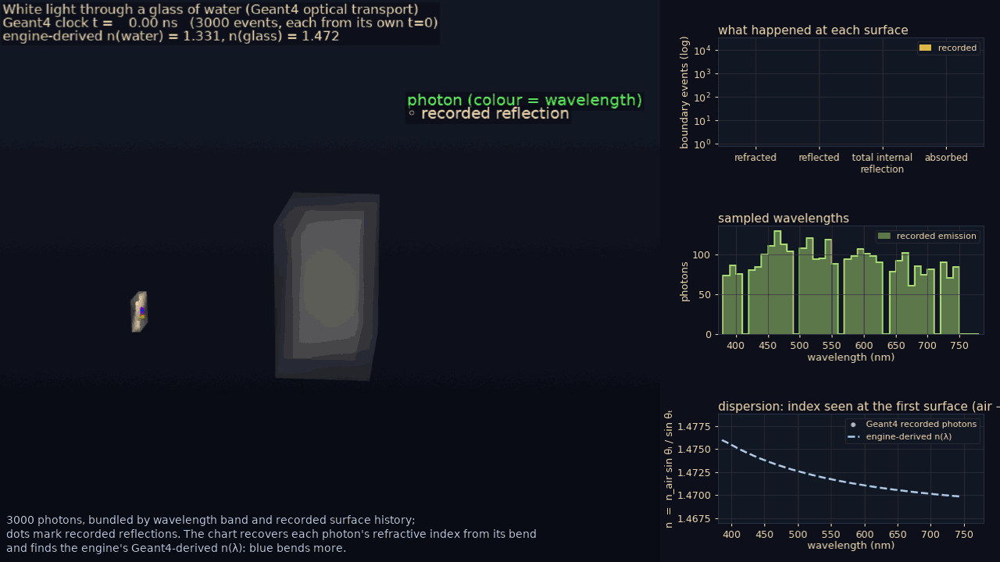
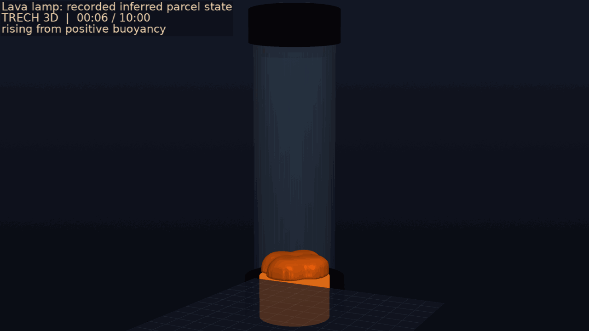
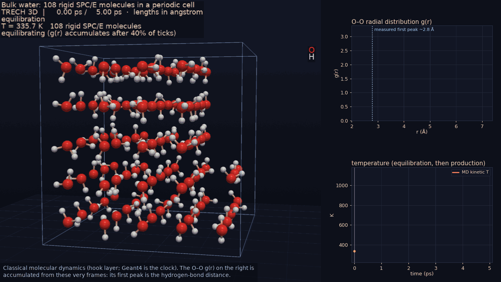
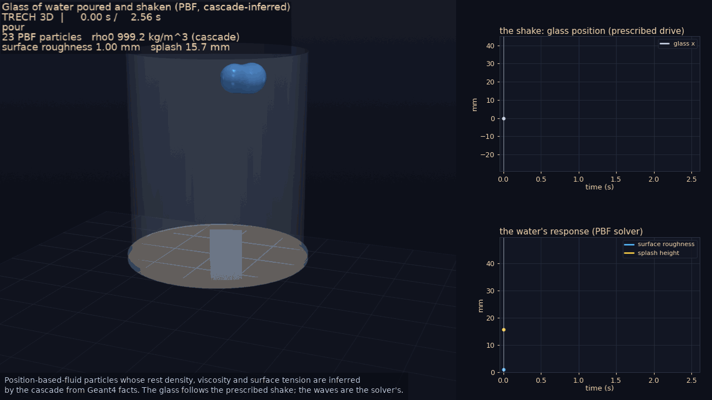
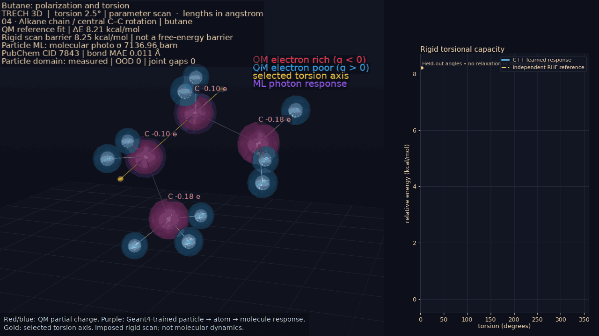
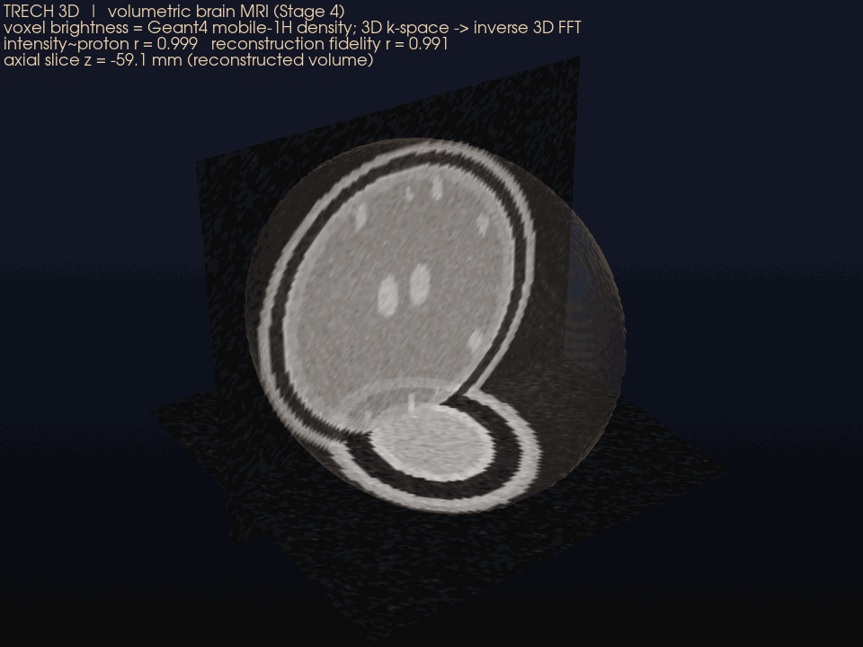
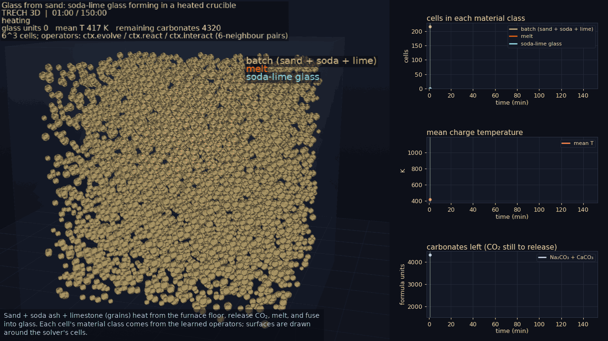
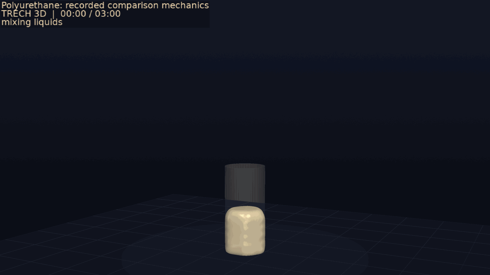
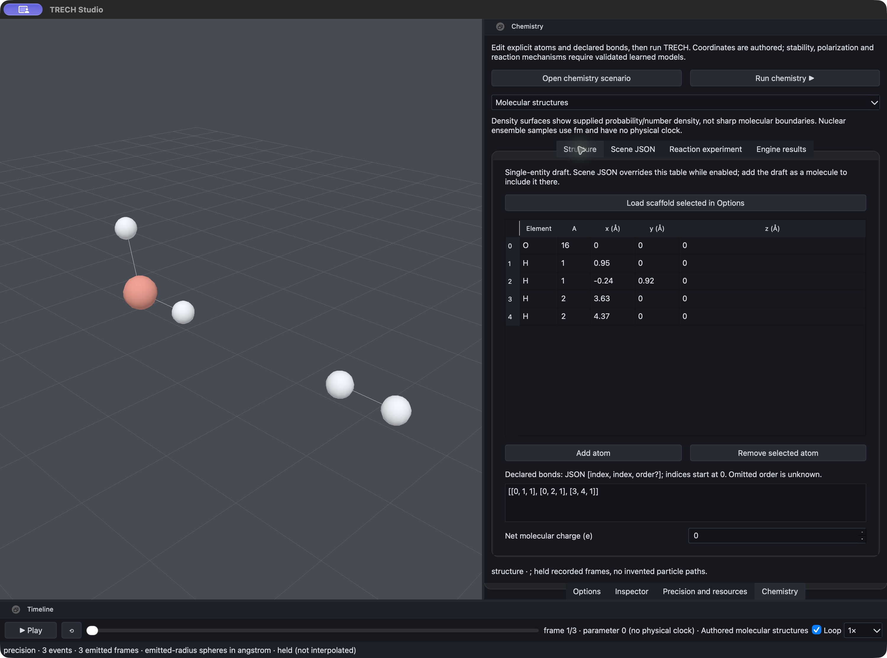
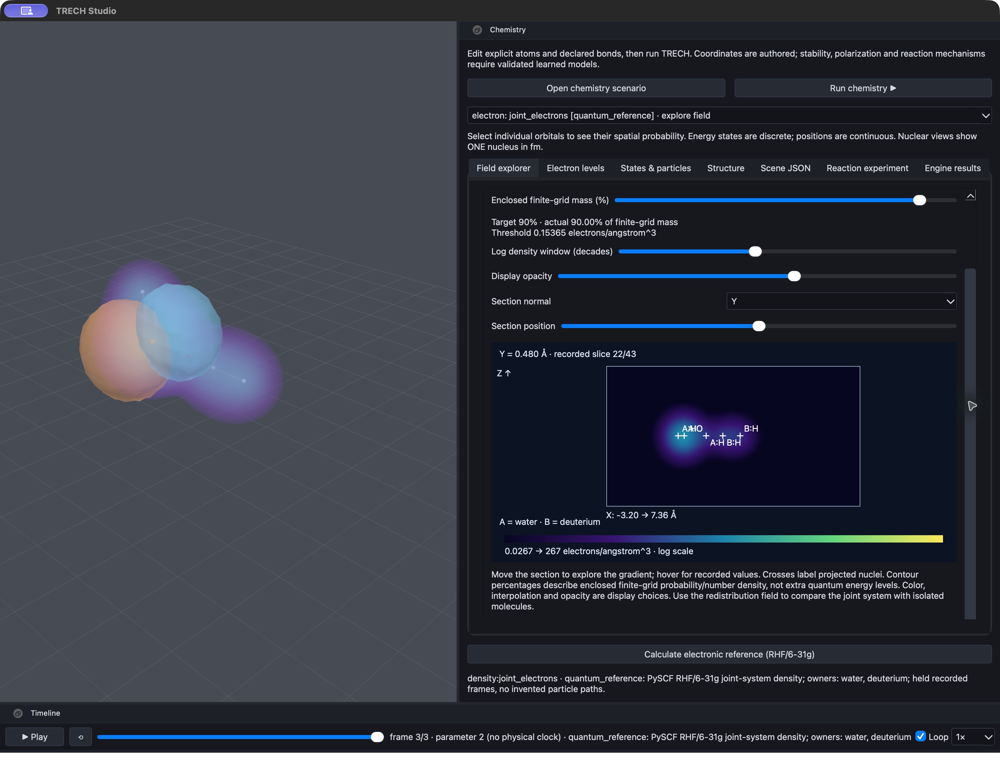

# TRECH

TRECH is a **C++ simulation and learning toolkit** for connecting particle interactions
to effects you can observe, from light bending in water to heated wax circulating in a
lava lamp. Describe an experiment in JavaScript, run it with the TRECH engine and watch
the recorded result in [TRECH Studio](studio/README.md).

[Quick start](#quick-start) · [Featured experiments](#featured-experiments) · [Studio previews](#trech-studio) · [Documentation](docs/README.md)



*White light through glass and water.* Geant4 transports photons using wavelength-dependent
optical properties derived by TRECH. In a planar version of the experiment, the validation
recovers refractive indices from the recorded tracks using Snell’s law.
[Spectral scenario](examples/scenarios/glass_of_water_spectral/glass_of_water_spectral.js) ·
[Optics benchmark](docs/validation/validation_glass_of_water.md)

## How TRECH models an experiment

A **system** is the apparatus and its conditions. For a lava lamp that means the vessel,
carrier liquid, wax and heater. Its **state** holds what can change, such as wax positions
or temperatures. A **field** describes how a quantity varies across space. The lamp’s
carrier temperature can be represented as one average temperature per horizontal layer.
An **observable** is something you ask the run to report, such as how far the wax rises or
how the temperature profile changes over time. [Core concepts](docs/concepts.md)

**Geant4 supplies the particle-scale base.** TRECH builds the declared geometry and
materials, then records what Geant4 samples, including tracks, energy deposits and
secondaries. TRECH can also query material facts such as number densities and
interaction cross sections. The C++ host exposes selected values to JavaScript hooks
and to inference. [How a run works](docs/architecture/runtime.md)

**The multi-scale cascade connects models through their named inputs and outputs.**
Each stage reads available facts and can supply new quantities to a later stage.
The engine can skip intermediate scales and route cells to different laws as their
conditions change. In one experimental benchmark, the cascade starts with elemental photon
interactions, estimates a molecular response, then predicts how much radiation
crosses a sample or deposits energy in it. Those predictions are checked against
independent Geant4 runs. Offline training can use PyTorch, and the engine can evaluate
portable model files or run TorchScript through LibTorch.
[Multi-scale inference](docs/inference/multiscale.md) ·
[Particle-to-observer benchmark](docs/inference/particle_observer.md) ·
[Model training and deployment](docs/inference/libtorch.md)

Strict mode is the default and disables model inference. Predictive mode enables
configured models and records their use. TRECH records run inputs, seeds, model
identities and results so you can tell whether a quantity came from Geant4 transport,
a learned prediction or a comparison solver.
[How to read the evidence](docs/validation/README.md)

## Featured experiments

### Fluids and heat · Lava lamp

Watch wax rise as it heats and settle as it cools. Geant4 material probes help seed
the cascade, and the inferred parameters drive a reduced thermofluid model that
advances the wax parcels. A separate `ctx.evolveField` validation compares candidate
methods for the carrier’s temperature field against the scenario’s own temperature
profile. The animation replays the parcel model.



[Lava-lamp scenario](examples/scenarios/lava_lamp/lava_lamp.js) ·
[Field evolution walkthrough](docs/engine/field_evolution.md) ·
[More fluid experiments](docs/scenarios/catalog.md#water-and-fluids)

### Bulk water · Molecular motion and diffusion

A periodic box of 108 rigid SPC/E water molecules evolves under a molecular-dynamics
comparison solver. The run accumulates an oxygen–oxygen radial distribution to show
how the liquid is structured and estimates self-diffusion from molecular motion.
Geant4 events pace the hook-layer updates.



[`h2o_bulk_water`](examples/scenarios/h2o_bulk_water/h2o_bulk_water.js) ·
[Studio replay](studio/previews/h2o_bulk_water.gif) ·
[Water structure and diffusion](docs/research/foundations.md#molecular-dynamics-and-water)

### Shaken glass of water · From molecular data to sloshing

The scenario pours water and prescribes how the glass moves. A particle-fluid solver
produces waves and splashes using parameters supplied by the cascade. Molecular-dynamics
data ground the density estimate, while the cohesion and viscosity maps are illustrative.
The viewer reconstructs the water surface from recorded particle positions. The
charts show the prescribed glass motion and the solver’s splash height.



[`glass_of_water_shaken`](examples/scenarios/glass_of_water_shaken/glass_of_water_shaken.js) ·
[Studio replay](studio/previews/glass_of_water_shaken.gif)

### Molecular behaviour · Butane torsion

Rotate butane about its central carbon–carbon bond and follow the change in predicted
energy and partial charges. A fit to an independent quantum calculation supplies
that response. The chart compares predicted energies with reference values at held-out
angles. The purple halos show a separate Geant4-trained photon-interaction prediction.
Each frame shows a prescribed rotation angle.



[`molecular_04_butane` scenario](examples/scenarios/molecular_04_butane/molecular_04_butane.js) ·
[Molecular series and quantum reference](docs/scenarios/molecular_series.md) ·
[Geant4-trained molecular response](docs/inference/particle_molecule.md)

### Magnetic resonance · Simulated brain scan

The experiment builds a simplified digital brain phantom. Geant4 supplies hydrogen
number densities for the modeled tissue materials, which set the relative signal
strength. The MRI driver simulates acquisition in k-space and reconstructs the
3D volume with an inverse Fourier transform. The replay sweeps through axial slices
of the reconstructed phantom.



[Brain phantom scenario](examples/scenarios/testscenario_magnetic_resonance_brain/testscenario_magnetic_resonance_brain.js) ·
[MRI acquisition and reconstruction driver](scripts/run_magnetic_resonance_brain.py) ·
[Magnetic-resonance examples](docs/scenarios/catalog.md#magnetic-resonance)

### Materials and chemistry · Glass from sand

A furnace model heats a batch of sand, soda ash and limestone. Learned operators
advance heating and reactions, and neighbouring cells exchange heat. The
validation checks atom conservation and compares the learned operators with the
reference model they were trained to reproduce. The viewer draws surfaces around the
recorded batch, melt and glass cells.



[Furnace scenario](examples/scenarios/glass_from_sand/glass_from_sand.js) ·
[Studio replay](studio/previews/glass_from_sand.gif) ·
[Furnace model validation and held-out deployment](docs/inference/multiscale_domain_study.md#glass-furnace-campaign-learn-freeze-deploy-at-held-out-temperatures)

### Polyurethane foam · Expansion and curing

A reduced foaming model follows a mixture as it expands and cures. Geant4 material
facts seed the cascade, and a learned reaction operator advances the parcel chemistry.
The bonded-parcel mechanics model accounts for leaning, cracking and shedding under
gravity. The validation compares the learned reaction response with its model teacher
and checks how the foam behaves with gravity removed.



[`polyurethane_foam`](examples/scenarios/polyurethane_foam/polyurethane_foam.js) ·
[Studio replay](studio/previews/polyurethane_foam.gif) ·
[Scenario and validation context](docs/scenarios/catalog.md#chemistry-and-materials)

## TRECH Studio

Studio lets you replay recorded runs, inspect their data and edit scenario inputs.
The Chemistry workspace captures below show the structure editor for water and
deuterium and the Field Explorer displaying an independent quantum density reference.

| Structure editor | Field Explorer |
| --- | --- |
|  |  |

[Install Studio](studio/README.md#install--run) ·
[Studio playback previews](studio/previews/README.md) ·
[Chemistry screenshot provenance](docs/media/images/studio-chemistry/README.md)

## Quick start

With a built TRECH binary, run the small electron-in-water experiment from the repository root.

```sh
./build/dev/trech run examples/scenarios/hello_world/hello_world.js --output build/dev/out_hello
```

[Build TRECH](docs/build.md) · [Inspect the experiment and read its results](docs/first_run.md) ·
[Open a run in Studio](studio/README.md)

## Explore further

- [Scenario catalog](docs/scenarios/catalog.md) and [preview gallery](docs/previews.md) for more experiments.
- [Scenario authoring](docs/scenarios/authoring.md), [hook API](docs/engine/scenario_hooks.md) and [output schema](docs/engine/output_schema.md) for building and inspecting runs.
- [Scientific and mathematical foundations](docs/research/foundations.md) for the equations, models and checks behind the examples.

[Documentation home](docs/README.md) · [Project roadmap](ROADMAP.md) · [Contributor handbook](AGENTS.md) · [License](LICENSE)
