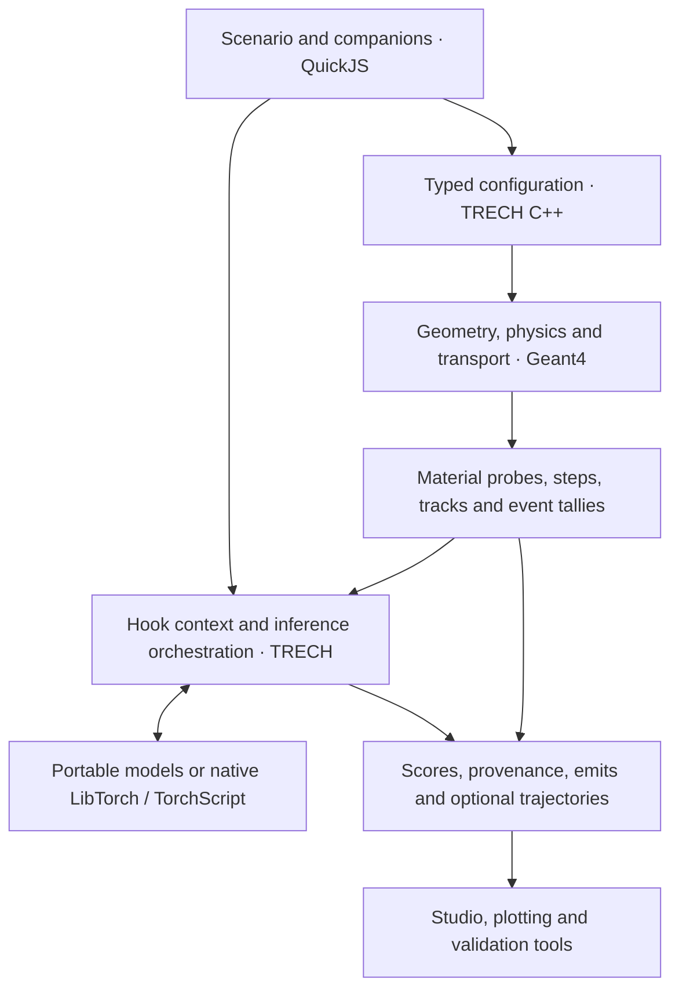

# How a TRECH run works

[Documentation home](../README.md) · [Core concepts](../concepts.md) · [Multi-scale inference →](../inference/multiscale.md)

Geant4 and LibTorch answer different questions inside the C++ application. Geant4
samples particle histories in configured matter. TRECH hosts Geant4, defines how those
histories are observed and decides how to pass suitable facts into inference. LibTorch is
a numerical backend for some model execution and fitting. The scenario and artifact
contracts give model features their physical meaning.

## Before transport

1. The CLI evaluates JavaScript and its includes in QuickJS. `TRECH_CONFIG` produces
   JSON, and callbacks registered in `TRECH_HOOKS` stay in the host. `trech inspect`
   evaluates authoring and typed inputs without creating a Geant4 kernel.
2. TRECH parses and normalizes the authored config into C++ `TrechConfig`, applies
   run options and any permitted `onInit` override, and records the effective config.
3. TRECH registers detector construction, a reference physics list (QBBC by default)
   and user actions with the Geant4 run manager. Detector construction creates materials,
   solids and placements. Geant4 initializes navigation and physics tables. TRECH
   can then query material and interaction data to populate optional probes.
4. The run manager starts the events with `BeamOn` for a normal batch run. Compatible
   [live lab commands](../engine/cli.md#live-lab) can reuse the initialized kernel.

[Config and hook boundaries](../engine/scenario_hooks.md) ·
[`GeantRunner.cpp`](../../src/sim/GeantRunner.cpp) ·
[Geant4's application lifecycle](https://geant4.web.cern.ch/documentation/dev/bfad_html/ForApplicationDevelopers/GettingStarted/mainProgram.html)

## During the run

| Level | What Geant4 supplies | What TRECH can do with it |
| --- | --- | --- |
| Step | A particle's movement, its pre/post state, deposited energy and process information | Aggregate lengths, deposits and secondaries, attribute them to volumes and expose bounded `onStep` callbacks |
| Track | One particle's history from creation to termination | Dispatch `onTrackStart` / `onTrackEnd` and optionally record trajectory samples |
| Event | The primaries and all tracks descended from them | Summarize deposits and multiplicities, classify the event and expose `ctx.event` at hook boundaries |
| Run | An ensemble of events under a configured kernel | Reduce tallies into scores, record provenance and expose run callbacks |

The host copies selected facts into the JavaScript context. A hook sees documented
values and helpers (`ctx.event`, `ctx.materials` when enabled, `ctx.state`, `ctx.rng` and
`ctx.emit`). It has no direct access to Geant4 kernel objects. In predictive mode an
inference call can also merge ambient facts into its named input map. Caller-provided
overrides apply to that call. [Context and operations](../engine/scenario_hooks.md#context-object) ·
[Geant4 physics process model](https://geant4.web.cern.ch/documentation/dev/bfad_html/ForApplicationDevelopers/TrackingAndPhysics/physicsProcess.html)

Can inference affect what Geant4 transports?

Most hook inference predicts quantities for a scenario's own state or observers.
TRECH also has an explicit predictive optics path. When a configured optics surrogate
is accepted, TRECH can put the inferred refractive index into a material's Geant4
optical properties before transport. Geant4 then samples the tracks using those
properties. The tracks are Geant4 transport and the optical input has learned provenance.
Strict mode disables the surrogate and can retain the independent optics extractor.
[Optics validation](../validation/validation_optics_surrogate.md) ·
[Model artifact manifest](../engine/output_schema.md#scenario-model-artifact-manifest)

## After the run

Use `trech_scores.jsonl` for aggregates, `trech_provenance.jsonl` for reproduction
details and `trech_hook_emits.jsonl` for optional scenario records. Separate outputs
may include event features, trajectories and re-simulation candidates. Studio can launch
the engine, replay the recorded tracks and frames, and export supported configuration
drafts. View controls work on the representation of the recorded data.
[All output contracts](../engine/output_schema.md) · [Studio guide](../studio/README.md)

Where does training fit?

Offline training can harvest Geant4 run outputs and separate them into fitting,
selection and held-out runs. Model checkpoints enter a later run through named config
entries and their declared feature schema. Some engine components also fit online,
for example response-domain learners. See
[how TRECH uses LibTorch](../inference/libtorch.md) and the
[particle-to-observer example](../inference/particle_observer.md).

Compare [strict and predictive usage](../engine/cli.md#strict-and-predictive-runs),
open the [Geant4 capability map](../engine/GEANT4_features_and_limits.md), or drill
into the [full engine dataflow diagrams](../../CHARTS.md).
