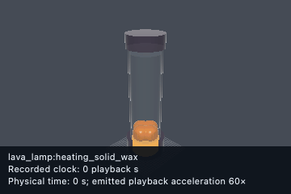
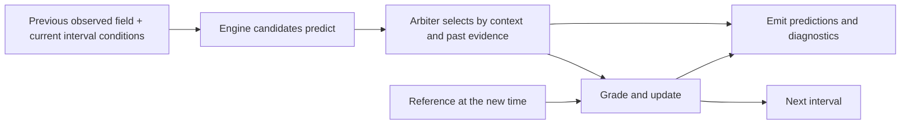

# Fields and field evolution

[Documentation home](../README.md) · [Engine index](README.md) · [What is a field?](../concepts.md#field) · [Scientific foundations →](../research/foundations.md#continuum-fields-and-lattices)

`ctx.evolveField(spec)` asks the engine to advance a named scalar field to a supplied
physical time. A field here is a value for each spatial cell, for example temperature in kelvin.
The method may represent the same region internally at a different resolution and
map its results back to those cells. This API runs in predictive mode. Current calls
come from validation companions observing the lava lamp and the glass furnace.

## Walk through a lava-lamp frame



The replay shows the lamp’s parcel state. The validation compares carrier temperatures in a
separate output stream.

1. On frame zero the [lamp's validation companion](../../examples/scenarios/lava_lamp/lava_lamp.validation.js)
   supplies a cylinder and the bounding boxes of its horizontal slabs, plus the
   initial temperature of each slab. Transport properties include diffusivity and,
   for the flow candidate, viscosity. The companion uses the same field `name` on
   later calls so the engine can retain its state.
2. At each output time the companion supplies the heater and cooler exchanges,
   the wax heat load, and the carrier-column temperatures as the grading reference.
   The field's `time_s` is the scenario's physical time. Several internal lattice
   steps can fit between two calls.
3. The engine's registry creates candidates that can represent the field. Each
   predicts separately, then a shared arbiter chooses per cell from available
   predictions. Reference values arriving on the call are used to score those
   predictions and update the state for the next interval.
4. The companion writes `field_evolution` records. `field` contains the arbitrated
   values, `selection` identifies choices and `methods` reports each candidate. The
   final summary compares their shared coverage, errors and policy choices.



| Candidate | How it proposes the next field |
| --- | --- |
| `persistence` | Carries the previous state forward as a baseline. |
| `lattice_conductive` | Uses a D3Q7 scalar lattice for diffusion and exchanges. |
| `lattice_convective` | Couples D3Q19 flow and D3Q7 scalar transport with buoyancy. |
| `learned_operator` | Learns cell increments from earlier transitions. It can abstain when a cell's context is outside its support. |

<details>
<summary>Run a short lamp case and inspect its field output</summary>

```sh
./build/rel/trech run examples/scenarios/lava_lamp/lava_lamp.js \
  --strict-config --param duration_s=30 --param simulation_ticks=10 \
  --output build/rel/out_lamp_field
```

In `trech_hook_emits.jsonl`, look for `tag: "field_evolution"`. Read the initial
`payload.field`, then pick one cell and compare its later values in `payload.methods`
with the chosen method in `payload.selection`. Read the final `payload.summary` to
compare candidate coverage. The short run illustrates the output format. The longer
[recorded study](../../AGENTS/engine/lattice/AGENTS.md#recorded-arbitration-on-the-lava-lamp-default-600-s-2026-11-19)
contains the phase-by-phase results and the compute budget.

</details>

## How selection uses evidence

The comparison is **prequential**. Predict from the evidence accumulated so far, score
against the new reference, then update. One learner per candidate estimates local log
error. The arbiter also tracks a recent global leader and uses the more detailed
per-context policy when its past results justify it. Before evidence separates methods,
the lower median of distinct predictions is used. Candidate failures and abstentions
are recorded. Compare candidates on common cells as well as checking how many cells
each covers. The oracle score uses the best prediction after seeing the answer and
serves as a diagnostic.

<details>
<summary>What changes when there is no reference?</summary>

The selected field becomes the engine's next internal state. A coarser twin can supply
a self-consistency comparison for convection, which measures sensitivity between
discretizations. Scoring against an external reference instead measures agreement with
that reference. To compare across runs, a caller can export learned state and restore
it frozen. The numerical lattices start again from declared field values.
[Warm start and frozen contract](scenario_hooks.md#engine-field-evolution)

</details>

<details>
<summary>Does the lamp or furnace run on the returned field?</summary>

Both companions emit `feeds_back: false`. The lamp grades against its authored carrier
column, and the furnace grades against temperatures produced by its normal operators.
The results show one-step agreement with those teachers. The validation companion's
returned field stays outside the scenario state. Automatic discovery of fields from
a declared physical system is tracked in the
[field roadmap](../../AGENTS/engine/lattice/ROADMAP.md#priority-queue).

</details>

[Input and return schema](scenario_hooks.md#engine-field-evolution) ·
[Emit fields](output_schema.md#engine-field-evolution-emits) ·
[FieldEvolution source](../../src/ml/FieldEvolution.cpp) ·
[Candidate registry](../../src/ml/FieldMethods.cpp) ·
[Numerical verification tests](../../tests/test_lattice_continuum.cpp)
