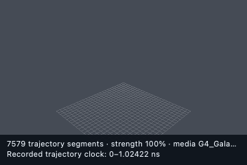

# Your first TRECH run

[Documentation home](README.md) · [Build](build.md) · [Core concepts →](concepts.md)

In [`hello_world.js`](../examples/scenarios/hello_world/hello_world.js), the system is a
100 mm water world with a 1 MeV electron source. The authored run requests ten events
with seed 12345. Ask what energy the source deposits in water, then trace the answer
back to the inputs.

## Inspect the input

From the repository root, use `inspect` to evaluate the JavaScript configuration and
see any typed parameters without starting a Geant4 run.

```sh
./build/dev/trech inspect examples/scenarios/hello_world/hello_world.js --strict-config
```

<details>
<summary>Find the world, source and seed</summary>

Read `config.environment.worldSizeMm` and `config.environment.worldMaterial`, then `config.beam`
and `config.run`. The inspection shows the evaluated authoring keys. When you run it,
TRECH serializes the apparatus block as `detector` in provenance's canonical config.

</details>

## Run it and read the answer

Use a fresh output directory for each comparison. Scores and provenance are
JSON Lines, with one JSON object per line.

```sh
./build/dev/trech run examples/scenarios/hello_world/hello_world.js \
  --strict-config --output build/dev/out_hello
```

Open `build/dev/out_hello/trech_scores.jsonl` and find the `run_end` record. Read
`n_events`, `total_edep_mev` and `system_event_edep_mean_mev`. Use
`trech_provenance.jsonl` to find the canonical config, its hash, the seed, the
runtime versions and `determinism_mode`. For field names and optional files, see the
[output schema](engine/output_schema.md).

<details>
<summary>What was measured here?</summary>

Geant4 sampled electron transport and any secondary tracks under the configured
particle physics. The total deposit sums energy deposited during the run. The event
mean answers the same question per primary history for this single-primary source.
Repeated histories estimate a distribution of outcomes. The
[transport and uncertainty guide](research/foundations.md#particle-transport-and-monte-carlo)
explains why the mean and the spread answer different questions.

</details>

## Compare two run sizes

Repeat the run with `--events 100 --output build/dev/out_hello_100`. In the example run,
the deposited energy per event is 1 MeV and the standard error is zero. The larger sample
raises the total deposit while the mean stays the same. Add `--viz-all` to capture the
electron tracks and [open the output in Studio](../studio/README.md).

<details>
<summary>Try an observable that varies from event to event</summary>



```sh
./build/dev/trech run examples/scenarios/analytic_beer_lambert/analytic_beer_lambert.js \
  --events 100 --output build/dev/out_attenuation
```

In the scores, read `primaries_uncollided_fraction` and compare it with
`analytic_checks[0].classical_predicted`. Each incident photon contributes a binary
outcome. A small run can differ from the analytic value through sampling alone.
The [transport guide](research/foundations.md#particle-transport-and-monte-carlo)
shows how to estimate that sampling error.

</details>

Next, [follow the handoffs through the runtime](architecture/runtime.md), or pick a
[scenario with a different observable](scenarios/catalog.md).
