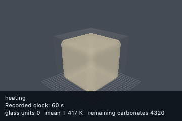
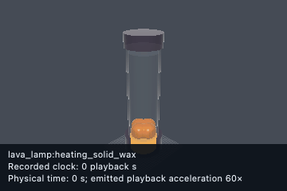
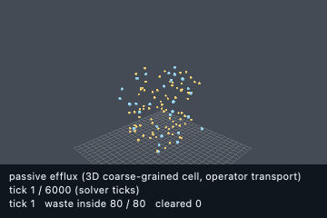
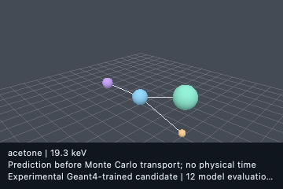

# Statistical domains and multi-scale prediction

[Inference index](README.md) · [Runtime routing overview](multiscale.md#follow-changing-domains-within-a-level) · [Model execution and fitting](libtorch.md)

TRECH analyzes the feature distribution of a population, measures candidate subdivisions, and
can fit separate response models to recurring populations. The live detector is an opt-in
diagnostic. The specialist trainer freezes membership and support at fit time, chooses experts
using whole selection runs, and measures the frozen checkpoint on whole test runs. Runtime
dispatch uses the module's frozen decision rules and the current inputs.

## Live subdivision and lineage

The projected-gap detector checks feature axes, LibTorch principal components and pairwise
diagonals. The density detector uses a symmetric local distance graph when components overlap
in projection. It recovered both rings in a concentric-ring regression. In the lava lamp,
per-axis standardization stretched the geometry and failed to recover the known initial droplets.
The lamp now uses a shared spatial scale for its x, y and z coordinates.

| Lamp run | Frames | Parcel assignments | Frames with a subdivision | Initial four droplets | Group count agreed with separate spatial count |
| --- | ---: | ---: | ---: | --- | ---: |
| Nominal 600 s | 121 | 29,040 | 109 | Recovered | 82 / 121 |
| 310 K heater, 60 s | 13 | 3,120 | 6 | Recovered | 12 / 13 |
| High precision, 60 s | 13 | 6,240 | 8 | Recovered | 11 / 13 |

NumPy reproduced all 38,400 assignments and every lineage record. Each pair of runs produced
byte-identical ordinary hook output. The 13 refined-frame diagnostic records also matched
between Debug and Release. The nominal lamp recorded 375 domain ID continuations,
20 groups with multiple predecessors and 18 predecessor IDs with multiple destinations. These
are topology diagnostics of a reduced thermofluid simulation. The initial droplets are an
authored check. The separate spatial count uses a fixed connection radius, so agreement
measures consistency between two definitions of connectedness.

Enable the graph with `--param detect_domains=true --param 'domain_method="density"'`.
The [hook contract](../engine/scenario_hooks.md#ctxdetectdomains) describes its limits, and
[the emit schema](../engine/output_schema.md#statistical-domain-discovery-emits) describes lineage.

## Online response-domain learning

`ctx.learnDomains` (engine `DomainLearner`) finds domains where **one response law stops
explaining a population**, not where the feature distribution has a gap. It needs the response
the scenario's own operator produced: for `ctx.evolve` operators these are the pre-bound rates
from `report_rates`. Every prediction is made before the call's rows are learned and is graded
against a pooled single-domain law fed the same rows. The [hook contract](../engine/scenario_hooks.md)
describes the mechanism; the [emit schema](../engine/output_schema.md#response-domain-learning-emits)
describes the records.

### Unit-level evidence

`trech_domain_learner` checks behaviour on synthetic laws where the truth is known:

| Situation | Result |
| --- | --- |
| Three affine regimes on a uniform square (no feature gap) | 3 domains, membership purity 1.000, prequential RMSE 0.0034 vs pooled 0.94 |
| Frozen replay on 300 new rows | RMSE 0.0039, 0 rows off by more than 0.1; identical with or without targets |
| One quadratic law with noise | stays 1 domain |
| Every regime switches to one law at call 25 | merges fire, prequential RMSE recovers to 8 × 10⁻⁴ |
| Steady coefficient drift, with vs without the tendency predictor | RMSE 0.201 → 0.163 (−19%) on identical data |
| Curved law, one domain, online LibTorch residual network | selected; RMSE 0.0052 vs 0.50 for the affine pooled law |
| Two 3,000-row blobs, block-wise density discovery | two groups, 9 rim rows residual |

The NumPy twin ([`domain_learner.py`](../../tools/torch/trech_torch/domain_learner.py)) reproduces
routing and predictions of a 12-domain state with residual networks on 400 rows (229 extrapolated)
to 6.7 × 10⁻¹⁶ (`trech_domain_learner_numpy`).

### What live scenarios exposed and fixed

- **Clamped targets.** Learning `(after − before)/dt` of a bounded state taught the clamp. Cold
  batch cells have a negative melt rate bounded at zero, so the learned law had no restoring term.
  Deployed at 1560 K it melted cold cells in closed loop: per-step shadow RMSE 16 K and 0.84 melt
  fraction, with no glass formed, although engine and NumPy agreed to 7 × 10⁻¹⁶. `ctx.evolve`
  `report_rates` now exposes the operator's rates, and the furnace learns those.
- **Frozen grading leaked.** A frozen learner given targets still updated its predictor choice
  and bias trends. The lamp's held-out parity check failed (0.83 relative). Frozen learners now
  grade without changing anything that drives a prediction.
- **Extrapolation.** Young domains fitted on narrow ranges extrapolated badly (one lamp call at
  754σ). Linear extrapolation is bounded to two spans, curvature to the envelope and outputs to the
  observed range; extrapolated rows start on the pooled law and leave it only with strong evidence;
  rows far outside an envelope return to the pooled law.
- **Joint extrapolation.** At held-out 1560 K a catch-all domain held glass cells inside its
  per-feature box but in a contact-versus-cell-temperature region no training run visited; its
  quadratic law, exact in-sample (RMSE 5 × 10⁻⁵ K/s), was off by about 0.5 K/s there. Domains now
  carry farthest-point support centres; leaving the joint support counts as extrapolation and
  remote rows fall back to the pooled law. Residual networks may move a law by at most three of
  its residual standard deviations, and offline specialists are refused for laws that are
  already exact (one had been accepted for a 4 × 10⁻¹¹ → 3 × 10⁻¹¹ holdout change).
- **Context.** The lamp's frame-scale law depends on the heater temperature, a run constant. Without
  it the frozen domains could not condition on the operating point; it is now a feature. Within a
  domain it is constant, so remoteness is measured against the pooled law's scale.
- **Numerical residue.** Splits once chased ridge bias in near-collinear quadratic bases. A split
  must now remove at least 10⁻⁶ of the target variance as well as 5% of the cross-validated error.
- **Cost.** Refitting every domain every call made the 6,000-call efflux run take over 30 minutes.
  Refits now follow buffer turnover, and residual networks train when an eighth of the buffer is
  new. A cold furnace learn run fell from 150 s to 34 s.
- **Warm-start serialisation.** The binding converted `options` to JSON on every call, so a
  warm-started learner re-serialised its whole stored state (35 MB with reservoir rows for
  efflux) every call. The second efflux training run spent three hours in QuickJS
  `JSON.stringify`. Options are now read only when the learner is created; later calls check
  the type only.

### Glass furnace, cold start



One default run at 1750 K (`learn_domains=learn`, 600 learner calls over 216 cells). The host
budget gave a quadratic basis, up to 24 domains of 3,755 reservoir rows and 32-wide residual
networks. The furnace output is byte-identical to the declared run, and the learner took 23 s of
the 32 s run. After the first tenth of calls, the prequential RMSE was 0.0021 per second for the
melt rate (pooled 0.0075, −72%) and 0.0126 K/s for the heating rate (pooled 0.0268, −53%). Over
the whole run, including the start-up while every domain is young, the gains are 50% and 3%. The
17 learned domains agree with the furnace's three material classes, which the learner never
reads: purity 0.995, adjusted Rand index 0.82. The ±1.96σ prediction interval covered 99.4% of
graded rows: conservative, not calibrated.

### Glass furnace campaign: learn, freeze, deploy at held-out temperatures

[`study_domain_learning.py`](../../tools/torch/study_domain_learning.py) ran five whole training runs
(1500, 1600, 1700, 1750 and 1880 K). Each warm-starts from the previous state and its reservoir
rows. Each run took about 25 s of learner time. Steady-state prequential RMSE against the pooled
law fed the same rows:

| Training run | Melt rate (1/s), domains / pooled | Heating rate (K/s), domains / pooled | ARI vs unread classes |
| --- | ---: | ---: | ---: |
| 1500 K (cold start) | 0.00151 / 0.00455 | 0.00955 / 0.0230 | 0.77 |
| 1600 K | 0.00072 / 0.00499 | 0.00308 / 0.0179 | 0.96 |
| 1700 K | 0.00257 / 0.00782 | 0.00893 / 0.0290 | 0.91 |
| 1750 K | 0.00293 / 0.00762 | 0.0107 / 0.0292 | 0.90 |
| 1880 K | 0.00423 / 0.0101 | 0.00934 / 0.0366 | 0.30 |

The one-pass frozen state had 15 domains and 44 lineage entries (superseded 2026-11-20; see the two-pass rebuild below). Capacity-sized offline residual networks
(width 64, 3,617 epochs) were refused for every domain: each law was already exact to 10⁻⁶ of its
target variance, or too small. The state is committed as
[`data/glass_furnace_domain_learner/thermal.json`](../../data/glass_furnace_domain_learner/thermal.json)
with its [build record](../../data/glass_furnace_domain_learner/thermal.build_record.json).

Two operating points were never used for learning. `evaluate` grades the frozen learner on the
declared trajectory. `deploy` lets it drive the thermal update in place of the three per-material
operators, while the declared operator runs on a copy as a shadow.

| Held-out | Evaluate RMSE melt / heating (pooled) | Deploy shadow RMSE per step | Glass units | Other created-product observables | Mean / max temperature gap |
| --- | --- | ---: | ---: | --- | ---: |
| 1560 K | 0.00291 / 0.0217 (0.00404 / 0.0262) | 0.31 K | 324 / 324 | cells, first tick, CO₂, carbonates identical; min fusion +4.6 K | +1.1 K / +1.9 K |
| 1820 K | 0.00633 / 0.0411 (0.00754 / 0.0400) | 0.96 K | 648 / 648 | cells, first tick identical; CO₂ 1.0%, carbonates 1.9% | −15.1 K / −7.1 K |

**Two-pass rebuild (2026-11-20, the committed state).** The one-pass learner above deployed
its melt-fraction rate on every cell, including glass, whose operator rates temperature only.
Once deploy drove a field only where the replaced operator rates it, its 1820 K run ended 16 K
warmer than the operators. Most of the bias, about +2 K per step on glass, came from a domain
that mixed batch and glass rows. Its earlier 1820 K result had passed only because the bad glass
melt rates offset it. The campaign was rerun with `--passes 2` over the same five training points
and the same pinned budget: 20 domains and 48 lineage entries, with no specialist accepted. Its
second-pass steady gains over the pooled law are 0.88–0.98 (melt) and 0.83–0.98 (heating).

| Held-out | Evaluate RMSE melt / heating (pooled) | Deploy shadow RMSE per step | Glass units | Other created-product observables | Mean / max temperature gap |
| --- | --- | ---: | ---: | --- | ---: |
| 1560 K | 0.00357 / 0.0231 (0.0053 / 0.0269) | 0.30 K | 324 / 324 | cells, CO₂, carbonates identical; first glass 6 ticks early (27 vs 33); min fusion +4.8 K | +0.16 K / +0.26 K |
| 1820 K | 0.00966 / 0.0356 (0.0111 / 0.0420) | 0.56 K | 648 / 648 | cells, first tick identical; CO₂ 0.07%, carbonates 0.14%; min fusion +1.9 K | +2.3 K / +3.7 K |

At 1820 K `glass_domain_learner_deploy_held_out_1820k` passes 10/10 in both groupings. At
1560 K the first glass now forms 6 ticks early, beyond the 3-tick operator tolerance, which no
suite case grades (queued). Build: `build/domain_learning/furnace_campaign_p2`, published with
`tools/torch/publish_domain_learner.py`. The record carries `passes: 2`.

The one-pass results follow. All furnace checks passed in both deployed runs. Engine and NumPy agree on 9,600 deployed rows to
2.2 × 10⁻¹⁶. The product observables meet the scenario's operator tolerances. The temperature
tolerances (2 K mean, 1 K maximum) were set for a distilled family accurate to 10⁻⁶. At 1560 K the
mean gap meets them and the maximum (1.9 K) does not; at 1820 K both exceed them. At 1820 K the steady heating-rate error is 23% worse than the pooled
law, although the closed-loop product is unchanged. The ±1.96σ intervals covered 86% (1560 K)
and 70% (1820 K) of held-out rows: the learner's uncertainty is not calibrated under transfer.
Validation cases `glass_domain_learning_unlabelled` and `glass_domain_learner_deploy_held_out_1820k`
gate what holds and report the temperature gaps.

### Lava lamp campaign



Frame-scale (meso) response of the wax parcels: heating rate and mean vertical velocity over one
5 s output interval. The heater temperature enters as run context. The three training heaters
were 325, 333.15 and 345 K, each a 600 s run. The step laws are authored and parcels interact,
so the response is noisy. Steady-state training gains against the pooled law ranged from −77% to
+10% for heating and from −19% to +20% for velocity. No offline specialist was accepted.

| Held-out heater | Heating (K/s), domains / pooled | Mean vertical velocity (mm/s), domains / pooled | Parity |
| --- | ---: | ---: | ---: |
| 318 K (below the training range) | 0.00868 / 0.00868 | 0.121 / 0.121 | 2.2 × 10⁻¹⁶ |
| 340 K (inside) | 0.0176 / 0.0224 | 0.275 / 0.244 | 1.2 × 10⁻¹⁵ |

At 318 K every parcel is remote from every domain's support, so the frozen learner defers entirely
to the pooled law. Before the joint-support rule, the same campaign was 11× worse than pooled
there. Inside the range, heating improves by 21% while vertical velocity worsens by 13%.
The lamp is a weak case for frozen domain laws.

### Membrane efflux campaign



This learner covers the particle transport operator, the micro-scale step of `testscenario_efflux`
with `physics_source="operator"`. It has 13 features: position, radius, velocity, mass, the
permeant and cleared flags, and the stochastic kick. It has six targets: the three
position-rate components before bounds (`report_rates`) and the three post-step velocity
components. The operating point is the run seed. Seeds 101 and 102 trained the learner with a
reservoir warm start; each was a 6,000-call run. Seed 201 was held out. The host budget probed
321 GFLOP/s on 8 threads, giving 24 domains, 5,023 buffer rows per domain, a linear basis, and
64-wide specialists trained for 3,585 epochs.

| Run | Position-rate gain vs pooled (x / y / z) | Velocity gain vs pooled (x / y / z) |
| --- | --- | --- |
| train 101, cold (steady) | 66% / 63% / 65% | 83% / 84% / 82% |
| train 102, warm (steady) | 71% / 72% / 73% | 86% / 87% / 85% |
| held-out 201, frozen domains (steady) | 77% / 75% / 73% | 87% / 88% / 85% |
| held-out 201, frozen + specialists (steady) | 78% / 76% / 74% | 89% / 91% / 88% |

Over all 6,000 held-out calls, the routed RMSE of `d_x_dt` was 0.0141 against the pooled law's
0.0655. For `set_rvx` it was 0.00218 against 0.0163. NumPy replay matched the engine to
4.4 × 10⁻¹⁶, or 6.4 × 10⁻¹⁶ with specialists. The PyTorch specialists were accepted for 23 of
24 domains on the temporal holdout; for example, domain 9's holdout MSE fell from 2.4 × 10⁻⁴ to
2.1 × 10⁻⁶. They still add little over the ridge laws when graded online. The ±1.96σ intervals
covered 99.4–99.7% of held-out rows, so they are conservative here, unlike the furnace transfer.
The learner reached its 24-domain capacity.

The agreement with particle fate (permeant / retained / cleared) has purity 0.988 and ARI 0.13.
That agreement is not independent evidence, because the permeant and cleared flags are input
features. The low ARI shows that the transport response subdivides each fate class: there are
16 permeant-dominated domains, while retained particles split across eight. A single fate label
is too coarse for the transport law.

Before the warm-start fix, the seed-102 run did not finish in three hours. With the fix, the
training runs took 341 s and 268 s, and each held-out evaluation took 240 s. Efflux has no
`deploy` mode yet, so these are prequential results on a declared trajectory, not closed-loop
results.

## Training and deploying specialists

`trech-train-domain-specialists` accepts independent TRECH runs through `--fit`,
`--selection` and `--test`. Supply `--inputs`, `--outputs` and a subset of inputs
in `--routing-features`. Copy `response.pt` with its hash-bound `response.pt.io.json`
when deploying the checkpoint. It accepts named inputs in a `models[]` declaration and can
run through point prediction or a cascade. Support checks use the measured per-expert bounds
and nearest training-region distance. A query with no accepted expert uses the pooled response.
The manifest records decisions, training data hashes, and errors per whole test run and expert.

Pass `--width auto --epochs auto` to size the networks from the engine's measured compute budget
(`trech budget`); the manifest records the budget. On the 2026-11-18 host (8 threads, about
300 GFLOP/s LibTorch double matmul) the first heuristic chose width 64 with 1,200 epochs and
under-trained two of three targets. The corrected heuristic scales epochs with the square root
of throughput (3,554 epochs). The retrained specialists reached held-out RMSE 0.0075
(photoelectric), 0.0064 (Compton) and 0.0135 (Rayleigh) on 384 rows, below both the
pooled network of that fit (0.0280, 0.0128, 0.0333) and the earlier fixed-size study below.

The atomic experiment used four fit panels, two selection panels, and two final panels. Each
panel sampled Geant4 photon-interaction tables at interleaved energies for H, C, N and O.
The trainer selected one hydrogen network and one shared carbon/nitrogen/oxygen network.
Both improved all three held-out outputs within their own domain on both panels.

| Log cross section | Pooled RMSE | Routed RMSE | Reduction |
| --- | ---: | ---: | ---: |
| Photoelectric | 0.04832 | 0.02118 | 56% |
| Compton | 0.02134 | 0.01089 | 49% |
| Rayleigh | 0.04331 | 0.01397 | 68% |

The comparison covers 384 held-out rows. The study measures interpolation over the four
element identities and uses Geant4's interaction tables as targets. In a separate native query
panel, both LibTorch and Python TorchScript produced identical results. The native run evaluated
24 H and 72 C/N/O expert queries and eight pooled queries beyond the fit range. Strict mode
recorded zero evaluations. The accepted experts differ from the pooled prediction on 96 rows.

For a negative control, the furnace supplied whole 1500, 1600, 1700, 1750, 1880 and 1890 K
fit runs, 1760 and 1860 K selection runs, and 1560 and 1820 K held-out runs. The projected
groups provided insufficient independent specialist support. The pooled affine model served all
5,211 held-out rows at RMSE 3.88 × 10⁻⁷ K/s against the thermal teacher.

At 1820 K, an independent comparison exposed when declared chemistry crossed its material
boundary with a stale class. The scenario now classifies after the thermal call. All eight
reported observer quantities then matched automatic routing. A 1,728-cell run exposed a second
problem. Rounding each ingredient separately limited local silica conversion to 75%. Distributing
whole stoichiometric batches preserves the exact initial inventory, and the high-precision
declared run now passes 11 checks and forms 547 glass cells.

The earlier learned domains covered formed glass at converted silica 0.9 only. Some refined
cells reach 1.0 and cool below the old glass temperature range. The old routed high-precision
run left 300,826 such thermal evaluations uncovered. Harvesting immediately before each operator
call and refitting on the five balanced runs plus three new high-precision runs restored measured
support. Whole-run holdouts at 1710 K and 1810 K reproduced all five reduced teacher operators to
RMSE below 4 × 10⁻¹⁴ in their output units. Two additional paired live runs at 1750 K and 1820 K
matched all eight observer values. Automatic routing agreed on 16,588,788 of 16,588,800 cell
evaluations, with the 12 disagreements at the batch-to-melt boundary. The refined checkpoints
are an opt-in study result through `operator_checkpoints`.

To reproduce the refit, emit training rows in three `precision_profile=high` furnace runs at
1680, 1770 and 1870 K, add the five balanced harvests described above (without 1890 K), and hold
out high-precision runs at 1710 K and 1810 K. Run
[study_glass_refinement.py](../../tools/torch/study_glass_refinement.py) with those
`--fit` and `--test` directories and a new `--out` directory. The tool publishes all five
models and their manifests together after adding measured routing domains.

Reproduce the table study from the repository root:

```bash
build/render-venv/bin/python tools/torch/study_atomic_domains.py \
  --binary build/dev/trech --out build/atomic_domain_study
```

## Particle-to-observer experiment



The photon study uses two learned chains on a bounded Geant4 reference. The existing
atomic and nano composition model supplies the dense observer. A separate `ctx.lift` branch
starts from trained atomic cross sections, groups atoms by elemental identity, evaluates a
nano set model for each group, and passes those group predictions into a meso set model.
The nano training labels come from fresh Geant4 element tables. Multiplication by areal density
accounts for units and material amount. Both meso models learn uncollided-photon and
deposited-energy fractions from independent Geant4 events. All predictions run before the
scenario starts transporting its photons.

The study exercises unit-density homogeneous CHNO composition proxies, 10–30 keV central
photons, and 0.25–9 mm centre-to-face paths. Fit, selection, calibration and final test use
disjoint composition inventories. Balanced blocks vary energy and path length continuously.
A separate coverage-targeted bank ranks feasible operating points by the frozen model's measured
coverage and adds separation within each material's requested experiments.

The study tools are [coverage sampling](../../tools/torch/study_particle_coverage.py),
[dense observer fitting](../../tools/torch/study_particle_observer.py),
[hierarchy fitting](../../tools/torch/study_particle_hierarchy.py), and
[native replay](../../tools/torch/replay_particle_study.py). The scenario takes explicit
`observer_model` and `lift_checkpoint` paths. For a hierarchy fitted with
`--atomic-model`, pass that same module through `lift_atomic_model`. One routed atomic query
per distinct element supplies the nano groups, and the meso set model consumes their predictions.
The native replay checks checkpoint digests, strict mode, group counts and Python parity. The existing
[observer contract](particle_observer.md) covers the default checkpoint.

### Final runs and validation

The balanced Geant4 campaign ran for 7,466 seconds and finished 17 blocks of 48 runs.
Each run transported 240,000 photons. The targeted, selection, calibration and final
test panels added 48, 40, 36 and 48 runs respectively. Together these panels transported
237.12 million photons. The fits used 1,056 conditions, including 192 additional grid
conditions at 24,576 photons per condition. The host used Geant4 11.4 patch 2, LibTorch
2.14.1, PyTorch 2.8.0 and NumPy 2.0.2.

The final test panel withheld the propylene glycol, alanine and heptane composition proxies
and their energy and geometry combinations. In each case the acceptance tolerance was the
larger of five Monte Carlo standard errors and 0.03 for uncollided fraction or 0.04 for
deposition fraction. Every model below passed 48/48 cases.

| Frozen path | Uncollided fraction RMSE | Deposited-energy fraction RMSE |
| --- | ---: | ---: |
| Committed dense observer | 0.005328 | 0.004845 |
| Fresh refit of original dense observer | 0.005143 | 0.004606 |
| TorchScript observer with cross section × areal density features | **0.001447** | **0.001975** |
| Recursive set models with the original atomic stage | 0.008035 | 0.007268 |
| Recursive set models with routed atomic specialists | 0.010277 | 0.008897 |

The selected TorchScript model reduced RMSE by 73% and 59% relative to the committed
observer. The coverage checks still flagged 29/48 per-feature gaps and 10/48 joint gaps,
down from 38/48 and 26/48. Fully supported queries rose from 3/48 to 12/48. The interval
fitted for nominal 90% coverage covered 43/48 uncollided and 40/48 deposition tests. The
hierarchies covered 27/48 uncollided tests and 35/48 (original atomic stage) or 29/48
(routed stage) deposition tests. These residual envelopes measure transfer across fixed
simulation panels. Broader calibration sampling remains open.

Each hierarchy evaluated all 144 nano groups and 48 meso groups. Nano R² across the three
interaction targets ranged from 0.99978 to 0.99991 with the original atomic stage and
0.99963 to 0.99987 with specialists. Native Debug and Release replay made 2,288 model
evaluations across the two paths, including 144 routed atomic evaluations. Strict replays
made zero. The dense model matched Python TorchScript exactly. The exported hierarchy
predictions agreed with NumPy within 8 × 10⁻¹⁶ in fraction units. The routed hierarchy
remains an experimental deployment path. Its higher end-to-end test error matters even
though the atomic specialists improved over their pooled neural baseline on the table task.

The balanced sweep indexed blocks 0–16. The targeted bank used block 0 with the 288-condition
pilot's manifest. Selection used blocks 0–4, calibration blocks 0–2 and testing blocks 0–3.
All used the same case generator and fixed seeds. To reproduce the final fit with the local
artifacts, supply the initial campaign's `split=train` rows plus the 17 `train_*.json` files
and `targeted_0000.json` to `--fit`. Supply the five selection files to `--selection`.
Use 28,000 epochs for the observer and 7,200 for each hierarchy. Run `--calibration`
on its own panel after freezing the model, followed by `--test` on the untouched cases.
Pass `--binary` to the hierarchy test to validate its nano groups with fresh table probes.
Pass the same atomic module to training, calibration, testing and native replay for the
routed variant.

These results cover bounded photon transport and the observed thermofluid and furnace
diagnostics. The study checkpoints remain opt-in. The inference roadmap tracks other observer
families, physical validation, uncovered composition ranges and calibration transfer.

### Regression checks

The full Debug scenario suite recorded 62 passes and three informational cases across 65
cases. The Release scenario rerun recorded 59 passes and three informational results.
The three slow MD/sloshing cases were covered by the full Debug run. The original photon
observer's 18-case panel also passed with the new TorchScript candidate, with fraction RMSE
0.001435 and 0.001971. The checked-out build holds the run-level JSONL, checkpoint manifests
and detailed grades in `build/multiscale_study_1118`.
