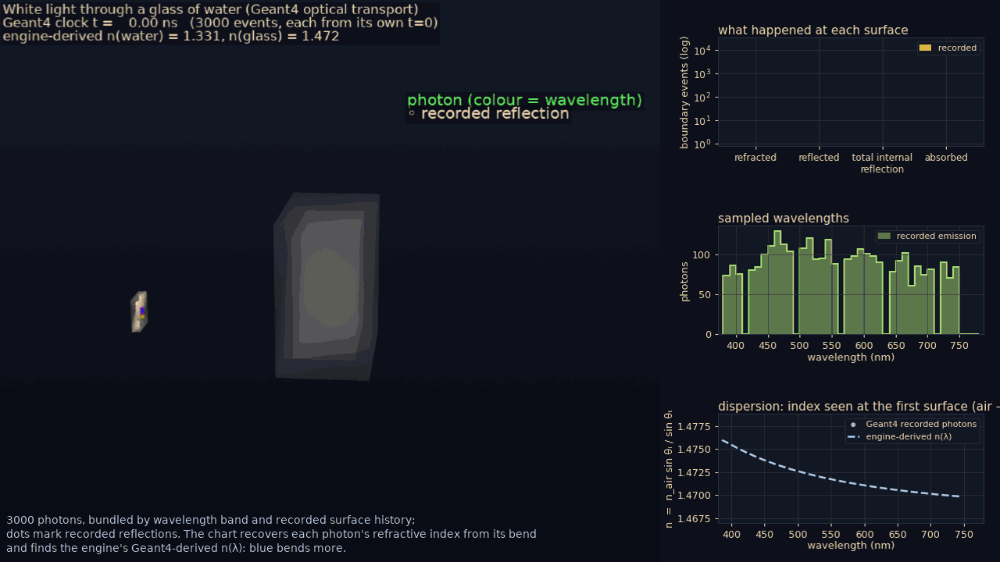
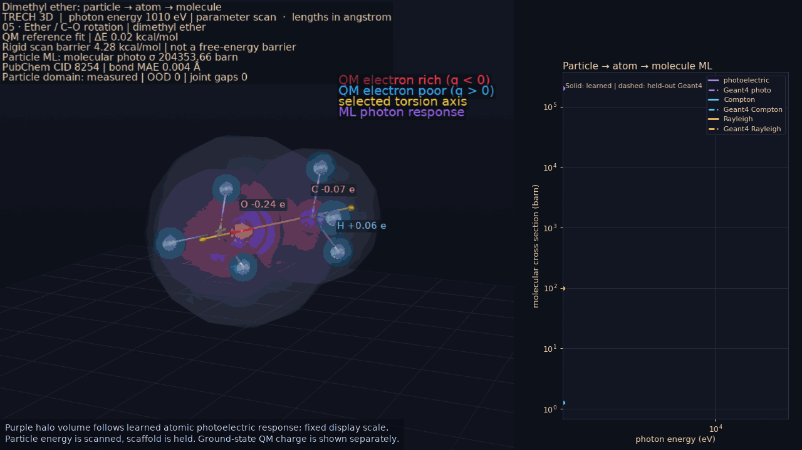
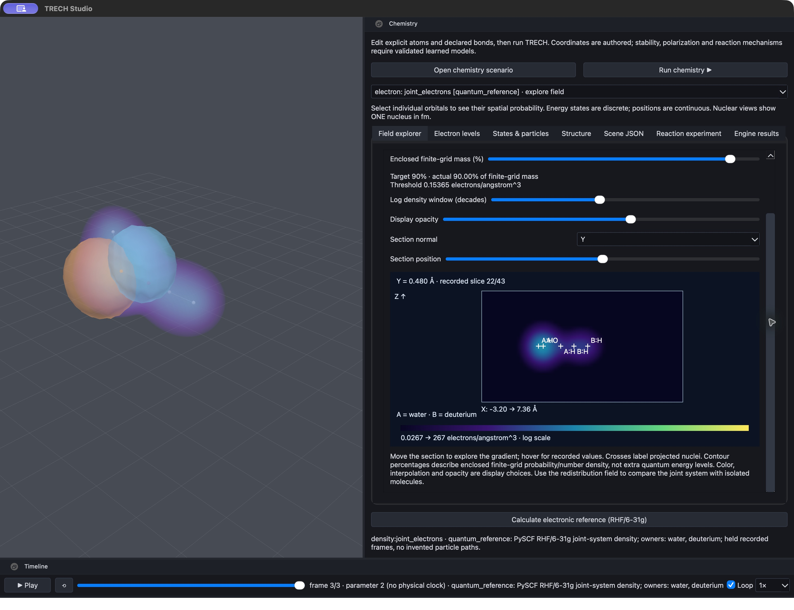

# TRECH — Investor presentation

Discussion draft · 4 November 2026 · 15 slides

## Slide 01 — TRECH: learning across the scales of matter

**A simulation and learning toolkit connecting Geant4 particle physics to predictions at the scale of an experiment.**

The ambition: learn behaviour through atomic → nano → micro → meso → macro stages, so an experiment can ask a large-scale question grounded in microscopic evidence.

**The funding proposal:** up to **€50,000 in AI development credits**, alongside separately funded engineers, physicists and scientific computing resources, to advance a bounded research release.

---

## Slide 02 — The opportunity: make complex simulations easier to build and trust

- A macroscopic question can depend on particle interactions, molecular structure, material response and collective motion.
- Connecting these scales requires specialised models, data, software and validation.
- TRECH aims to assemble those connections into a reusable, context-driven inference cascade.
- The potential value is faster exploration of experiments, with an auditable explanation of each prediction's evidence and limits.

**The investment thesis:** fund the engineering and scientific work needed to turn an executable foundation into a credible research tool.

---

## Slide 03 — The architecture and its scientific contract

**JavaScript experiment → C++/Geant4 transport → scale-tagged learned models → experiment-scale outputs → Studio inspection**

- Geant4 supplies particle transport, material information and interaction data within its supported physics.
- Learned stages pass named outputs to the next scale; the long-term goal is automatic selection from context.
- Runs record configurations, seeds, model identities and inference counts; scenarios can emit detailed stage traces.
- Strict mode disables inference; predictive mode labels learned results separately from Geant4 tallies.

General-purpose prediction across all scales remains the objective. Most higher-scale stage models are still illustrative.

_Evidence: [architecture](../CHARTS.md), [inference contracts](../AGENTS/engine/inference/AGENTS.md)._

---

## Slide 04 — An existing simulation and inspection foundation

- A working C++/Geant4 engine with JavaScript scenarios, scoring and provenance.
- Implemented inference cascades and learned state, transition and interaction operators.
- A desktop Studio for replay, scenario controls, source editing and model inspection.
- Optical transport provides an established demonstration baseline; other scenario families have different validation maturity.

*Recorded optical tracks. Camera, beam appearance and playback choices are representation.*

_Evidence: [project overview and gallery](../README.md), [current maturity](../AGENTS/project/AGENTS.md#current-status-known-gaps-and-roadmap-snapshot)._

---

## Slide 05 — A first bounded particle → atom → molecule result

- Shared models learn atomic and molecular photon response from Geant4 interaction tables.
- Current coverage: hydrogen, carbon, nitrogen and oxygen compositions, over **1–30 keV**.
- Reported maximum held-out relative error is below **0.6%** for this specific approximation; separate photon Monte Carlo runs check attenuation.

*A parameter scan, not molecular motion. Purple halos encode response with a display scale; charges belong to a separate quantum comparison.*

This result approximates independent-atom photon response. Bonding, correlated electrons and torsional dynamics remain open.

_Evidence and exact validation scope: [particle-to-molecule models](particle_molecule.md)._

---

## Slide 06 — The hardest work: defensible mathematical bridges

**Geant4 interaction data alone do not determine general molecular structure, stability or chemical dynamics.**

- Physicists and numerical researchers must establish which information can pass between scales, and which additional states or evidence are required.
- Bridge models need defined units, conserved quantities, valid operating ranges and quantified uncertainty.
- Independent quantum calculations and experiments must test the learned response while retaining their own source labels.
- Unsupported conditions must trigger a visible limitation, further simulation or additional training.

The research challenge is to learn transferable physical relationships. Visually plausible or imposed behaviour cannot establish predictive validity.

_Research plan: [next learned lift](particle_molecule.md#next-learned-lift), [uncertainty and trust](../AGENTS/engine/inference/trust/ROADMAP.md)._

---

## Slide 07 — Substantial engineering remains unfinished

| Workstream | Existing foundation | Work still required |
| --- | --- | --- |
| V8 runtime | Optional source/probe; separate Node/V8 atomic research tool | Embedded host, hook/operator parity, reproducibility and measured performance; simulation currently uses QuickJS |
| JavaScript ML descriptions | Model registration, scale tags and named inputs/outputs | Editable harvest/training/inference jobs, progress, cancellation and safe model activation |
| Rendering and shaders | Working WGSL surface, particle, trajectory and density pipelines | Transparency between intersecting objects, refraction, compute-based surfaces and measured memory/performance limits |
| UI and scenario management | Browser, controls, source editing and bounded export | Complete multi-file round-trip, dependencies, gizmos and safe live editing |

**Partial completion means a defined release scope with acceptance tests. The full roadmap remains larger.**

_Roadmaps: [V8](v8.md), [JS workflows](../AGENTS/scenarios/references/ROADMAP.md), [rendering](../AGENTS/studio/rendering/ROADMAP.md), [authoring](../AGENTS/studio/authoring/ROADMAP.md)._

---

## Slide 08 — Studio: make experiments usable and inspectable

- Let researchers configure, run, inspect and revise experiments through one workspace.
- Show provenance, model coverage and uncertainty alongside the scene.
- Complete scenario editing and dependency packaging without losing authored logic.
- Scale loading and rendering to larger recorded results; measure visual performance separately from physical accuracy.

*Existing native UI inspecting an independent RHF/6-31g electronic-density comparison. This is not a Geant4-derived molecular-dynamics prediction.*

_Evidence: [screenshot source and scope](images/studio-chemistry/README.md), [Studio roadmap](../AGENTS/studio/ROADMAP.md)._

---

## Slide 09 — Deep prediction needs high-performance computing

**Long horizons, large ensembles and coupled scales require substantial scientific compute.**

- CPU resources support Geant4 sampling, parameter sweeps and independent validation runs.
- Suitable GPU resources can support model training and batched inference; acceleration must be demonstrated for each workload.
- Cluster scheduling, checkpointing, data storage and reproducible datasets become engineering requirements as workloads grow.
- Learned approximations may reduce repeated simulation only after their error and cost are measured.

Distributed execution and production accelerator scaling require further work. Some current stateful scenarios require serial processing.

**AI coding credits and scientific-compute costs are separate budgets.**

_Current limits: [runtime](../AGENTS/engine/runtime/ROADMAP.md), [backends](../AGENTS/tooling/dependencies/ROADMAP.md), [large-result handling](../AGENTS/studio/workspace/ROADMAP.md)._

---

## Slide 10 — AI agents and experienced specialists

| Contribution | Responsibility |
| --- | --- |
| AI development agents | Implement scoped changes, produce tests, investigate failures and maintain documentation |
| C++ and runtime engineers | Review architecture, V8 integration, concurrency, profiling and reproducibility |
| Graphics and application engineers | Complete shaders, resource handling, editing and scenario workflows |
| Physicists and numerical/ML researchers | Design mathematical bridges, datasets, uncertainty methods and independent validation |
| HPC engineers and pilot partners | Operate workloads, supply benchmarks and evaluate practical usefulness |

Agents extend development capacity. Human specialists own engineering acceptance and scientific claims.

---

## Slide 11 — Proposed AI-credit envelope: up to €50,000

**Planning assumption for a bounded completion phase; allocations are illustrative and require scoping.**

| Agent-assisted work | Proposed credit allocation |
| --- | ---: |
| Runtime/V8 integration and parity work | €8,000 |
| Rendering/shader completion and performance work | €10,000 |
| UI, scenario management and authoring | €10,000 |
| JS ML workflows and bridge-integration tooling | €12,000 |
| Regression checks, reproducibility and release integration | €10,000 |
| **Total proposed AI-credit ceiling** | **€50,000** |

Engineer and physicist time, CPU/GPU/cluster usage, storage and experimental validation need separate estimates. Actual credit consumption depends on scope and rework; this allowance does not guarantee roadmap completion or a scientific breakthrough.

---

## Slide 12 — Release funding against measurable milestones

| Gate | Deliverable | Acceptance evidence |
| --- | --- | --- |
| 1 — Reproducible baseline and scope | Selected workloads, dependency baseline, cost estimates and agreed tolerances | Fresh reference runs; recorded replay limits; named owners and acceptance tests |
| 2 — Usable research workflow | Selected V8, ML-authoring, Studio and rendering improvements | Same-input backend checks; scenario edit/run/reopen checks; measured latency and memory |
| 3 — Qualified scientific pilot | One bounded bridge extension and a partner benchmark package | Held-out conditions, independent reference comparisons, uncertainty, compute cost and documented failure cases |

Continue funding after expert review of each gate. Scope or stop a scientific branch when evidence does not support its assumptions.

Current baseline risks include a known default-thread strict-replay discrepancy and dependency revisions awaiting rebuild/validation.

_Baseline gaps: [runtime](../AGENTS/engine/runtime/ROADMAP.md), [dependencies](../AGENTS/tooling/dependencies/ROADMAP.md)._

---

## Slide 13 — CERN and ESA: priority prospective partners

**CERN** is a natural research and sponsorship prospect: Geant4 is a reference simulation engine for LHC experiments. A proposal could focus on reproducible transport-to-response inference and transparent validation. [CERN Knowledge Transfer](https://kt.cern/geant4/)

**ESA** is relevant to space-radiation applications: its GRAS tool already uses Geant4. Radiation/material-response benchmarking offers a bounded starting point. [ESA GRAS](https://essr.esa.int/project/gras-geant4-radiation-analysis-for-space)

Longer-term ESA research directions could include atmospheric impacts of rocket plumes, launch environments and material resistance. ESA's published plume/climate and hot-plume studies illustrate the additional flow, chemistry, radiation and scale-coupling disciplines involved. [Atmospheric impacts](https://www.esa.int/Space_Safety/Clean_Space/Making_less_of_an_impact), [hot-plume modelling](https://www.esa.int/Enabling_Support/Space_Engineering_Technology/Shaping_the_Future/Hot_Plume_Modelling_Project)

These are proposed outreach targets; interest and funding are unconfirmed. Atmospheric, full-launch and structural-strength prediction would require additional validated models and data.

---

## Slide 14 — First sponsored pilot and route to value

- Select one material family, one observable and a bounded operating range with a research partner.
- Extend the existing particle-response chain before attempting complete atmospheric or launch simulations.
- Compare accuracy, turnaround time and compute cost with a documented reference workflow.
- Deliver runnable scenarios, versioned models, provenance, validation results and a clear operating envelope.

The commercial hypothesis is that research organisations will pay for useful integration, specialised scenario development, validation and supported computing workflows. A sponsored pilot should test that demand alongside the science.

**The first success is a useful, independently assessed workflow with explicit limits.**

---

## Slide 15 — The ask: fund a credible next stage

**Support TRECH with three complementary commitments:**

1. Up to **€50,000 in AI development credits**, released against agreed milestones.
2. Funded time from experienced engineers, physicists and numerical/ML researchers.
3. Scientific computing capacity and an independently assessable pilot problem.

The intended outcome is a bounded research release: a more usable engineering platform and a qualified extension of its scientific capability.

**Next step:** agree the pilot observable, expert owners, acceptance thresholds and separate staffing/compute budgets before the first funding tranche.
