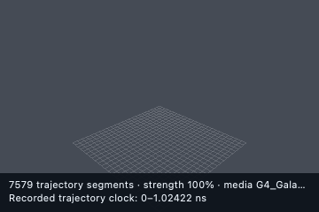
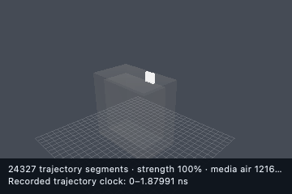
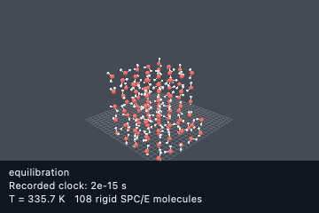

# Scientific and mathematical foundations

[Documentation home](../README.md) · [Research index](README.md) · [Core concepts](../concepts.md) · [Validation →](../validation/README.md)

These equations explain the quantities TRECH reports, how reduced models are built
and how numerical or physical claims are checked. Each section links to the
calculation or experiment that gives the equation a role in this repository.

## Particle transport and Monte Carlo

A cross section describes the likelihood of a process. In a homogeneous mixture, a
macroscopic cross section (inverse length) can be written as a sum of species number
densities times microscopic cross sections.

$$
\mu(E)=\sum_i n_i\,\sigma_i(E).
$$

For fixed energy and a homogeneous path of length $L$, the uncollided fraction is
$e^{-\mu L}$. The Beer–Lambert check calculates this separately using a Geant4 cross
section and compares it to the fraction of simulated primaries without an interaction.
Both sides depend on Geant4's physics inputs, so this checks internal consistency.
[Beer–Lambert scenario](../../examples/scenarios/analytic_beer_lambert/analytic_beer_lambert.js) ·
[Transport cross-checks](../scenarios/catalog.md#particle-transport-and-optics) ·
[Geant4 physics-process documentation](https://geant4.web.cern.ch/documentation/dev/bfad_html/ForApplicationDevelopers/TrackingAndPhysics/physicsProcess.html)

For deposits $E_j$ in $N$ independent event histories, the event mean is
$\bar E=\sum_j E_j/N$ and the estimated standard error of that mean is $s/\sqrt{N}$,
where $s$ is the event sample standard deviation. More histories narrow sampling
error in the mean. Bias from the chosen transport model or geometry requires a separate check.
For a fraction $p$ estimated from independent binary outcomes, the usual plug-in
standard error is $\sqrt{p(1-p)/N}$. Use the
[score definitions](../engine/output_schema.md#trech_scoresjsonl) and the
[observer validation protocol](../inference/particle_observer.md#data-and-independent-acceptance)
to see how the repository reports and uses these quantities.

## Optical boundaries

For two smooth dielectric media, Snell's law relates the angles from the surface
normal by $n_1\sin\theta_1=n_2\sin\theta_2$. The Fresnel coefficients give reflection
and transmission probabilities for the boundary, with polarization taken into account.
Geant4 uses the supplied material optical properties to sample boundary histories.
TRECH can derive or infer the properties, and its planar-glass validator uses the
recorded positions and known plane normals to recover refractive indices from tracks.
Comparisons with reference indices separately grade the inputs themselves.
[Optical boundary physics](https://geant4.web.cern.ch/documentation/pipelines/master/prm_html/PhysicsReferenceManual/electromagnetic/optical_photons/optical.html) ·
[Inverse optics benchmark](../validation/validation_glass_of_water.md)

## Molecular dynamics and water

The bulk-water comparison integrates Newtonian trajectories with a constrained
SPC/E-based force field. It measures the oxygen–oxygen radial distribution $g(r)$,
the neighbour density at distance $r$ relative to the bulk density. The first peak
probes the preferred first-shell distance. A different observable, self-diffusion
$D$, measures the rate at which molecules spread. In isotropic 3D diffusion the
Einstein relation gives a long-time mean-square-displacement slope of $6D$.
The Green–Kubo estimate integrates the molecular velocity autocorrelation and divides
by three. The scenario uses finite fitting and integration windows for both estimates.

Those observables come from hook-layer trajectories. Geant4 provides the configured
material and event cadence. In the shaken-glass comparison, selected MD facts become
inputs to a cascade that estimates coarser fluid parameters.
[Bulk-water source](../../examples/scenarios/h2o_bulk_water/h2o_bulk_water.js) ·
[Shared MD implementation](../../js/trech_water_md.js) ·
[Water and fluids catalog](../scenarios/catalog.md#water-and-fluids) ·
[Original SPC/E model](https://doi.org/10.1021/j100308a038)

## Coarse-graining and set models

A reduced representation keeps quantities relevant to a question while discarding
detail. A group that represents particles of weights $w_i$ at positions $\mathbf{x}_i$
can retain total weight and centroid.

$$
W=\sum_i w_i,\qquad \bar{\mathbf{x}}=\frac{\sum_i w_i \mathbf{x}_i}{W}.
$$

These preserve weight and first spatial moment for positive $W$. Recovering another
quantity such as a transport response requires information about the members or a
trained closure. A DeepSets-style sum-pooling model computes
$\rho(\sum_i \phi(\mathbf{z}_i))$. Permuting the input members leaves the mathematical
sum unchanged. TRECH also supports other pooling and message-passing set models.
[Recursive hierarchy](../inference/group_hierarchy.md) ·
[Model formats](../inference/ml_models.md#set-networks-deepsets--message-passing) ·
[Zaheer et al., *Deep Sets*](https://arxiv.org/abs/1703.06114)

## Continuum fields and lattices

A scalar continuum model can transport a temperature field by advection and diffusion.
For constant diffusivity $\kappa$ and a source $S$, the reference equation is

$$
\partial_t T + \mathbf{u}\cdot\nabla T = \kappa\nabla^2T + S .
$$

Velocity $\mathbf{u}$ carries the field, diffusivity smooths gradients, and $S$ accounts
for local heating or cooling. Initial state and boundary conditions determine the
problem being solved. The lattice Boltzmann engine advances directional populations
on a regular grid. A collision step relaxes populations toward local equilibrium
and a streaming step moves them to neighbouring nodes. Moments of those populations
yield the continuum variables. The convective candidate couples the scalar lattice
to a flow lattice using Boussinesq buoyancy, where scalar changes enter the buoyancy
term as small density deviations. The conductive candidate uses a scalar lattice
without fluid motion.
[Field evolution](../engine/field_evolution.md) ·
[Native lattice code](../../src/core/LatticeContinuum.cpp) ·
[Lallemand and Luo, lattice Boltzmann dispersion and stability](https://journals.aps.org/pre/abstract/10.1103/PhysRevE.61.6546)

For grid spacing $\Delta x$ and step $\Delta t$, the scalar lattice diffusivity in
lattice units is $\kappa\,\Delta t/\Delta x^2$. The field candidates map caller cell
values and source terms onto the numerical lattice by spatial overlap. The output is
sampled back onto the caller's cells for comparison on a common support.
[Candidate mapping and time-step selection](../../src/ml/FieldMethods.cpp)

With characteristic speed $U$ and length $L$, the Péclet number
$UL/\kappa$ compares advective and diffusive effects. Lattice Mach number compares
flow speed to lattice sound speed. These quantities can describe candidate context and
numerical regimes. In TRECH the field selection uses observed errors. The
[lattice test fixtures](../../tests/test_lattice_continuum.cpp) check convergence and
conservation on reference problems, including Taylor–Green flow and diffusion.

## Learning, error and trust

The most basic comparison is a residual $e_i=\hat y_i-y_i$ on a supported observation.
For equal weights, bias is the mean residual and
$\mathrm{RMSE}=\sqrt{\sum_i e_i^2/N}$. Positive bias means overprediction on average.
A one-step field comparison matches support, units and physical time before reporting
errors. A held-out run can instead grade the accumulated error when a learned model
drives state over many steps. The two tests answer different questions. See
[field error diagnostics](../engine/scenario_hooks.md#co-located-field-error-diagnostics)
and the [furnace learner campaign](../inference/multiscale_domain_study.md#glass-furnace-campaign-learn-freeze-deploy-at-held-out-temperatures).

Prequential grading predicts before learning from the observation being graded.
Held-out validation goes further by freezing the predictor for a separate dataset or run.
Record where a model abstains and whether an input is far from training support. Two
methods' RMSE values are comparable on the same observations. Coverage is a separate
quantity. A teacher, an independent Geant4 run, an independent quantum reference
and a lab measurement each support a different claim.
[Trust metadata](../engine/scenario_hooks.md#per-stage-trust-profile-low-confidence-flags-carried-with-the-model) ·
[Validation guide](../validation/README.md)

## Choose a scientific case

| Subject | Follow |
| --- | --- |
| Refraction, index and Fresnel comparisons | [Glass-of-water optical inverse validation](../validation/validation_glass_of_water.md) |
| Water structure and self-diffusion | [Water cases](../scenarios/catalog.md#water-and-fluids) |
| Rigid scans, torsion and charge | [Molecular series](../scenarios/molecular_series.md) |
| Quantum densities and energy levels | [Studio quantum reference](../studio/chemistry_probability.md) · [Atomic stability study](atomic_stability.md) |
| Compressible Euler flow and convergence | [Independent process references](../scenarios/process_references.md) |
| Resonance, encoding and MRI reconstruction | [Magnetic resonance cases](../scenarios/catalog.md#magnetic-resonance) |
| CNT chirality, band structure and devices | [CNT background](cnt/BackToTheCarbon.md) · [CNT cases](../scenarios/catalog.md#carbon-nanotubes) |
