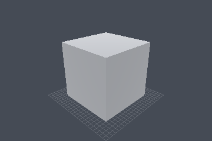
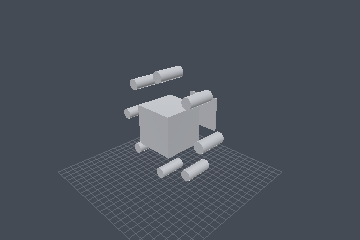
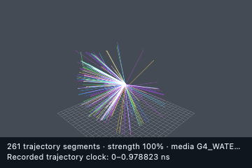

# Author a scenario

[Documentation home](../README.md) · [Scenario index](README.md) · [Core concepts](../concepts.md) · [Bundle contract](scenario_bundles.md)

Start with the physical question. Define what is present, where it sits, which
conditions act on it and which observable answers the question. For example,
[`hello_world.js`](../../examples/scenarios/hello_world/hello_world.js) specifies a water
world, an electron source and a finite event count. [Inspect the effective config](../first_run.md)
before adding geometry or state.

## Decide where to put each declaration

| Need | Authoring surface |
| --- | --- |
| Material, geometry, source and run conditions | Root JavaScript sets `TRECH_CONFIG` to an object, JSON string or function returning one. |
| User-editable inputs | Declare typed `TRECH_VALUE` options directly or from the bundle's `.ui.js` definitions. Use `trech inspect` and `--param name=<json>`. |
| Runtime observations | Register `TRECH_HOOKS` and use the documented context to read facts and emit records. |
| Comparisons, forced fixtures and expectations | Use the `.validation.js` companion and label the reference and its coverage. |
| View and Studio hints | Use `.view.js` and `.ui.js` for presentation and typed controls. |

See the [bundle format](scenario_bundles.md) for resolution order, scope and nested includes.
A scenario declares the system and hands state to engine operators. The engine owns
prediction methods and can route them by context. For the current separation of
field grading and normal scenario state, see [field evolution](../engine/field_evolution.md).

## Geometry, materials and source

Use `environment` for the apparatus and `geometry.volumes` for named volumes with
nested `shape` and `placement`. A child names its parent through `placement.parent`.
The `environment`, `medium` and `detector` aliases merge in that order and
serialize as `detector`. `G4_*` material names refer to the Geant4 material database.
Use `materials[]` to declare mixtures and `scoreEdep` on volumes you want to score.
`beams` accepts an array of entries from which the active or first source is
selected. Check `beam` in the run's canonical provenance config for the selected source.
The [C++ configuration types](../../include/trech/core/Config.hpp) define defaults.
The [config parser](../../src/core/Config.cpp) defines accepted keys, aliases, validation
and serialization.

The JS geometry helpers can check placements before a run. The engine's
post-construction report describes actual material or parent substitutions,
skipped volumes and sampled overlaps. Inspect `geometry_resolution` and
`geometry_overlap_check` in [provenance](../engine/output_schema.md#trech_provenancejsonl).
See the [geometry refusal fixture](../../examples/scenarios/geometry_refusal_guard/geometry_refusal_guard.js)
for opting into refusal on selected defects.

## Examples by feature

| Feature | Start from | Preview |
| --- | --- | --- |
| Small world and named water volume | [Water box](../../examples/scenarios/water_box/water_box.js) |  |
| Beam units and selection | [Multi-beam input](../../examples/scenarios/config_multi_beam_units/config_multi_beam_units.js) | Config fixture |
| Config composition and validation presets | [TRECH_FLOW example](../../examples/scenarios/config_flow_language/config_flow_language.js) |  |
| Grid, ring, layer and shell geometry | [Procedural assembly](../../examples/scenarios/geometry_procedural_assembly/geometry_procedural_assembly.js) |  |
| Hook dispatch, emissions and allowed init overrides | [Hook dispatch](../../examples/scenarios/config_hook_dispatch/config_hook_dispatch.js) | Hook emits |
| Event classification and exceptional-event queue | [Threshold stratification](../../examples/scenarios/config_stratify/config_stratify.js) · [ML stratification config fixture](../../examples/scenarios/config_stratify_ml/config_stratify_ml.js) |  |
| Legacy `multiscale` config | [Bridge scaffold](../../examples/scenarios/config_multiscale_stub/config_multiscale_stub.js). For active inference use the [cascade and operator guides](../inference/multiscale.md). | Config fixture |

Common helpers and preflight

Use `TRECH_INCLUDE("trech_helpers.js")` for units, material facts, deterministic
random helpers and observer clocks. Geometric generators and placement audits are
in [`trech_geometry.js`](../../js/trech_geometry.js). `TRECH_FLOW` supports fluent
transforms such as `defaults`, `derive` and `finalize`, and read-only checks such as
`flow.check` and `flow.validate`. The environment preset can report conflicting
apparatus aliases. See [the QuickJS host implementation](../../src/js/JsRuntime.cpp) and
[the example auditor](../../scripts/audit_flow_presets.py).
The [include error fixture](../../tests/fixtures/js/include_error_demo.js) illustrates
how source files appear in stack traces.

Use [precision profiles](../engine/adaptive_precision.md) to describe spatial,
temporal, statistical and representation controls separately. When hooks accumulate
state across events, use `run.threads: 1` for replay. For callback signatures, legal
patches, RNG and emit guardrails, see the [hook API](../engine/scenario_hooks.md).

Next, [browse reusable process bindings](solution_processes.md),
[open the scenario in Studio](../studio/studio_authoring.md) or
[choose validation evidence](../validation/README.md).
