# Scenario catalog

[Documentation home](../README.md) · [Scenario index](README.md) · [Categories and pruning](categories.md) · [First run](../first_run.md) · [Preview gallery](../previews.md)

Choose a question, then follow the scenario source and the evidence for its answer.
Previews use the latest committed capture for each scenario. Click a still to play
the replay where an animation is available.
Sources here are runnable bundle roots. Use `trech inspect <root.js>` to discover
parameters and `trech run <root.js> --output <dir>` to run one. The
[scenario purity report](../validation/TRECH_current_scenarios_purity.md) indexes the
full corpus and tracks learned and authored behaviour. The
[validation report](../validation/validation_report.md) records the checked runs and case IDs.

## Particle transport and optics

| Start with | Question and evidence | Preview |
| --- | --- | --- |
| [Electrons in water](../../examples/scenarios/hello_world/hello_world.js) | What does Geant4 deposit per event? The [walkthrough](../first_run.md) traces config, scores and provenance. | Run scores |
| [Optical refraction](../../examples/scenarios/validation_glass_of_water/validation_glass_of_water.js) | Can inverse Snell and Fresnel calculations recover the optical properties used by Geant4? See the [optical benchmark](../validation/validation_glass_of_water.md). | <a href="../../studio/previews/validation_glass_of_water.gif">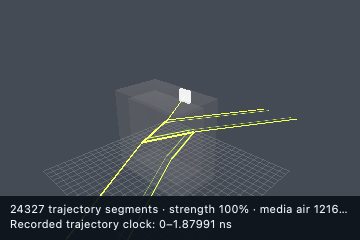</a> |
| [Gamma attenuation](../../examples/scenarios/analytic_beer_lambert/analytic_beer_lambert.js) | Does the uncollided fraction agree with exponential attenuation using Geant4's cross section? See the [derivation and interpretation](../research/foundations.md#particle-transport-and-monte-carlo). | <a href="../../studio/previews/analytic_beer_lambert.gif">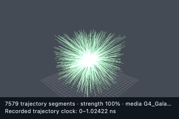</a> |

Transport variants and additional cross-checks

| Scenario | What it shows | Preview |
| --- | --- | --- |
| [Varied primaries](../../examples/scenarios/glass_of_water_varied/glass_of_water_varied.js) | Exercises a distribution of source positions, directions and wavelengths. | <a href="../../studio/previews/glass_of_water_varied.gif">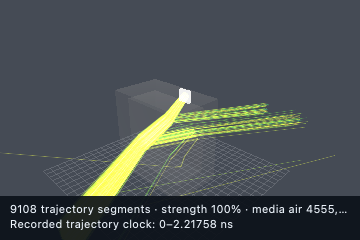</a> |
| [White-light dispersion](../../examples/scenarios/glass_of_water_spectral/glass_of_water_spectral.js) | Compares optical paths across a spectrum. | <a href="../../studio/previews/glass_of_water_spectral.gif">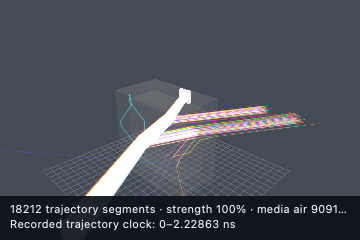</a> |
| [Water-box optics](../../examples/scenarios/config_optics/config_optics.js) | Minimal optical setup with a multi-event beam. | <a href="../../studio/previews/config_optics.gif">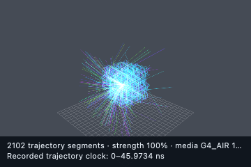</a> |
| [Single optical photon](../../examples/scenarios/h2o_optics_beam/h2o_optics_beam.js) | Single-path water-box fixture. | <a href="../../studio/previews/h2o_optics_beam.gif">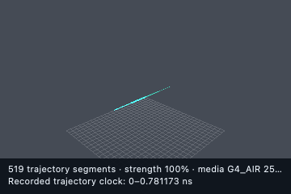</a> |
| [CSDA range](../../examples/scenarios/analytic_csda_range/analytic_csda_range.js) | Compares stopping distances with the integral of Geant4 stopping power. | <a href="../../studio/previews/analytic_csda_range.gif">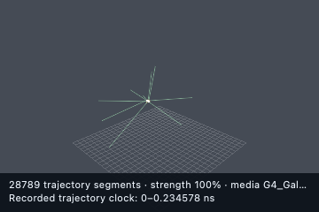</a> |
| [Photoelectric branching](../../examples/scenarios/analytic_photo_fraction/analytic_photo_fraction.js) | Compares first-interaction counts with the corresponding fraction of the total cross section. | <a href="../../studio/previews/analytic_photo_fraction.gif">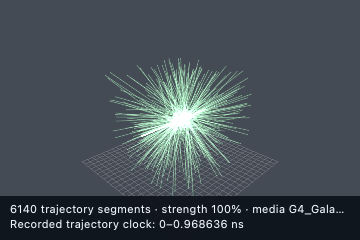</a> |
| [Compton transfer](../../examples/scenarios/analytic_compton_transfer/analytic_compton_transfer.js) | Compares energy and angle distributions with the free-electron Klein–Nishina reference. | Run scores |
| [Pair conversion](../../examples/scenarios/analytic_pair_production/analytic_pair_production.js) | Checks branching and threshold across energies. The suite also grades photonuclear branching and final-state closure. | Run scores |
| [Nitrogen–carbon cycle](../../examples/scenarios/config_nitrogen_carbon_cycle/config_nitrogen_carbon_cycle.js) | Checks conservation and Q-values from Geant4 isotope masses and samples both legs using the configured physics. | <a href="../../studio/previews/config_nitrogen_carbon_cycle.gif">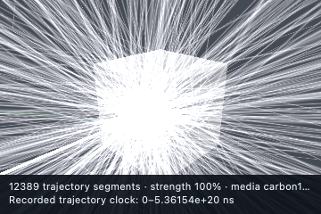</a> |
| [Optics surrogate](../../examples/scenarios/optics_surrogate_demo/optics_surrogate_demo.js) | Exercises a learned refractive index supplied to Geant4 transport. See the [surrogate validation](../validation/validation_optics_surrogate.md). | <a href="../../studio/previews/optics_surrogate_demo.gif">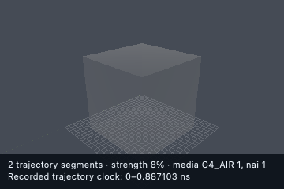</a> |

## Water and fluids

| Start with | Question and evidence | Preview |
| --- | --- | --- |
| [Periodic bulk water](../../examples/scenarios/h2o_bulk_water/h2o_bulk_water.js) | Does rigid SPC/E molecular dynamics reproduce water's radial structure and self-diffusion? The hook-layer trajectory uses Geant4 events as its update clock. | <a href="../../studio/previews/h2o_bulk_water.gif">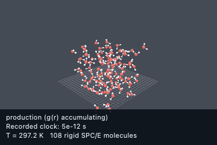</a> |
| [Pour and shake a glass](../../examples/scenarios/glass_of_water_shaken/glass_of_water_shaken.js) | How does a particle-fluid comparison use cascade-inferred parameters? Measured nano MD facts drive the inference. The density coarse-graining is grounded, and the cohesion and viscosity maps are illustrative. | <a href="../../studio/previews/glass_of_water_shaken.gif">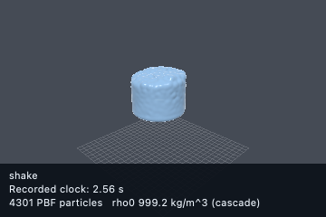</a> |
| [Lava lamp](../../examples/scenarios/lava_lamp/lava_lamp.js) | How do heating, wax phase change and parcel motion interact? Geant4 material facts help seed inferred parameters. A [separate validation companion](../engine/field_evolution.md#walk-through-a-lava-lamp-frame) compares engine field methods against the authored carrier column. | <a href="../../studio/previews/lava_lamp.gif">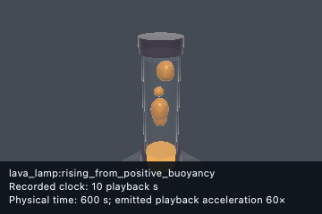</a> |

Water from a molecule to a phase change

| Scenario | What it shows | Preview |
| --- | --- | --- |
| [Single-water stability](../../examples/scenarios/h2o_molecule_stability/h2o_molecule_stability.js) | A hook-layer solver evolves a single flexible water molecule. | <a href="../../studio/previews/h2o_molecule_stability.gif">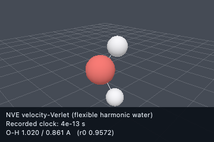</a> |
| [Water cluster](../../examples/scenarios/h2o_cluster_fluid/h2o_cluster_fluid.js) | The molecular dynamics comparison follows a small hydrogen-bonded droplet. | <a href="../../studio/previews/h2o_cluster_fluid.gif">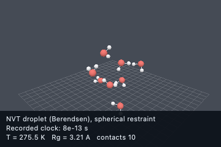</a> |
| [Diffusion sweep](../../examples/scenarios/h2o_diffusion_temperature/h2o_diffusion_temperature.js) | Checks the temperature trend against measured water. The bulk-water case estimates diffusion from mean-square displacement and velocity autocorrelation. | <a href="../../studio/previews/h2o_diffusion_temperature.gif">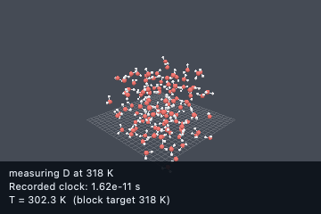</a> |
| [Freeze and melt](../../examples/scenarios/h2o_bulk_freeze_boil/h2o_bulk_freeze_boil.js) | Coarse-grained mW water freezes on an ice template and melts on heating. CHILL+ classifies local structure. | 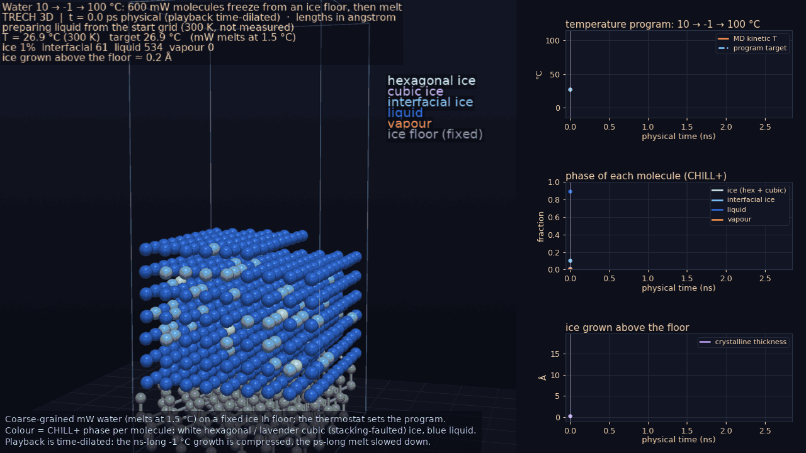 |
| [Brine geometry and transport](../../examples/scenarios/h2o_fluid/h2o_fluid.js) | Runs particle transport through a salt-and-brine apparatus. | <a href="../../studio/previews/h2o_fluid.gif">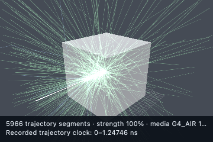</a> |
| [Molecule-shaped geometry fixture](../../examples/scenarios/h2o_single_molecule/h2o_single_molecule.js) | Exercises nested geometry and transport setup. | Subpixel geometry |

## Chemistry and materials

| Start with | Question and evidence | Preview |
| --- | --- | --- |
| [Glass furnace](../../examples/scenarios/glass_from_sand/glass_from_sand.js) | How do learned thermal, reaction and pair-conduction operators update the charge? Follow [domain routing and held-out deployment](../inference/multiscale_domain_study.md#glass-furnace-campaign-learn-freeze-deploy-at-held-out-temperatures) and the [field comparison](../engine/field_evolution.md). | <a href="../../studio/previews/glass_from_sand.gif">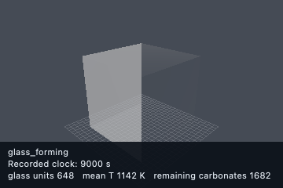</a> |
| [Water reaction cycle](../../examples/scenarios/testscenario_h2o_electrolysis_combustion/testscenario_h2o_electrolysis_combustion.js) | How does `ctx.react` update discrete inventories while protecting atom counts? The teacher grades the learned transition model. | <a href="../../studio/previews/testscenario_h2o_electrolysis_combustion.gif">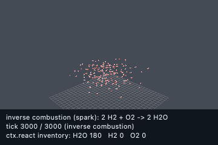</a> |
| [Molecular series](molecular_series.md) | Which torsion and polarization responses come from a quantum reference fit, and which photon interaction responses come from Geant4-trained models? | <a href="../../studio/previews/molecular_04_butane.gif">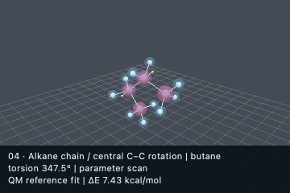</a> |
| [Process references](process_references.md) | What can the independent air-flow comparison and the NaCl interface workflow establish? Each page identifies its data and numerical scope. | <a href="../../studio/previews/aerodynamics_reference.gif">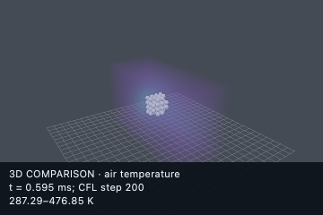</a> |

More reaction and mixture experiments

| Scenario | What it shows | Preview |
| --- | --- | --- |
| [Water and n-pentane](../../examples/scenarios/beaker_water_n_pentane/beaker_water_n_pentane.js) | Demonstrates separation and evaporation with inference seeded by Geant4 material facts. | <a href="../../studio/previews/beaker_water_n_pentane.gif">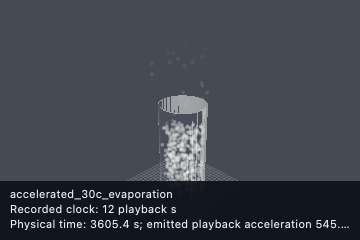</a> |
| [Briggs–Rauscher](../../examples/scenarios/briggs_rauscher_oscillator/briggs_rauscher_oscillator.js) | Explores oscillating color from a comparison model with inferred coefficients. | <a href="../../studio/previews/briggs_rauscher_oscillator.gif">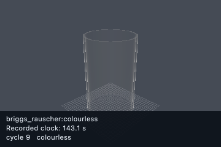</a> |
| [Polyurethane foam](../../examples/scenarios/polyurethane_foam/polyurethane_foam.js) | Follows cured foam from expansion through solidification and gravity-driven deformation. | <a href="../../studio/previews/polyurethane_foam.gif">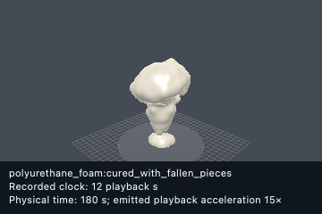</a> |
| [Elephant's toothpaste](../../examples/scenarios/elephants_toothpaste/elephants_toothpaste.js) | Follows a lather that erupts and drains in a separate reduced comparison model. | <a href="../../studio/previews/elephants_toothpaste.gif">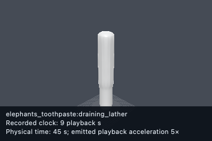</a> |
| [Chemistry configuration](../../examples/scenarios/config_chemistry_stub/config_chemistry_stub.js) | Exercises DNA option wiring. See the [Geant4 capability map](../engine/GEANT4_features_and_limits.md). | Config fixture |

## Biology and mechanics comparisons

| Scenario | What it shows | Preview |
| --- | --- | --- |
| [Passive membrane efflux](../../examples/scenarios/testscenario_efflux/testscenario_efflux.js) | Compares learned transport and crossing operators with a first-order clearance reference. [Design and checks](testscenario_efflux.md) | <a href="../../studio/previews/testscenario_efflux.gif">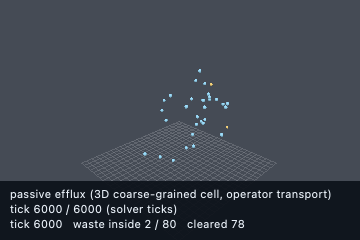</a> |
| [Osmotic dehydration](../../examples/scenarios/testscenario_osmotic/testscenario_osmotic.js) | Follows water loss and membrane deformation in a hook-layer comparison paced by Geant4. [Osmosis design](testscenario_osmotic-todo.md) | <a href="../../studio/previews/testscenario_osmotic.gif">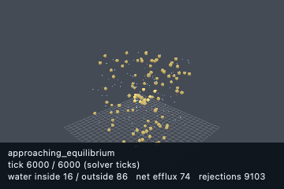</a> |
| [Pascal's principle](../../examples/scenarios/testscenario_pascal/testscenario_pascal.js) | Compares piston-driven pressure in rigid and deformable vessels. [Pascal design](testscenario_pascal-todo.md) | <a href="../../studio/previews/testscenario_pascal.gif">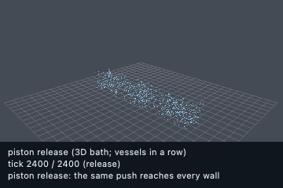</a> |

## Magnetic resonance

| Case | What produces the observable | Preview |
| --- | --- | --- |
| [Water resonance](../../examples/scenarios/testscenario_magnetic_resonance/testscenario_magnetic_resonance.js) | A hook-layer Bloch model evolves magnetization and produces a free-induction decay. Geant4 supplies material proton density. | <a href="../../studio/previews/testscenario_magnetic_resonance.gif">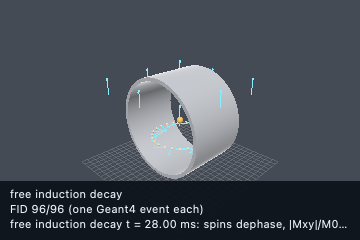</a> |
| [Tissue contrast](../../examples/scenarios/testscenario_magnetic_resonance_tissues/testscenario_magnetic_resonance_tissues.js) | Geant4 transports the photons prescribed by an excitation count scaled to tissue proton density. | <a href="../../tools/viz/demos/magnetic_resonance_tissues.gif">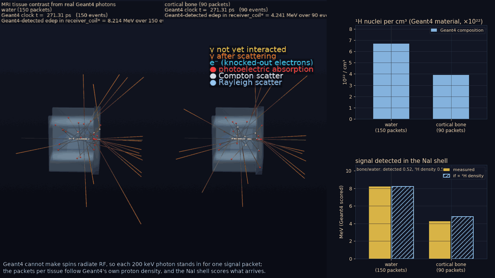</a> |
| [Frequency-encoded line](../../examples/scenarios/testscenario_magnetic_resonance_imaging/testscenario_magnetic_resonance_imaging.js) | A gradient and Fourier reconstruction recover a 1D density profile from hook-layer signals. | <a href="../../studio/previews/testscenario_magnetic_resonance_imaging.gif">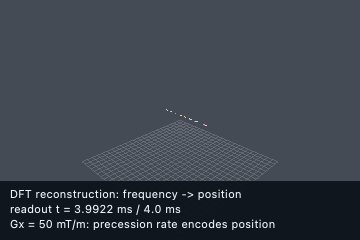</a> |
| [Brain phantom](../../examples/scenarios/testscenario_magnetic_resonance_brain/testscenario_magnetic_resonance_brain.js) | A procedural phantom uses Geant4-derived tissue proton densities, acquired through readout and phase-encode gradients and reconstructed in 2D/3D ([how](magnetic_resonance_imaging.md)). | <a href="../../tools/viz/demos/magnetic_resonance_brain.gif">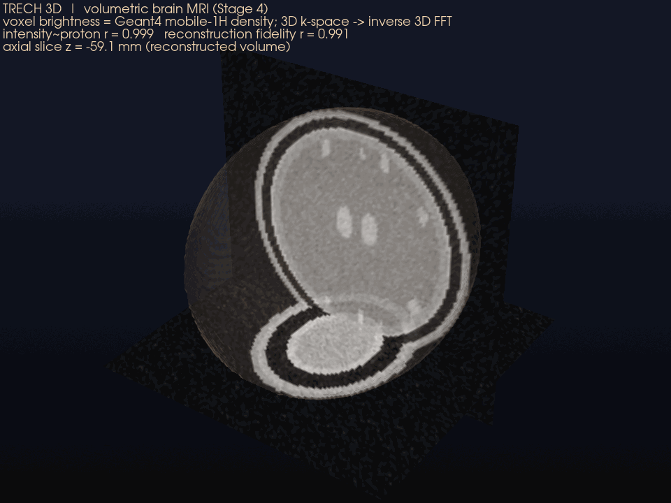</a> |

[Resonance replays](../previews.md#magnetic-resonance) ·
[Geant4 and magnetic-resonance responsibilities](../engine/GEANT4_features_and_limits.md#7-responsibility-matrix-by-trech-family)

## Carbon nanotubes

| Scenario | What it shows | Preview |
| --- | --- | --- |
| [Band structure](../../examples/scenarios/cnt_band_structure/cnt_band_structure.js) | Compares chirality-dependent gaps using tight binding. Geant4 separately transports electrons through representative channel geometry. | <a href="../../studio/previews/cnt_band_structure.gif">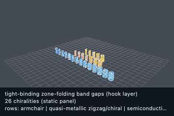</a> |
| [Transistors and logic](../../examples/scenarios/cnt_logic_gates/cnt_logic_gates.js) | Runs a device comparison model for currents and gate outputs, with separate Geant4 electron transport. | <a href="../../studio/previews/cnt_logic_gates.gif">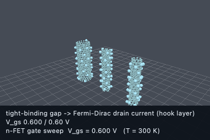</a> |

[CNT background](../research/cnt/BackToTheCarbon.md) · [CNT replays](../previews.md#carbon-nanotubes)

Geometry-only CNT fixtures

| Scenario | Setup | Preview |
| --- | --- | --- |
| [Tube in a fluid](../../examples/scenarios/config_cnt_stub/config_cnt_stub.js) | A parameterized multi-wall nanotube shell. | 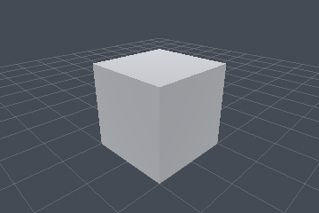 |
| [Tube-world geometry](../../examples/scenarios/config_cnt_world_stub/config_cnt_world_stub.js) | A fixed five-wall tube world. |  |
| [Tube with optics](../../examples/scenarios/config_cnt_optics_stub/config_cnt_optics_stub.js) | Recorded optical steps near a nanotube shell. | <a href="../../studio/previews/config_cnt_optics_stub.gif">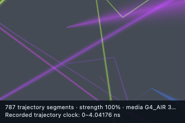</a> |

## Learning and runtime mechanics

| Scenario | What it shows | Preview |
| --- | --- | --- |
| [A single prediction](../../examples/scenarios/surrogate_generic_demo/surrogate_generic_demo.js) | Reads live material facts for a named model. | Model outputs |
| [An automatic chain](../../examples/scenarios/cascade_multiscale_demo/cascade_multiscale_demo.js) | Runs illustrative named maps in scale order. [Trace the cascade](../inference/multiscale.md#follow-a-named-feature-cascade) | Model outputs |
| [Particle-to-observer transport](../../examples/scenarios/particle_observer_cascade/particle_observer_cascade.js) | Follows learned atomic and nano response into a meso estimate checked against independent Geant4 histories. [Training and held-out evidence](../inference/particle_observer.md) | <a href="../../studio/previews/particle_observer_cascade.gif">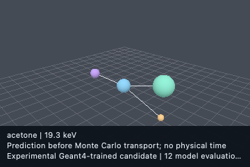</a> |
| [Spectral learning](../../examples/scenarios/spectrum_prediction/spectrum_prediction.js) | Fits independent atomic line and molecular UV/Vis data. [Spectra plots, protocol and results](../research/spectrum_prediction.md) | Spectra dock and tables |

- [Authoring examples](authoring.md#examples-by-feature) exercise geometry, config flow,
  stratification, callbacks and typed inputs. [Live lab examples](../engine/cli.md#live-lab)
  exercise the persistent JSON interface.
