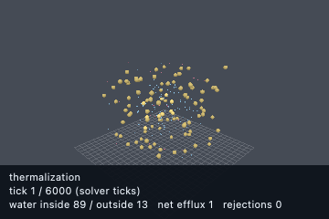

This experiment and its scenario should be implemented and used for validation test

### The Experiment: Osmotic Dehydration via Dimensional Exclusion

Studio replays the three-dimensional hook-layer comparison. The preview and the classic replay
were captured on 2026-11-12, before the operator path below became the default; they show the
JS-law particle motion. The implementation notes below describe the scenario's evolution from the
original two-dimensional model.

The objective is to validate TRECH physics/chemistry engine by placing a simplified "cell" in a hypertonic environment. The engine must naturally simulate the spontaneous efflux of water driven entirely by microscopic kinetic collisions and dimensional exclusion, without relying on hardcoded macroscopic forces.

Implementation note (2026-06-28): `examples/scenarios/testscenario_osmotic/testscenario_osmotic.js` implements this as a deterministic hook-layer 2D coarse-grained bath, one Geant4 event per MD tick. Brownian motion is a Langevin velocity refresh, so the temperature proxy stays bounded instead of heating without limit.

Cell-biology upgrade (2026-06-28): the scenario now reads as an evident biological cell rather than a gas-in-a-box.
* **Flexible spring membrane / crenation.** A 64-node turgor-driven elastic ring (radial turgor spring + neighbour bending + damping, sub-stepped and clamped so it is unconditionally stable) replaces the fixed circle as the cell's outline. Turgor follows a viscoelastically-lagged average of the internal water count, so as water leaves the ring contracts and buckles into lobes — the cell **crenates**. The membrane node radii are an emitted physical state (`membrane` in the `osmotic_particles` snapshots; metrics in `final_summary.membrane`), not a renderer-only effect. To keep the validated osmosis statistics byte-stable, particle exclusion is still resolved on the nominal pore ring (decoupled from the spring ODE), and the renderer conforms the bath's radial coordinate onto the emitted membrane outline for visual coherence.
* **Expelling "wrong polarized" molecules.** Every molecule carries a `polarity`. The channel pores pass only correctly-polarized water; glucose is excluded by **size** and a third species — small **ions** that *fit the pore geometrically but are rejected by polarity* — demonstrates the membrane expelling wrong-polarized molecules even though they would fit dimensionally. Ions are a separate species (off the H2O/glucose tallies) so the osmosis numbers the validation case asserts are unchanged. The cumulative rejection count is emitted (`wrong_polarized_rejections`).

3D upgrade (2026-09-29): the bath, pores and membrane are now three-dimensional. Particles move in a cubic bath (half-size 40, keeping the historical outside/inside volume ratio ~4.6); 24 water-channel caps cover the same ~38% of the membrane as the old 12 arcs; the membrane is a 642-vertex icosphere with radial DOF moved overdamped by the MEASURED collision-pressure difference, near-conserved lipid area and bending. The scripted `cos(8θ)` lobe target and the decoupled-overlay membrane are gone: particles collide with, cross and are swept by the deformed membrane, and crenation emerges from volume loss at held area. `pressure_response_observed` now grades the external-over-internal bias during the windows in which the cell actually shrank (at osmotic balance the two sides converge).

The committed validation case (`osmotic_shift_observed`, category `fluid`) now checks **9/9** expected behaviours: dimensional AND polarity exclusion, net osmotic water shift, early pore crossings, macroscopic flux growth, bounded kinetic energy, late external/internal pressure bias, observed membrane crenation, and membrane stability. Latest run: `net_water_flux_out=71`, first crossing tick 3, max mean KE 0.963 vs 0.81 target, late external/internal pressure 1.18, cell mean radius 28 → 21.3 (area −41%, crenated), 3016 wrong-polarized molecules expelled. The [classic replay with flux and pressure charts](../../tools/viz/demos/osmotic_dehydration.gif)
uses the bath and membrane states emitted by that comparison.

Operator migration (2026-11-26): the particles now move and cross by learned engine operators,
not by JavaScript laws. Two models under `data/discrete_operators/` are the default
(`physics_source=operator`):

* **Velocity response** (`osmotic_thermostat_operator`, micro `ctx.evolve`). Each tick it
  takes a molecule's velocity, mass and three seeded unit random numbers and returns the change
  in velocity. It replaces `applyLangevinThermostat`, an Ornstein-Uhlenbeck refresh: a random
  kick plus a pull back toward the bath's thermal speed.
* **Channel passage** (`osmotic_crossing_operator`, micro `ctx.react`). For every molecule
  touching the membrane, it decides from the molecule's radius and polarity, whether it meets a
  pore, and the channel's declared width (0.6) and polarity (+1) whether the molecule crosses.
  The species table no longer carries a `crossable` flag: that water passes while glucose and
  the ions do not is the operator's verdict.

JavaScript keeps what is structure or numerical machinery: pore placement, the channel and
species declarations, free flight (x += v·dt), the bath walls, the reflection of a molecule that
does not cross, and pressure scoring. The retired laws are `reference*` functions, run only with
`--param physics_source='"reference"'`, and the reference run reproduces the previous output
byte for byte. **The membrane's response is still the authored `integrateMembrane` law on both
paths**: the pressure, area and bending terms that shrink and fold the cell.

### Cost of a membrane operator (2026-11-28)

The membrane is the next law to become an engine operator, and it is the run's hot path, so its
cost was measured before choosing how often the operator runs. Run the scenario with
`--trace debug:osmotic_membrane` and the trace times each `integrateMembrane` call (one per tick)
and each `membraneGeometry` call inside it (one per substep). The spans only observe: an untraced
run writes the same output as before. Then
`python3 scripts/bench_membrane_operator_cost.py --authored-trace <run>/trech_trace.jsonl` times a
synthetic per-vertex operator through `ctx.evolve` and writes a report like the committed
[membrane_operator_cost.json](../validation/membrane_operator_cost.json).

| Part | Cost |
| --- | --- |
| Authored membrane law | 24.5 ms per tick: 147 s of a 158 s run (93 %) |
| Its mesh geometry (volume, area and their per-vertex gradients, 6× per tick) | 21.1 ms per tick (82 % of the law) |
| Its vertex update | 4.7 ms per tick |
| A learned per-vertex operator, one call per substep (widths 16–64) | 1.4–5.3 ms per tick |
| The same operator, one call per tick | 0.2–0.7 ms per tick |

So an operator called every substep costs about what the update it replaces costs, and the
granularity hardly changes the run time. The operator will keep the law's six substeps. What
would make the run faster is the geometry, which any membrane law needs as input; a general
engine method for triangle-mesh volume and area gradients is queued. The synthetic operator's
weights are random: this measures cost, not accuracy. The trace keeps at most 20,000 records per
category, so a full run records all 6,000 law spans but the geometry share comes from the 2,857
ticks recorded in full.

Two lessons from training, worth knowing before retraining either model:

* *A velocity bias becomes a drift.* The velocity memory (γ = 0.96) multiplies any constant
  error b in the learned velocity change by 1/(1−γ) = 25. The first fit, which output the new
  velocity directly, had b ≈ 0.008 for glucose: a 0.2 steady drift, almost glucose's 0.28
  thermal speed. Outside glucose piled against one bath wall, and the cell stopped shrinking. The
  committed model outputs the small velocity *change*, trains on mirrored (−v, −noise) pairs,
  and samples each mass on its own thermal scale. Its glucose drift is ≈0.013, and the bath
  kinetic energy is within 1.3% of the teacher's for every species.
* *Certainty needs a margin.* `ctx.react` clamps each learned hazard to [0, 1]. A blocked
  molecule trained to exactly 0 would get a small positive prediction and, over thousands of
  wall strikes, leak across. So the teacher writes certain passage as 1.25 and certain blocking
  as −0.25. The clamp turns both into exact 1 and 0, and the run counts the clamps
  (`inference.hazards_clamped`). For the three declared species the clamped hazard is exact on
  both sides, at a pore or not. On 178,761 fresh rows more than 0.05 from the size threshold, 23
  were inexact: all were a very small, wrong-polarity molecule in a very wide channel.

The pair case `osmotic_operators_match_reference` compares the default run with the reference
run on the water left inside, solute that crossed (must be 0), the cell's volume shrink and the
late bath kinetic energy. At the default seed: inside water 10 vs 16, no solute crossed, shrink
0.405 vs 0.423, kinetic energy 1.209 vs 1.210, no input outside the trained domain, and all 9
`osmotic_shift_observed` flags on both paths. One trajectory per side is noisy, so the tolerances
are set from a three-seed sweep (seeds 101 and 202 also pass all 9 flags on both paths). See the
[migration ledger](../../AGENTS/scenarios/migrations/ROADMAP.md#scenario-migration-ledger--exact-authored-laws-and-learned-targets)
for what remains.

**1. Test Substance (The Dynamic Variable)**

* **Water ($H_2O$):** This acts as the solvent and the primary dynamic particle that will cross the membrane.

**2. Intracellular Composition (The Cytoplasm)**

* **Membrane:** A circular perimeter made of fixed or spring-constrained segments. Between segments are "pores" with a fixed diameter ($d_{pore}$).
* **Content:** A high-concentration solvent with a low-concentration solute.
* *Solvent:* **$H_2O$** particles. Radius is strictly smaller than the pore ($r_{H_2O} < \frac{d_{pore}}{2}$).
* *Solute:* Macromolecules, representing sugars like **Glucose ($C_6H_{12}O_6$)** or simplified proteins. Radius is strictly larger than the pore ($r_{solute} > \frac{d_{pore}}{2}$).
* *Initial Ratio:* e.g., 90% $H_2O$, 10% $C_6H_{12}O_6$.

**3. Extracellular Environment**

* **Hypertonic Fluid:** An inverted ratio compared to the inside. A massive concentration of large $C_6H_{12}O_6$ particles and a very low concentration of small $H_2O$ particles.

---

### Physical Parameters for the Engine

To ensure stability and realistic behavior in your simulator, use these relative scales:

* **Temperature ($T$):** Set to **$310\text{ K}$** (approx. $37^\circ\text{C}$). In the simulation, temperature translates to the mean kinetic energy of the particles via the formula $E_k = \frac{3}{2}k_B T$. You will apply random force vectors (Brownian motion) every frame to maintain this average energy.
* **Relative Masses:** $H_2O = 1\text{ u}$, $C_6H_{12}O_6 = 10\text{ u}$. This mass difference ensures water particles move with higher velocity and scatter realistically off the heavier solute particles.
* **Relative Diameters:** Pore = **2.0 units**, $H_2O$ = **1.0 unit**, $C_6H_{12}O_6$ = **3.5 units**.
* **Pressure:** Target $\sim1\text{ atm}$ ($101.3\text{ kPa}$). This must remain an *emergent* property, calculated continuously as Force/Area based on the sum of elastic collision impulses against the membrane walls over time.

---

### Expected Results (Validation Criteria)

If your collision detection, elastic response, and thermodynamic randomness are functioning correctly, you should observe the following emergent behaviors:

1. **Initial Chaos:** $H_2O$ and $C_6H_{12}O_6$ will bounce randomly. Both internal and external $H_2O$ molecules will occasionally perfectly align with the pores and pass through. $C_6H_{12}O_6$ will constantly collide with the membrane but bounce back due to dimensional exclusion.
2. **Net Flux:** Because there are significantly fewer $H_2O$ molecules on the outside, the probability of an internal $H_2O$ molecule hitting a pore and exiting is mathematically higher than an external $H_2O$ molecule entering.
3. **Osmotic Shift:** Over time, the absolute count of internal $H_2O$ will drop, and external $H_2O$ will rise.
4. **Membrane Reaction:**
* *If the membrane is rigid:* You will measure a severe drop in internal pressure and a spike in external pressure.
* *If the membrane is flexible (springs):* You will visibly see the cell **crenate** (shrink and crumple inward) as the internal pressure drops, perfectly mimicking real-world cellular dehydration.

## Simulation Timescale

A true physics/chemistry simulator uses a decoupled, variable time integration method (like an adaptive Verlet or Runge-Kutta integrator) where the time step ($\Delta t$) expands or shrinks based on the required precision—such as preventing particles from "tunneling" through the membrane during high-speed collisions.

Instead of screen frames, we should measure the expected results in **Simulation Time Units ($t$)**. If we assume a standard coarse-grained molecular dynamics scale (where $1t$ represents the average time it takes a water molecule to travel its own diameter), here is the physical timeline of events you should look for to validate your engine.

### The Physical Timeline of Osmosis

**1. Thermalization and Energy Distribution ($t = 0 \to t = 50$)**

* **What happens:** You initialize the particles with a specific temperature ($310\text{ K}$). In these first moments, particles exchange momentum through initial collisions. The kinetic energy distributes until it follows a Maxwell-Boltzmann distribution.
* **Engine observation:** Your adaptive $\Delta t$ will likely need to be very small here to resolve initial dense clusters of particles pushing away from each other without mathematical instability.
* **Expected result:** The localized pressure against the membrane stabilizes. The system "wakes up."

**2. Local Diffusion and Barrier Probing ($t = 50 \to t = 500$)**

* **What happens:** Particles explore their immediate local volume. Both water ($H_2O$) and solute ($C_6H_{12}O_6$) begin repeatedly striking the membrane.
* **Engine observation:** You will see the dimensional exclusion rule validated. Solute molecules will strike the pore boundaries and perfectly rebound. A few water molecules that happen to perfectly align their velocity vectors with the pores will cross the boundary.
* **Expected result:** You will register the first few crossover events, but the macroscopic concentration hasn't noticeably changed yet.

**3. Macroscopic Osmotic Flux ($t = 500 \to t = 5,000$)**

* **What happens:** Statistical probability takes over. Because the internal volume has a vastly higher concentration of water, the frequency of internal water hitting the pores is much higher than external water hitting the pores.
* **Engine observation:** As the system enters a stable flow state, your engine can likely expand its $\Delta t$ (taking larger time steps) because you are now tracking statistical averages rather than resolving highly volatile initial energy spikes. However, the engine must dynamically shrink $\Delta t$ at the exact moment particles enter the narrow pore spaces to ensure high-precision collision detection.
* **Expected result:** You will see a steady, observable trend. The counter for "Internal $H_2O$" will drop consistently, while "External $H_2O$" rises. If your membrane has flexible spring constraints, the cell will begin to noticeably shrink or deform (crenation).

**4. Osmotic Equilibrium ($t = 5,000 \to t_{eq}$)**

* **What happens:** The concentration of water inside the cell drops, and the volume of the cell shrinks (increasing the internal concentration of the trapped solute). Eventually, the ratio of water-to-volume inside matches the ratio outside.
* **Engine observation:** The system is highly stable. You can run large time steps for maximum performance, only slowing down for boundary collisions.
* **Expected result:** The net flux reaches zero. Water molecules are still crossing the membrane in both directions, but the *rate* of entry exactly equals the *rate* of exit. The cell stops shrinking.

### Why this is the ultimate test for TRECH engine

By running this timeline, you validate three completely different scales of engine simultaneously:

1. **Microscopic:** Collision detection perfectly handles the size difference (Solutes are blocked, Water passes).
2. **Thermodynamic:** The kinetic energy (Temperature) drives the movement without the simulation "freezing" or exploding over time.
3. **Macroscopic:** The purely random, chaotic movements naturally generate the mathematical law of osmosis, moving the system from high concentration to equilibrium entirely on its own.
