# TRECH previews: media not shown anywhere else

This page shows the committed GIFs and images that no other Markdown page displays. The
[README](README.md), [Studio README](studio/README.md) and screenshot guides already show their
own images, so they are not repeated here. The PNG next to a GIF is only that GIF's poster frame,
so this page shows the GIF instead.

**How to read these.** Every frame is a viewer replay of engine output: recorded Geant4
trajectories, or the `material_frame` state a scenario emitted, on its own clock. These replays
are not new validation. Labels such as *comparison*, *hook layer*, *QM reference* and
*learned/predicted* mean what the [project principles](AGENTS.md#essential-project-principles)
say. Only Geant4 transport is ground truth. Classical formulas and hook-layer solvers are
comparisons, and predictive-mode output is inference, not a Geant4 tally. The camera turntable,
the colours and any accelerated playback clock are rendering choices. The caption under each
frame is the capture's own annotation.

Most items come from `scripts/update_experiment_media.sh`. The Studio previews come with JSON
sidecars that record the run, seed, mode and frame sampling:
[`studio/previews/`](studio/previews/README.md). The classic-viewer captures have their own
index: [`tools/viz/demos/`](tools/viz/demos/media_index.md).

- [Optics and photon transport](#optics-and-photon-transport)
- [Analytic cross-checks](#analytic-cross-checks)
- [Water: molecules to fluids](#water-molecules-to-fluids)
- [Reactions, recipes and materials](#reactions-recipes-and-materials)
- [Molecular series](#molecular-series)
- [Chemistry workspace references](#chemistry-workspace-references)
- [Carbon nanotubes](#carbon-nanotubes)
- [Magnetic resonance](#magnetic-resonance)
- [Inference and the multi-scale cascade](#inference-and-the-multi-scale-cascade)
- [Biology and mechanics validation](#biology-and-mechanics-validation)
- [Airflow comparison](#airflow-comparison)
- [Configuration and geometry examples](#configuration-and-geometry-examples)
- [Scenarios with nothing spatial to draw](#scenarios-with-nothing-spatial-to-draw)
- [Retired and historical captures](#retired-and-historical-captures)
- [Data assets](#data-assets)

## Optics and photon transport

Optical photons are transported by Geant4. Each medium's refractive index, absorption and
scattering are derived by TRECH from Geant4's own cross sections, not taken from a handbook.

**`viz_refraction_demo`.** A monochromatic optical beam enters a glass slab that holds a water
cube, then exits back into air. Every bend you see comes from the derived n of each medium. The
README shows only this scenario's poster PNG.

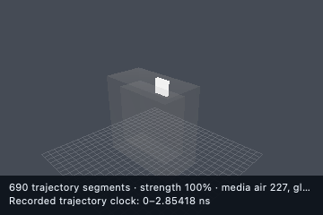

**`validation_glass_of_water`.** This is the strict validator geometry. A single collimated,
monochromatic photon source hits planar, axis-aligned interfaces. Because every surface normal
is ±x, y or z, `scripts/validate_glass_of_water.py` can invert Snell's law and the Fresnel
equations from the recorded steps.

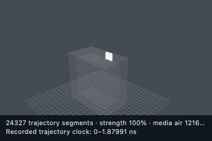

**`glass_of_water_varied`.** The same optics with a *varied* source in a narrow green
band. The run samples a real photon distribution instead of one
repeated primary.

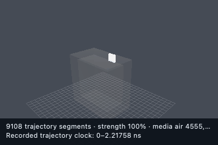

**`glass_of_water_spectral`.** A white blackbody source from 380 to 750 nm. Each photon refracts
at the angle set by its own wavelength through the derived n(λ) tables, so the dispersion you see
is not hard-coded. The README hero GIF shows the same scenario in the classic viewer.

**`config_optics`** and **`h2o_optics_beam`.** Two minimal optics configurations: an optical
beam into a 10 cm water box in air. `config_optics` records 100 events, and `h2o_optics_beam`
shows a single short photon path.

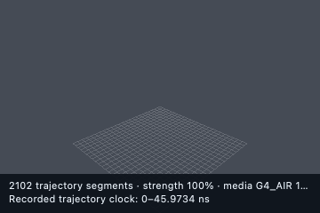 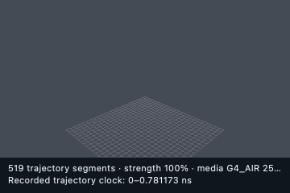

**`config_cnt_optics_stub`.** Optical transport through a nanotube-shell geometry in air and water. The
replay is zoomed onto the few recorded segments.

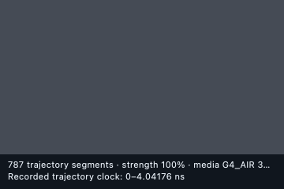

## Analytic cross-checks

Each of these scenarios answers the same question in two independent ways. One answer is a
Geant4 tally. The other is a classical formula fed with Geant4's own cross sections or stopping
powers. The formula is the comparison and never drives the run. The GIFs show the recorded
Geant4 histories.

**`analytic_beer_lambert`.** A narrow gamma beam through a water slab. The question is what
fraction of photons crosses without interacting, compared with exp(−μx).

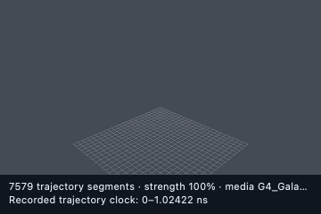

**`analytic_photo_fraction`.** Same beam, different question: of the gammas that interact, what
fraction undergo the photoelectric effect first, compared with σ_phot/σ_total.

**`analytic_csda_range`.** A proton beam that stops inside a water block, compared with the
continuous-slowing-down (CSDA) range integrated from Geant4's stopping power.

`analytic_compton_transfer` (Klein–Nishina energy transfer) and `analytic_pair_production`
(pair-production branching and threshold) produce only tallies. They appear in the
[table below](#scenarios-with-nothing-spatial-to-draw).

## Water: molecules to fluids

The molecular-dynamics replays below come from hook-layer solvers that run *for comparison*.
Geant4 does not form or evolve chemical bonds. Its role here is to supply the material base.

**`h2o_molecule_stability`.** A single flexible H₂O integrated with velocity-Verlet at constant
energy (NVE). The bonds oscillate around the equilibrium geometry without breaking apart.

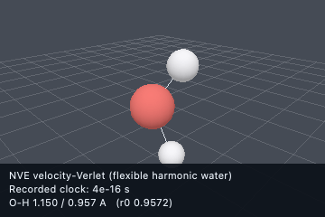

**`h2o_cluster_fluid`.** A small group of water molecules settling into a hydrogen-bonded droplet
near 300 K. It shows fluid-like behaviour emerging from molecular interactions.

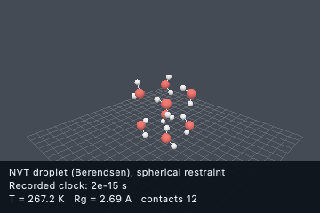

**`h2o_bulk_water`.** 108 rigid SPC/E molecules in a periodic box, so the liquid has no surface.
The run accumulates the O–O radial distribution function g(r) for comparison with measured
liquid water.

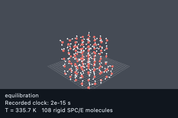

**`h2o_diffusion_temperature`.** The same bulk water at three temperatures in one deterministic
run. It measures how the self-diffusion coefficient D changes with temperature, which tests a
trend rather than a single state point.

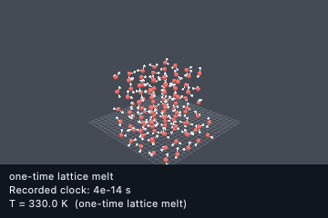

**`glass_of_water_shaken`.** The canonical demo of the project's main thesis. Fluid parameters
are inferred by the cascade from the nano-scale base, and a particle fluid solver (PBF, position
based fluids) then sloshes the water. The README shows this scenario in the classic viewer.

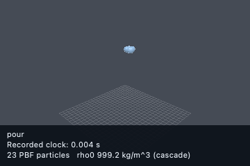

**`h2o_fluid`.** Geant4 transport through a brine-and-salt apparatus in air. Solid NaCl is built
from its elements by mass fraction, because Geant4 ships no NaCl compound.

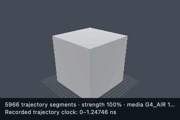

## Reactions, recipes and materials

These scenarios declare their chemistry and materials in JavaScript. Geant4 probes the
composition and density, and the cascade infers observer-scale behaviour on an emitted clock,
which may be an accelerated clock that keeps the physical time.

**`lava_lamp`.** A parameterized wax/carrier thermofluid run in which heater and geometry
context drive buoyant rise and fall. The README shows only this capture's poster frame, and the
Studio README shows the gated 10-minute reference. This is the standard suite capture.

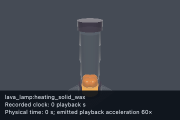

**`beaker_water_n_pentane`** and **`beaker_water_n_pentane_studio`.** Water and n-pentane are
poured into an open beaker at 30 °C. Layer order, mixing then separation, and the evaporating
pentane plume are all cascade outputs. The `_studio` wrapper adds labelled blue and gold tints
because both liquids are colourless; the tints are for display only.

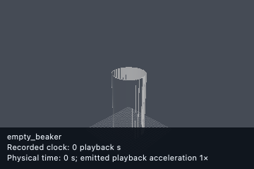 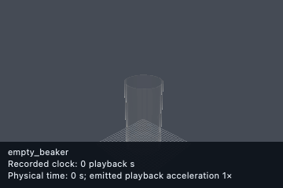

**`briggs_rauscher_oscillator`.** Three aqueous solutions mixed in a beaker cycle from colourless
to amber to blue-black and back.

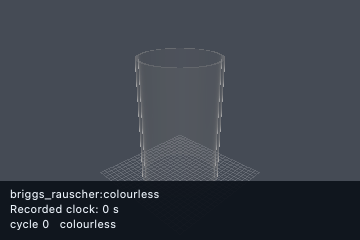

**`elephants_toothpaste`.** Iodide-catalysed decomposition of H₂O₂ in a graduated cylinder. The
released oxygen is trapped by surfactant and erupts as foam.

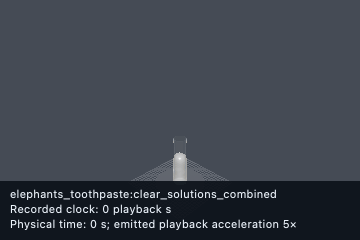

**`polyurethane_foam`.** A polyol and a diisocyanate are mixed in a cup, then the mixture
creams, expands and cures into a rigid sponge.

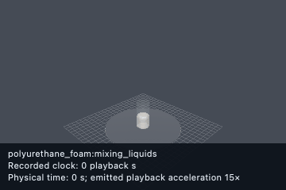

**`glass_from_sand`.** A material that does not exist at t = 0. Sand, soda ash and limestone are
heated in a crucible until the carbonates decompose and soda-lime glass forms.

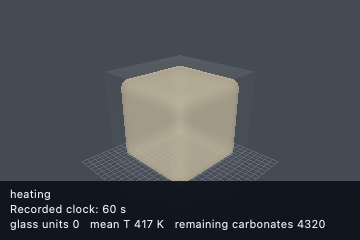

**`testscenario_h2o_electrolysis_combustion`.** Electrolysis (2 H₂O → 2 H₂ + O₂) followed by the
reverse combustion. The scenario declares conserved atom inventories, and `ctx.react` carries
the integer molecule counts.

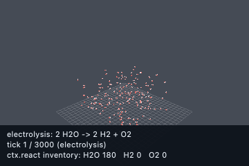

**`config_nitrogen_carbon_cycle`.** The data-driven G4NDL neutron list samples thermal
¹⁴N(n,p)¹⁴C. A raised decay cut lets the ¹⁴C beta-decay back to ¹⁴N within the event, so both
legs of the cycle are sampled by Geant4.

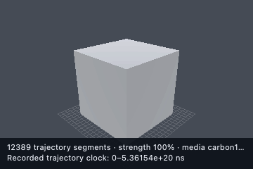

## Molecular series

These replays are rigid torsion scans, not molecular dynamics. The geometries are imposed scan
samples. Partial-charge bubbles and energies come from models fitted to quantum chemistry and
are labelled *QM reference fit*. Groups 04–06 also share a learned particle-to-molecule response
trained on Geant4. See [docs/molecular_series.md](docs/molecular_series.md).

| | | |
| --- | --- | --- |
| 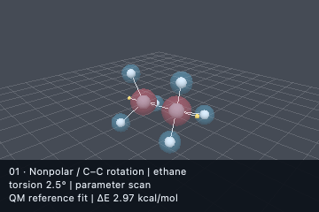 **01 ethane**: nonpolar control, C–C torsion |  **02 ethanol**: polar alcohol, C–O torsion | 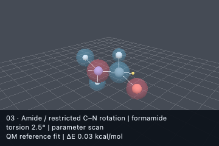 **03 formamide**: restricted amide C–N torsion |
| 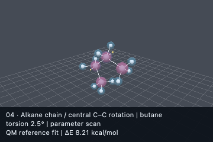 **04 butane**: alkane conformations + learned response | 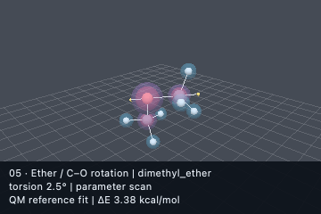 **05 dimethyl ether**: ether polarization | 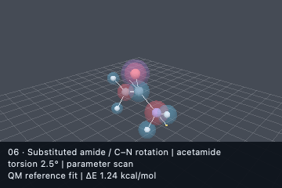 **06 acetamide**: substituted amide |

**`molecular_series`** is the original combined group. It replays the ethanol scan.

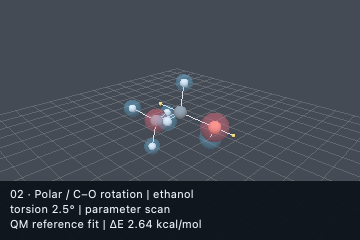

The classic PyVista viewer renders the same runs at 1280×720 with a chart panel. The README
already shows butane, ethanol, formamide and the dimethyl-ether particle response. The other
classic captures are below. The `molecular_*` captures show the torsion stream with the quantum
reference chart. The `molecular_particle_*` captures show learned atomic photoelectric halos and
molecular cross sections across 24 held-out photon energies, compared against Geant4. The photon
energy sweep has no physical time.

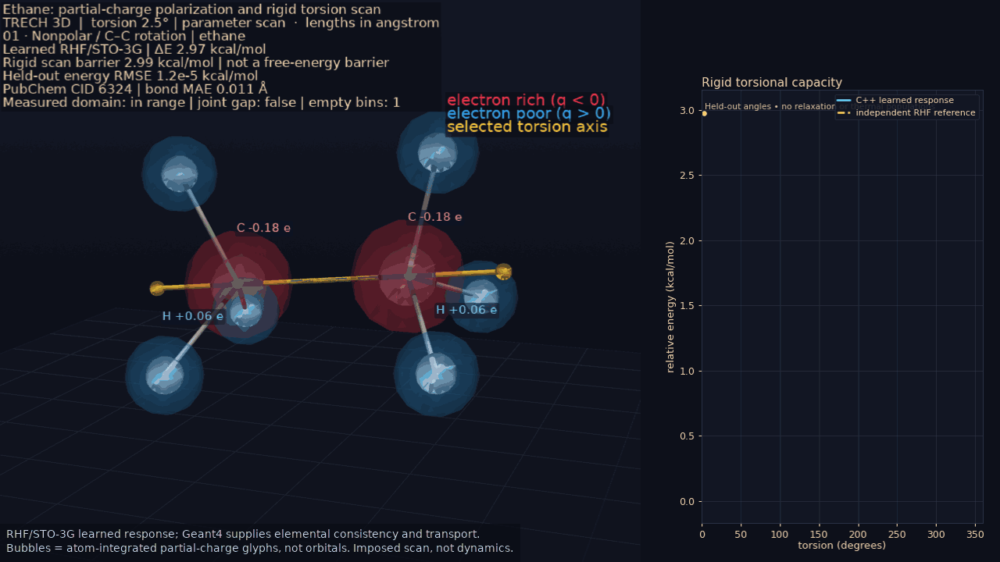

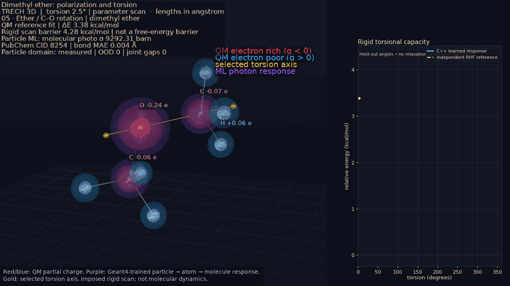

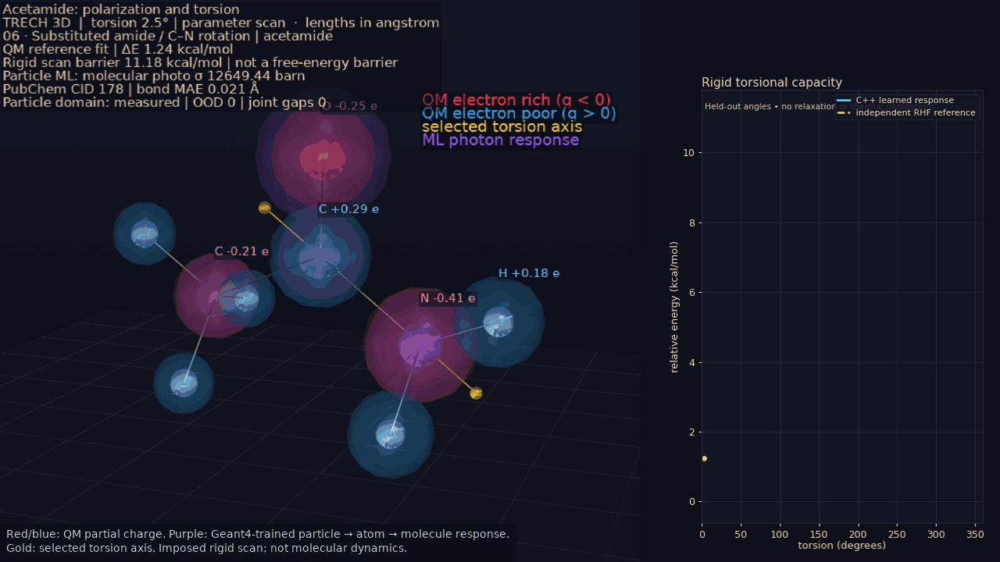

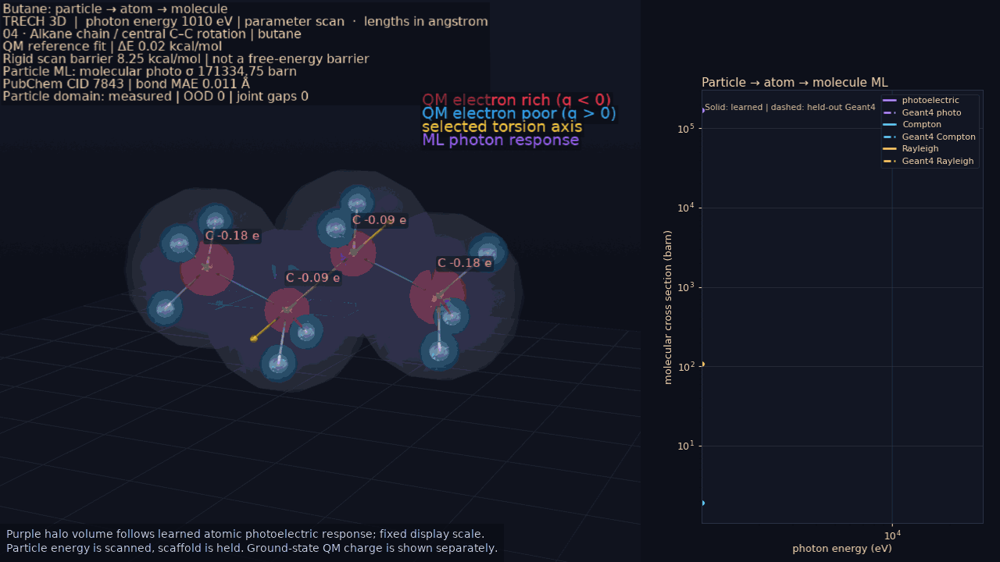

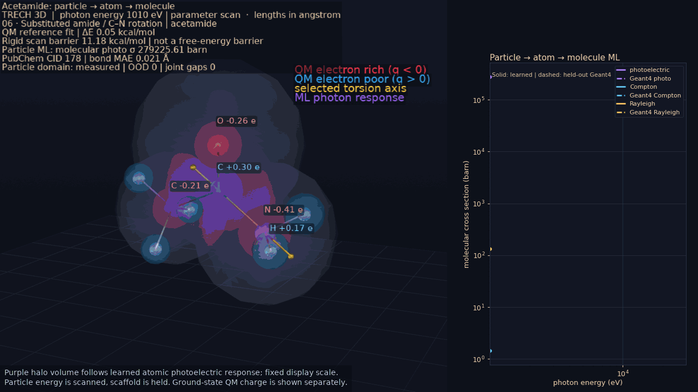

## Chemistry workspace references

**`chemistry_mode`.** The initial Chemistry workspace: an authored molecular graph next to the
live, isotope-resolved Geant4 material response. This is structure inspection, not molecular
dynamics, and no stability law is imposed.

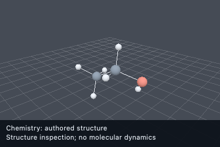

**`chemistry_atomic_levels_reference`.** Neon's occupied energy groups from an independent PySCF
RHF/6-31g density. The radii are computed, not fixed shell radii.

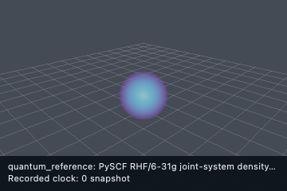

**`chemistry_probability_reference`.** The joint water + deuterium electronic density from the
same independent quantum comparison. Separation is a declared parameter scan, not inferred
dynamics.

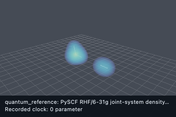

Three native Studio window captures (macOS, including the Metal viewport) from the same
workspace are not shown elsewhere. Their capture guide is
[docs/images/studio-chemistry](docs/images/studio-chemistry/README.md).

**Electron density.** The threshold surface of the independent joint RHF/6-31g density.

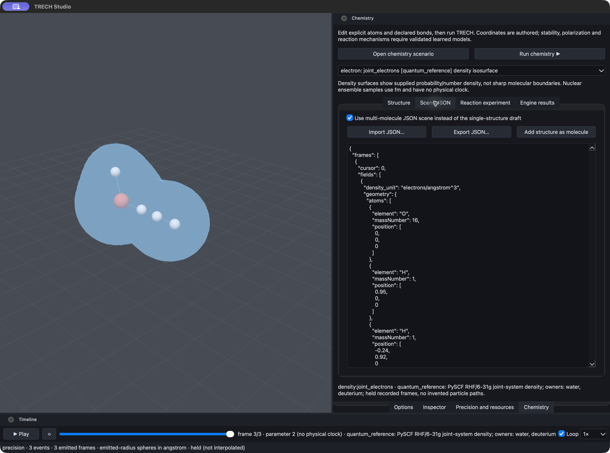

**Electron samples.** 1600 visualization samples of that density. These are not 1600 electrons
and not electron trajectories.

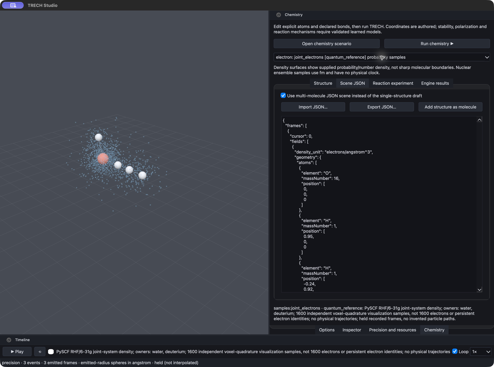

**Electron orbitals.** The selected occupied orbital (MO 6) with the full energy/occupation
table and the independent RHF dipole.

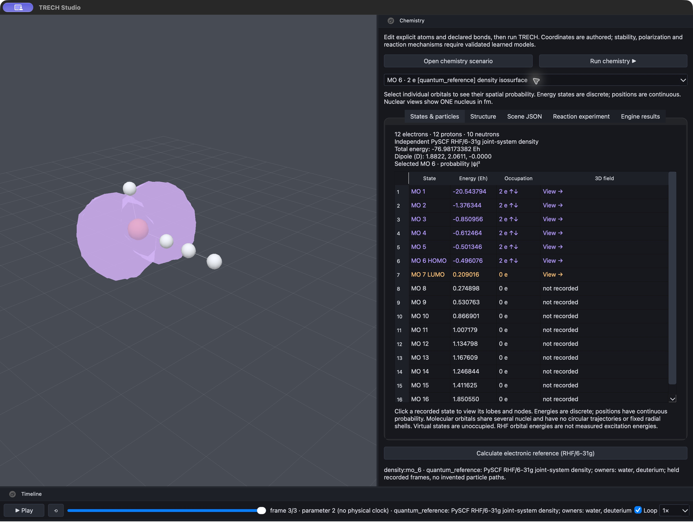

## Carbon nanotubes

**`cnt_band_structure`.** For 26 chiralities, a tight-binding zone-folding model (hook layer)
predicts whether each tube is metallic or semiconducting and what its gap is, using the (n, m)
chirality. The rows are armchair, quasi-metallic and semiconducting tubes.

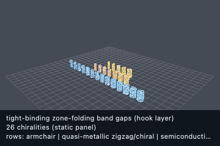

**`cnt_logic_gates`.** CNT field-effect transistors built from that band structure, with
Fermi–Dirac drain current under a gate-voltage sweep, then assembled into logic gates.

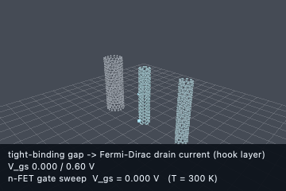

## Magnetic resonance

**`testscenario_magnetic_resonance` (stage 1).** A 5 cm³ water cube in a static B0 field
with a swept RF pulse. The Larmor line is *discovered* from the Geant4-derived proton density,
and the replay shows the spins dephasing in the free-induction decay.

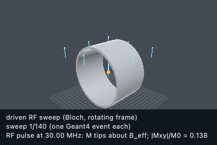

**`testscenario_magnetic_resonance_imaging` (stage 3).** 1D frequency encoding: a field gradient
makes the precession rate depend on position, and the coil records the sum of all voxels.

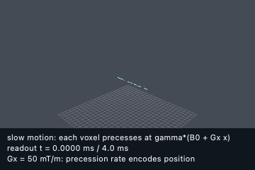

**`testscenario_magnetic_resonance_tissues` (stage 2).** A still of the virtual-tissue apparatus.
The per-tissue contrast is a tally rather than motion.

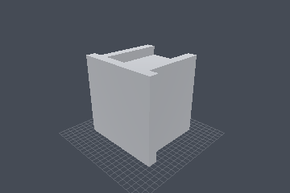

Stage 4 (`testscenario_magnetic_resonance_brain`) is a 2D image that the README shows in the
classic viewer. Its Studio still is in the [table below](#scenarios-with-nothing-spatial-to-draw).

## Inference and the multi-scale cascade

**`particle_observer_cascade`.** The cascade predicts observer-scale fractions *before*
transport. An independent Geant4 Monte Carlo run then checks them. The higher-scale numbers come
only from the learned observer model, which is labelled as an experimental candidate trained on
Geant4.

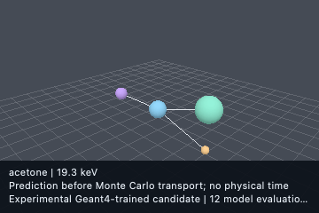

**`optics_surrogate_demo`.** A ridge surrogate (no LibTorch needed) corrects NaI's refractive
index, which the f-sum extractor cannot reach for high-Z materials. The viewport shows one
probe photon in the NaI box; the result is the corrected optical constants.

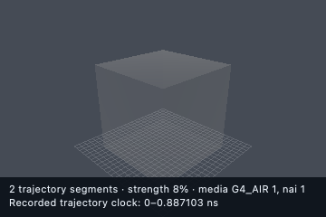

**`optics_training_panel`.** Derives visible-band optical constants for many transparent
materials to train the optics surrogate. As above, the viewport shows a single probe photon.

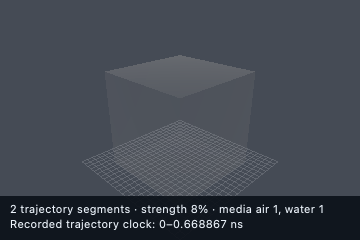

**`config_stratify_ml`.** Predictive-mode event stratification: events are labelled
*predictable* or *exceptional*, and the exceptional ones are queued for re-simulation. The GIF
shows the recorded electron and optical histories in water.

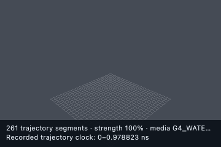

## Biology and mechanics validation

These scenarios advance a coarse-grained 3D solver inside the hook layer, one Geant4 event per
tick, and cross-check it against the classical law. The solver runs for comparison and is not a
Geant4 result.

**`testscenario_efflux`.** A lipophilic waste molecule diffuses out of a cell through its lipid
bilayer, compared with first-order Fickian clearance.

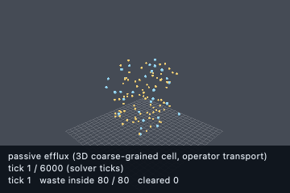

**`testscenario_osmotic`.** Osmotic dehydration: a membrane excludes particles by size and
polarity, and water flows out.

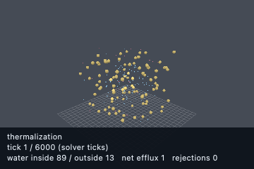

**`testscenario_pascal`.** A 3D water particle bath in a rigid vessel and in a deformable
spring-walled vessel. While the piston holds, the same push reaches every wall.

## Airflow comparison

**`aerodynamics_reference`.** An independent 3D Euler gas solver around a fixed blunt body, with
captions showing temperature and the CFL-step clock. This is a comparison, not a Geant4-trained
aerodynamics prediction. The README shows the gated reference GIF of this scenario.

The classic-viewer capture of the same run:

## Configuration and geometry examples

These scenarios have no emitted motion, so the media refresh saves a still of the authored
geometry rather than inventing animation.

| | | |
| --- | --- | --- |
|  **`geometry_procedural_assembly`**: entrance window, 3×3 polystyrene dosimeter grid in water, ring of NaI tubes, all built with `TRECH_GEOMETRY` generators and checked for overlaps before the run |  **`water_box`**: an 8 cm water cube in a 10 cm container |  **`config_flow_language`**: every built-in `TRECH_FLOW` preset must pass before Geant4 starts |
|  **`config_cnt_stub`**: parameterized multi-wall nanotube shell |  **`config_cnt_world_stub`**: a fixed 3 nm × 100 nm, five-wall tube world | |

## Scenarios with nothing spatial to draw

These scenarios produce tallies, tables or model outputs, not geometry or motion. Their Studio
still is an empty stage, so it is linked here rather than embedded.

| Scenario | What it produces | Still |
| --- | --- | --- |
| `analytic_compton_transfer` | Klein–Nishina mean electron energy transfer, Geant4 tally vs formula | [png](studio/previews/analytic_compton_transfer.png) |
| `analytic_pair_production` | Pair-production branching fraction and threshold vs Geant4 | [png](studio/previews/analytic_pair_production.png) |
| `cascade_multiscale_demo` | `ctx.cascade` chaining scale-tagged models to one observer-scale number | [png](studio/previews/cascade_multiscale_demo.png) |
| `surrogate_generic_demo` | A learned model called deterministically from a hook (`ctx.predict`) | [png](studio/previews/surrogate_generic_demo.png) |
| `spectrum_prediction` | Learned atomic line strengths and molecular UV/Vis envelopes from NIST/PubChem data | [png](studio/previews/spectrum_prediction.png) |
| `testscenario_magnetic_resonance_brain` | Geant4 proton densities for a 2D brain phantom image (shown in the README via the classic viewer) | [png](studio/previews/testscenario_magnetic_resonance_brain.png) |
| `h2o_single_molecule` | A micrometre-scale container, too small to see at this zoom | [png](studio/previews/h2o_single_molecule.png) |
| `hello_world` | 10 electrons in a water world: the smallest runnable config | [png](studio/previews/hello_world.png) |
| `config_hook_dispatch` | Hook dispatch with `ctx.emit` and `onInit` config overrides | [png](studio/previews/config_hook_dispatch.png) |
| `config_multi_beam_units` | Composed electron and gamma beams with unit helpers | [png](studio/previews/config_multi_beam_units.png) |
| `config_multiscale_stub` | The `multiscale` config block (`lbm_stub`) | [png](studio/previews/config_multiscale_stub.png) |
| `config_stratify` | Strict-mode event stratification features and the re-simulation queue | [png](studio/previews/config_stratify.png) |
| `config_chemistry_stub` | Water material preset and chemistry config fields | [png](studio/previews/config_chemistry_stub.png) |

## Retired and historical captures

> **Not current output.** The NaCl dehydration inventory animation has been retired. Its
> capacity and attachment kinetics were illustrative, and it had no calibrated physical clock.
> The current scenario reports `blocked_missing_interface_data` until a calibrated measured
> interface recording is supplied. These files are kept unchanged, with their original hashes,
> as a historical record. See [docs/images/studio-processes](docs/images/studio-processes/README.md).

 

The native window capture and the offscreen render of the same retired NaCl run, plus the
offscreen render of the **historical 2D** airflow comparison. The current airflow solver is 3D
(see [above](#airflow-comparison)).

 

## Data assets

PubChem 2D structure depictions cached next to their property records
([`data/pubchem/`](data/pubchem)). They are external reference data, used only for comparison
and labelling, and they never drive any physics.

 
