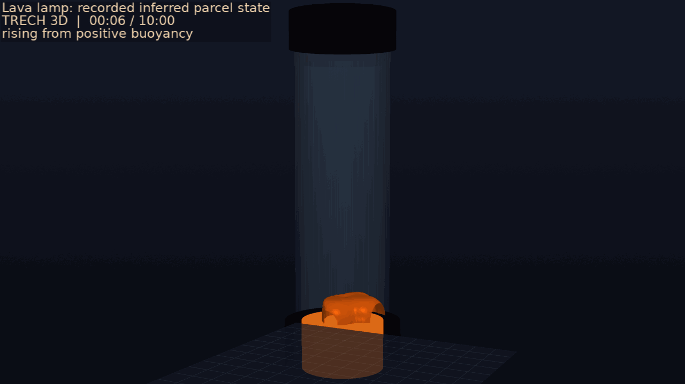
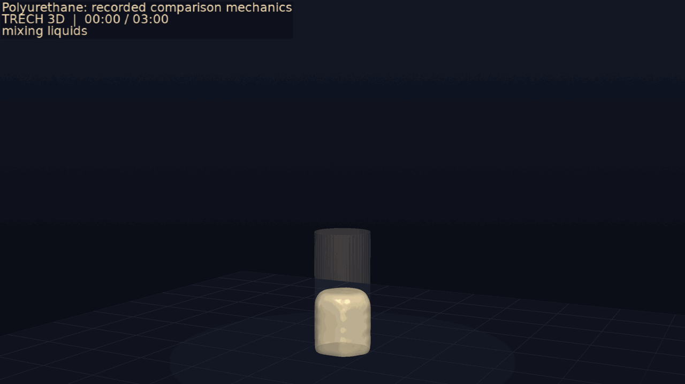
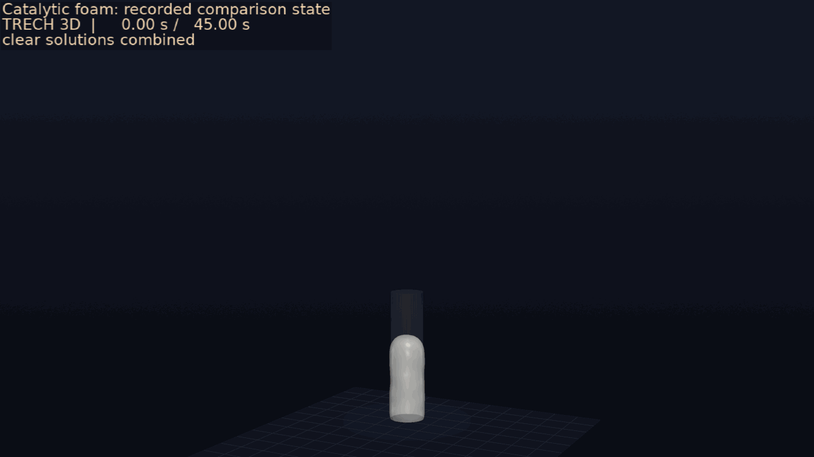

# trech-viz demos — every README animation is a TRECH 3D replay

Every animation linked from the top-level [`README.md`](../../../README.md) is a **faithful 3D
replay of a real TRECH run**, rendered by the classic PyVista viewer (`trech-viz`, one level up).
Nothing here draws a scripted trajectory, a textbook curve, or a pre-conditioned animation:

- **Geant4-transport scenarios** are captured with `trech run --viz` / `--viz-all` (the
  observation-only trajectory recorder) and replayed from `trech_viz_trajectories.jsonl` on the
  recorded Geant4 clock: every polyline, interaction vertex and kinetic energy is a Geant4 step.
  The HUD prints the engine's own predicted-vs-measured checks from `trech_scores.jsonl`.
- **Hook-layer scenarios** (MD, chemistry, membranes, CNT devices, magnetic resonance, fluids)
  emit `material_frame` straight from their solver state — atoms and bonds, parcels, membrane
  meshes, moving apparatus, magnetization vectors, live observables — and the viewer replays the
  held frames. Solvers that were planar are now genuinely 3D (osmosis, efflux, Pascal,
  electrolysis kinematics, the glass furnace charge).

The only rendering choices are the camera orbit, lighting, palette, ground grid, captions and text.
Colours, display radii, tints and exaggerations (Pascal's wall displacement ×3, the MRI gradient
ramp) are declared as representation in each frame and in the legend.

Every GIF is 1280×720: the 3D view plus a side panel of 2D charts. For Geant4 captures the charts
are statistics of the recorded tracks (each sample revealed at the Geant4 time it happened) next to
the engine's own formula prediction (dashed); for hook-layer captures they plot the observables the
solver emits per frame (`samples`/`curves`), with labelled reference data where the scenario
already grades against it (Holz 2000 D(T), the ~2.8 Å g(r) peak, the γ·B₀ line).

## Regenerate everything

```bash
cmake --preset rel -DCMAKE_PREFIX_PATH="$PWD/build/geant4-install" && cmake --build --preset rel
build/render-venv/bin/python tools/viz/demos/render_readme_3d.py          # all captures (~30 min)
build/render-venv/bin/python tools/viz/demos/render_readme_3d.py --list   # capture keys
build/render-venv/bin/python tools/viz/demos/render_readme_3d.py --only csda beer_lambert
```

[`render_readme_3d.py`](render_readme_3d.py) owns every run command and render setting (runs go
to `build/dev/out_readme_3d/`, derived data). The render venv needs `tools/viz` installed
(`pip install -e tools/viz`, which pulls matplotlib for the side chart panel).

| GIF | scenario | data replayed | honest scope |
| --- | --- | --- | --- |
| `glass_of_water_beam.gif` | `glass_of_water_spectral.js` | 3000 recorded white-light photons, bundled by wavelength band + recorded `G4OpBoundaryProcess` history; reflections marked | Geant4 transports with RINDEX from its own cross sections; the chart inverts each recorded bend through Snell's law and lands on the engine's n(λ) |
| `beer_lambert.gif` | `analytic_beer_lambert.js --viz-all --viz-max-trajectories 3000` | 70 drawn events, history-coloured; water glyphs | Kaplan–Meier survival of 1580 recorded photons vs exp(−μx); channel split vs σᵢ/σ |
| `csda_bragg.gif` | `analytic_csda_range.js --viz-all` | recorded 20 MeV proton tracks, coloured by recorded kinetic energy | Bragg curve + range straggling from recorded steps vs the engine's R_CSDA |
| `photo_fraction.gif` | `analytic_photo_fraction.js --viz-all` | recorded 30 keV γ + photo-electron tracks, vertices by process | first-interaction split vs σ_phot/σ_total; survival vs exp(−μx) |
| `nuclear_cycle.gif` | `config_nitrogen_carbon_cycle.js --viz-all --events 20000` (neutron-HP) | the 36 events with a ¹⁴C (+25 ordinary): labelled nuclei, reaction/decay labels, N₂ glyphs | both legs Geant4-sampled: ¹⁴N(n,p)¹⁴C and the ¹⁴C β⁻ decay (raised decay cut); Q-values from Geant4 masses |
| `optics_surrogate.gif` | `optics_surrogate_demo.js --param beam_tilt_deg=35` ×2 | the two runs side by side (split panes), bundled | recorded entry-face bend vs Snell with each run's engine n |
| `sampling_diversity.gif` | `glass_of_water_varied.js` | 250 drawn photons of a spot/divergence/spectrum-sampled beam | histograms of the emitted spot radius, divergence and wavelength |
| `brine_deposit.gif` | `h2o_fluid.js --viz-all` | recorded γ/e⁻ tracks; H₂O/Na⁺/Cl⁻ glyphs and a NaCl lattice in the seed (not to scale) | recorded electron energy loss per volume vs the Geant4-scored deposit |
| `magnetic_resonance.gif` | `testscenario_magnetic_resonance.js` | B₀ field lines + poles, M and B_eff per pulse with the Bloch path, FID isochromats | hook-layer Bloch dynamics; isochromats (Lorentzian offsets whose mean is the solver's envelope), poles and field lines are representation |
| `magnetic_resonance_tissues.gif` | tissue scenario ×2 (water 150 / cortical bone 90 excitations) | the two runs side by side in their NaI shells | packets ∝ Geant4 ¹H density; detected edep is a real tally, charted vs the ¹H ratio |
| `magnetic_resonance_imaging.gif` | `testscenario_magnetic_resonance_imaging.js` | slow-motion precession at γ(B₀+Gx·x), then the readout and the DFT line | the exact terms the readout synthesis sums, evaluated at display times; signal and image charted vs Geant4 ¹H density |
| `magnetic_resonance_brain.gif` | `scripts/run_magnetic_resonance_brain.py --out-gif` | a slice sweeping through the **3D** k-space reconstruction | procedural head phantom; brightness = Geant4 mobile-¹H density |
| `h2o_molecule.gif` / `h2o_cluster.gif` | flexible water MD | integrated nuclei, bonds, O–O contacts, restraint sphere | classical MD in the hook layer |
| `h2o_bulk_water.gif` | `h2o_bulk_water.js` | 108 rigid SPC/E molecules, periodic cell | the accumulating O–O g(r) and temperature charted |
| `diffusion_temperature.gif` | `h2o_diffusion_temperature.js` | molecules + each O atom's real 480 fs displacement trail | thermostat steps, per-block MSD and D(T) vs Holz 2000 charted |
| `glass_of_water_shaken.gif` | `glass_of_water_shaken.js` | 4,301 PBF particles fused by the declared Gaussian surface; glass at s(τ) | macro parameters cascade-inferred |
| `pascal_press.gif` | `testscenario_pascal.js` | 3D baths, pistons, sensor walls coloured by their own displacement (drawn ×3) against their rest planes | P_sensor/P_piston and bulge/permanent set charted |
| `osmotic_dehydration.gif` | `testscenario_osmotic.js` | 3D bath + a triangulated membrane driven by the measured pressure difference | volume, water inside and P_out/P_in charted |
| `efflux_clearance.gif` | `testscenario_efflux.js` | molecules moved by the 3D learned `ctx.evolve` operator, crossing by `ctx.react` | log-scale inside counts (first-order) and cleared total charted |
| `electrolysis.gif` | `testscenario_h2o_electrolysis_combustion.js` | `ctx.react` inventory; bubbles rise from electrodes, product water sinks into the bath | packet kinematics are representation; the inventory (2 : 2 : 1) is charted |
| `briggs_rauscher.gif` | `briggs_rauscher_oscillator.js` | the stirred Geant4 beaker in the emergent colour | concentrations and colour intensities charted; stir-bar spin is representation |
| `glass_from_sand.gif` | `glass_from_sand.js` | the 6³ cells as grains (batch), a liquid surface (melt) and a glass solid | phase counts, temperature, carbonates charted; per-material and per-pair operators |
| `beaker_water_n_pentane.gif` | `beaker_water_n_pentane.js` (display-tint wrapper) | emitted liquid/vapour representatives | pour/mix kinematics illustrative; layering + evaporation cascade-driven and charted |
| `cnt_band_structure.gif` | `cnt_band_structure.js` | 26 tubes rolled from (n,m), coloured by the model gap | static panel; motion is the camera |
| `cnt_structure.gif` | `cnt_logic_gates.js` (stream `cnt_transfer_sweep`) | (16,0)/(5,5)/(9,0) channels with electrons (count ∝ model I_d, representation) over a V_gs sweep | transfer curves + band gaps charted from the tight-binding + Fermi–Dirac model |
| `cnt_circuit.gif` | `cnt_logic_gates.js` (stream `cnt_cmos_gates`) | every gate netlist per truth row: FET conductance + node voltages | the evaluator's resistive-divider state |
| `lava_lamp_trech_viz.gif`, `polyurethane_foam.gif`, `elephants_toothpaste.gif` | see below | persistent parcels + fused surfaces | unchanged pipeline (already classic 3D) |

## lava_lamp_trech_viz.gif — ten physical minutes in ten seconds through classic TRECH 3D



This is not a bespoke animation script or a slowed sparse run. The typed scenario is executed for
600 physical seconds at the default 333.15 K heater condition with 100 Geant4 ticks, producing 101
unique `material_frame` states of the same ordered 240 parcels at 6 s
intervals. Classic `trech-viz` maps post-tick states 1–100 directly to the 100 GIF frames, with no
optical flow or temporal interpolation. Every frame declares a Gaussian-density surface contract;
classic TRECH contours it with PyVista, so touching parcels merge like the normal shaken-water
metaball rendering. Distance-faded pair-Gaussian samples inside the existing interface connection
radius grow a continuous waist during merging and thin it during separation; they cannot connect
different emitted components. Grid, clock HUD, surface shading, camera framing, palette quantization, and the 30° camera orbit
are display choices;
parcel IDs, centres, and wax states are the exact output used by the Studio reference GIF. The
viewer creates no simulation motion or replacement particles. The shared run consumes cascade-
inferred 3D circulation/vorticity, lateral-plume strength, and interfacial velocity coupling. Its
centroid spans 38.73 × 36.52 mm, travels 123.41 mm laterally, and occupies 10/12 azimuth sectors;
it retains 19 fine parcel-lineage coalescences, 18 fissions, and 43/101 merged states. The smoother
fluid interface separately records 8 merges, 10 splits, and 90/101 merged states. Contouring,
neck density, and camera orbit only make those simulated volumetric changes visible.

```bash
build/dev/trech run examples/experiments/lava_lamp.js \
  --param duration_s=600 --param playback_duration_s=10 \
  --param simulation_ticks=100 --output build/dev/out_lava_lamp_readme_10m
PYTHONPATH=tools/viz build/render-venv/bin/python -m trech_viz \
  --scene build/dev/out_lava_lamp_readme_10m/trech_viz_scene.json \
  --emits build/dev/out_lava_lamp_readme_10m/trech_hook_emits.jsonl \
  --gif tools/viz/demos/lava_lamp_trech_viz.gif \
  --width 260 --height 360 --seconds 10 --fps 10 --orbit 30 --no-beams
```

Honest scope: Geant4 provides the water/reference-blend material and optics base plus the event
clock; a two-stage cascade supplies thermophysical coefficients consumed by a bounded persistent
heat/phase/density/buoyancy solver. Geant4 does not solve heat flow or CFD, and the compact
response surface/parcel discretisation remain illustrative rather than metrology-grade.

## polyurethane_foam.gif — the solid sponge, bending and shedding under its own weight



The two-part polyurethane experiment (`examples/experiments/polyurethane_foam.js`) replayed through
the same classic `material_frame` path as the lava lamp: held states of hundreds of persistent
parcels mapped one-to-one onto GIF frames, no interpolation. Since the mechanics upgrade the parcels
are a **growing viscoelastic bonded network under standard gravity**, so the animation shows the bun
rise out of the cup, **lean**, **crack**, and **drop pieces that fall and come to rest on the
table** — every one of those a consequence of the stress state, not a scripted event. The HUD phase
line (`rising` → `gelling curing` → `cracking shedding pieces` → `cured with fallen pieces`) is read
from the scenario's own emitted state.

```bash
PYTHONPATH=tools/pubchem python -m trech_pubchem fetch --cache-dir build/pubchem_cache \
  glycerol "toluene 2,4-diisocyanate" water
TRECH_PUBCHEM_CACHE_DIR=build/pubchem_cache build/dev/trech run \
  examples/experiments/polyurethane_foam.js --output build/dev/out_polyurethane_foam
# the falsifiability control: same run with gravity switched off
TRECH_PUBCHEM_CACHE_DIR=build/pubchem_cache build/dev/trech run \
  examples/experiments/polyurethane_foam.js --param gravity_scale=0 \
  --output build/dev/out_polyurethane_foam_zero_g
tools/viz/.venv/bin/trech-viz \
  --scene build/dev/out_polyurethane_foam/trech_viz_scene.json \
  --emits build/dev/out_polyurethane_foam/trech_hook_emits.jsonl \
  --gif tools/viz/demos/polyurethane_foam.gif \
  --width 320 --height 520 --seconds 12 --fps 15 --no-beams
```

Honest scope: Geant4 provides the two solutions' composition/density/optics base (it literally sees
the isocyanate nitrogen) plus the event clock; a two-stage cascade supplies the foaming AND
mechanics coefficients consumed by a bounded hook-layer integrator, with standard gravity used as a
physical constant. Geant4 solves neither urethane kinetics nor continuum mechanics; the response
surface is illustrative and fracture siting is discretisation-sensitive, so the guard asserts the
aggregate response (see `ROADMAP.md`).

## elephants_toothpaste.gif — the soapy lather, 45 physical seconds in nine



Elephant's toothpaste (`examples/experiments/elephants_toothpaste.js`) through the same pipeline:
136 held states of 280 persistent parcels, post-tick states 1–135 on 135 GIF frames. The
iodide-catalysed runaway erupts over the cylinder rim in under a second of physical time, whitens
as the surfactant traps the O₂, carries the transient amber iodine tinge while turnover peaks,
steams near (but below) the boiling band, and then visibly subsides as the lather drains — and
never rigidifies, the emergent consistency contrast to the polyurethane sponge.

```bash
PYTHONPATH=tools/pubchem python -m trech_pubchem fetch --cache-dir build/pubchem_cache \
  "hydrogen peroxide" "potassium iodide" water
TRECH_PUBCHEM_CACHE_DIR=build/pubchem_cache build/dev/trech run \
  examples/experiments/elephants_toothpaste.js --output build/dev/out_elephants_toothpaste
tools/viz/.venv/bin/trech-viz \
  --scene build/dev/out_elephants_toothpaste/trech_viz_scene.json \
  --emits build/dev/out_elephants_toothpaste/trech_hook_emits.jsonl \
  --gif tools/viz/demos/elephants_toothpaste.gif \
  --width 300 --height 460 --seconds 9 --fps 15 --no-beams
```

Honest scope: Geant4 provides the solutions' composition/density/optics base (it sees the dissolved
iodine and potassium) plus the event clock; a two-stage cascade supplies the catalytic-decomposition
coefficients consumed by a bounded hook-layer integrator with a labelled evaporative clamp near the
carrier boiling band. Geant4 does not solve aqueous redox kinetics or foam drainage; the compact
response surface is illustrative, and the white/amber swatches are labelled representation while
their timing is emergent.
